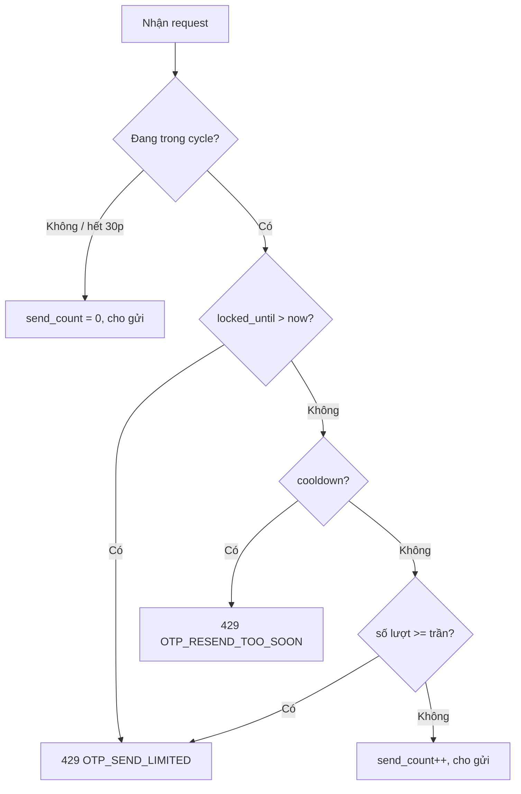
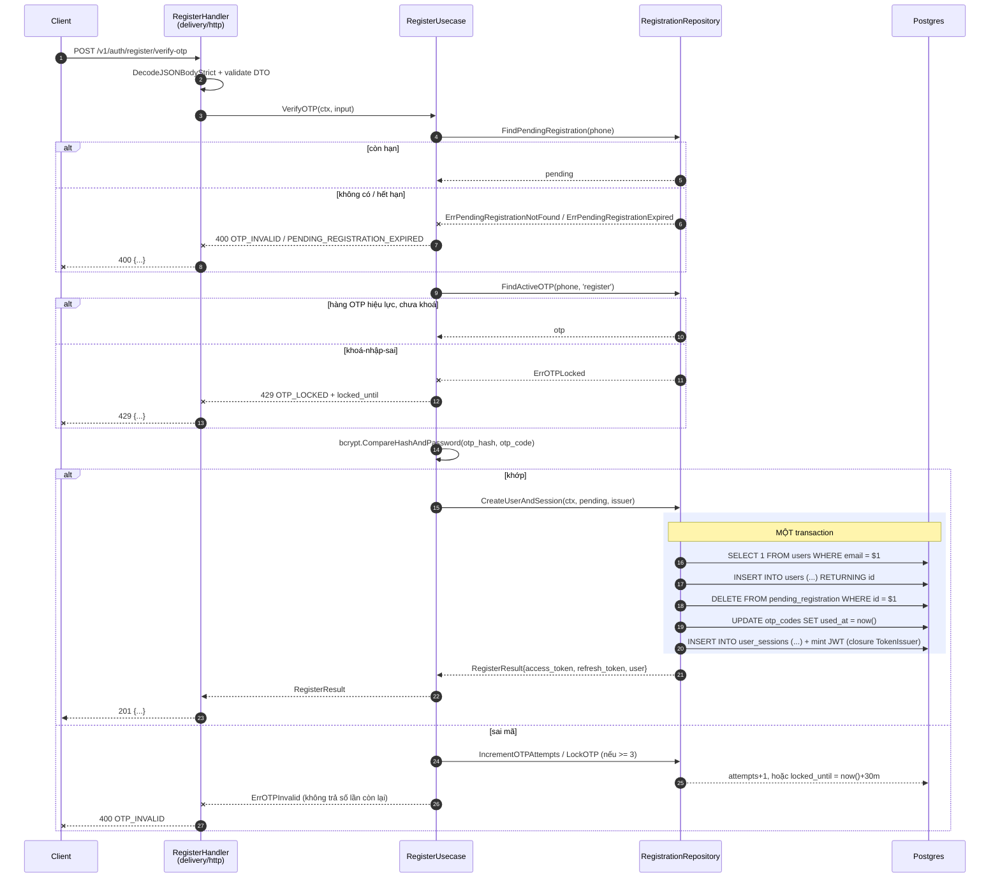

# Flow diagram (`flow.md`)

File `flow.md` là bản vẽ (visual) của luồng backend, nằm cạnh bốn file spec còn lại trong
`docs/specs/features/<feature>/`. Nó **không phải** nơi sinh ra logic mới — nó là gương chiếu 1:1
của các section "Step-by-step Flow" trong `design.md`, dùng **Mermaid** (khớp tiền lệ `erd.mmd`).

## Khi nào tạo `flow.md`

Cùng điều kiện với rule 5 của `SKILL.md`: **khi flow chính của feature có 2 lời gọi tuần tự trở
lên ra hệ thống ngoài** (DB query/transaction, external HTTP API, storage, mailer/SMS, cache, MQ).
Nếu có section "Step-by-step Flow" trong `design.md` thì **bắt buộc** có `flow.md` tương ứng, và
ngược lại.

Feature chỉ có đúng một query, không write, không transaction, không gọi ngoài → không có
Step-by-step Flow → **không có `flow.md`**. Section "Request flow" (ASCII) trong `design.md` đủ.

## Quan hệ với `design.md`

- **`design.md` §Step-by-step Flow là nguồn sự thật.** Nó ghi đủ Trigger / Pre-condition / Call /
  Success / Failure / Transaction boundary bằng chữ.
- **`flow.md` vẽ lại đúng nội dung đó**, không thêm bước, không bỏ bước. Mỗi mũi tên trace về một
  Step; mỗi Step phải xuất hiện dưới dạng message/note/alt-branch.
- **`design.md` §Request flow** (ASCII) được **thay bằng một con trỏ sang `flow.md`** khi `flow.md`
  tồn tại — không giữ hai bản vẽ cùng một thứ (một ASCII, một Mermaid) vì chúng sẽ drift. Nếu
  `flow.md` không tồn tại (feature một query), giữ nguyên ASCII.

Quy trình sinh: viết/xong `design.md` §Step-by-step Flow trước, rồi vẽ `flow.md` từ nó. Một thay
đổi flow luôn sửa `design.md` trước, rồi cập nhật `flow.md` cho khớp — theo đúng cascade
`requirements → design (→ flow) → tasks`. Không bao giờ sửa `flow.md` trước rồi mới sửa `design.md`.

## Cấu trúc file

Một section `###` cho mỗi section "Step-by-step Flow — ..." của `design.md`, cùng tên, cùng thứ
tự. Mỗi section là một khối ` ```mermaid ` (thường là `sequenceDiagram`).

### Participant (actor/layer)

Đặt tên ngắn, tên file thật trong dấu ngoặc (dùng `<br/>` để xuống dòng):

| Alias | Participant | Ghi chú |
|---|---|---|
| `C` | Client | caller của API |
| `H` | `<Feature>Handler` (delivery/http) | decode + validate + map error → status |
| `U` | `<Verb><Feature>Usecase` | validation + orchestration |
| `R` | `<Feature>Repository` | SQL, transaction, row↔entity |
| `DB` | Postgres | |
| `S` / `M` / `G` | `pkg/sms` / `pkg/mailer` / GCS / ... | chỉ thêm khi flow chạm external service |

Ví dụ:

```mermaid
participant C as Client
participant H as RegisterHandler<br/>(delivery/http)
participant U as RegisterUsecase
participant R as RegistrationRepository
participant DB as Postgres
participant S as pkg/sms
```

### Mũi tên

- `->>` lời gọi đồng bộ (request đi); `-->>` trả về (response/entity).
- `--x` trả về lỗi (sentinel error / 4xx / 5xx). Dùng cho nhánh `else` failure.
- `activate` / `deactivate` tùy chọn để vẽ call stack — nên dùng khi flow sâu 3 tầng trở lên, bỏ khi
  gọn.

### Transaction boundary

Bọc các message nằm trong **cùng một transaction** bằng `rect` + `Note over`:

```mermaid
rect rgb(235, 240, 255)
    Note over R,DB: MỘT transaction
    R->>DB: SELECT 1 FROM users WHERE email = $1
    R->>DB: INSERT INTO users (...) RETURNING id
    R->>DB: DELETE FROM pending_registration WHERE id = $1
    R->>DB: INSERT INTO user_sessions (...)
end
```

Nếu nhánh lỗi rollback, đặt `else` bên trong `rect` với mũi tên `--x` và ghi chú `rollback`.

### Nhánh điều kiện

- `alt` / `else` / `end` — nhánh success vs failure (đây là chỗ thể hiện Failure-case của Step).
- `opt` / `end` — bước chỉ chạy khi có điều kiện (ví dụ "nếu SĐT đang trong cycle gửi").
- `loop` / `end` — vòng lặp / retry.

Mỗi `alt`/`else`/`opt` phải trace về đúng nhánh Success/Failure trong Step tương ứng của
`design.md` — không bịa nhánh mà `design.md` không nêu.

### Bước thuộc module khác

Bước gọi sang external service (SMS, mailer, GCS) hoặc module khác phải ghi rõ bằng `Note`:

```mermaid
Note over U,S: thuộc pkg/sms, ngoài scope feature này
U->>S: SendOTP(phoneNumber, otpCode, purpose)
```

### `⚠️ Not confirmed`

Một bước mà `design.md` đang để marker `⚠️ Not confirmed` phải xuất hiện ở đây dưới dạng `Note` trên
đúng message — **không** vẽ như thể đã chốt:

```mermaid
Note over R,DB: ⚠️ Not confirmed: nếu UPDATE fail sau khi file đã upload GCS, có xóa file không?
```

Khi người dùng trả lời, cập nhật cả `design.md` lẫn `flow.md` trong cùng một version bump.

## Khi nào dùng flowchart thay vì sequence

Sequence diagram mạnh với "ai gọi ai, theo thứ tự nào, qua layer nào". Với **nhánh rẽ logic thuần**
— state machine (send-limit, khoá-nhập-sai), vòng lặp retry, bảng quyết định — flowchart dễ đọc
hơn. Trong trường hợp đó thêm một section `### Flowchart — ...` bằng `flowchart TB` (hoặc `LR`), và
ghi rõ nó vẽ bảng quyết định/block nào của `design.md`.

Quy tắc nút flowchart (giữ ngắn, tiếng Việt):



Không vẽ flowchart **thay** cho sequence khi flow là chuỗi lời gọi qua các layer — hai thứ bổ trợ
nhau, không thay thế nhau.

## Ngôn ngữ nhãn

Keyword Mermaid (`participant`, `sequenceDiagram`, `alt`, `loop`, `rect`, `flowchart`, `-->`) giữ
tiếng Anh. **Nhãn** participant/message/note viết **tiếng Việt ngắn gọn**, khớp prose tiếng Việt
của spec và comment `%%` trong `docs/specs/db/erd.mmd`. Ví dụ message `U->>R: FindConflicts(phone,
email)` — tên method giữ nguyên (vốn là tên Go), phần mô tả đi kèm dùng tiếng Việt.

## Tham gia version + changelog

`flow.md` mang header `Version`/`Last updated` giống bốn file kia, và **bump cùng version chung**
khi thay đổi. Mỗi version bump ghi một dòng `- flow.md: <thay đổi gì>` trong `changelog.md` (xem
`versioning_and_changelog.md`). Vì `flow.md` là gương của `design.md`, một version mà chỉ sửa
`design.md` §Step-by-step Flow **bắt buộc** cũng sửa `flow.md` cho khớp trong cùng một bump — không
có chuyện "chỉ sửa design, để flow drift".

## Ví dụ mẫu (flow verify-otp của onboarding)



Chú ý cách ví dụ trên **không** giấu bước nào: re-check email trong transaction, cập nhật
`used_at`, mint JWT trong tx — mỗi thứ đều là một dòng riêng, đúng như `design.md` Step 5/6 đã
liệt kê. Đó chính là điểm của file này.
