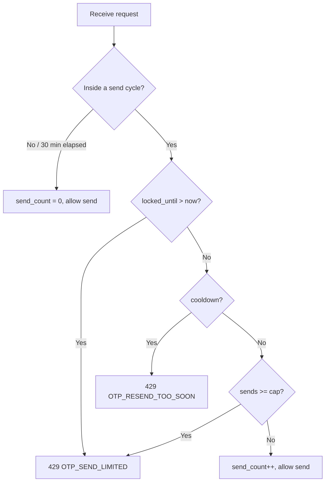
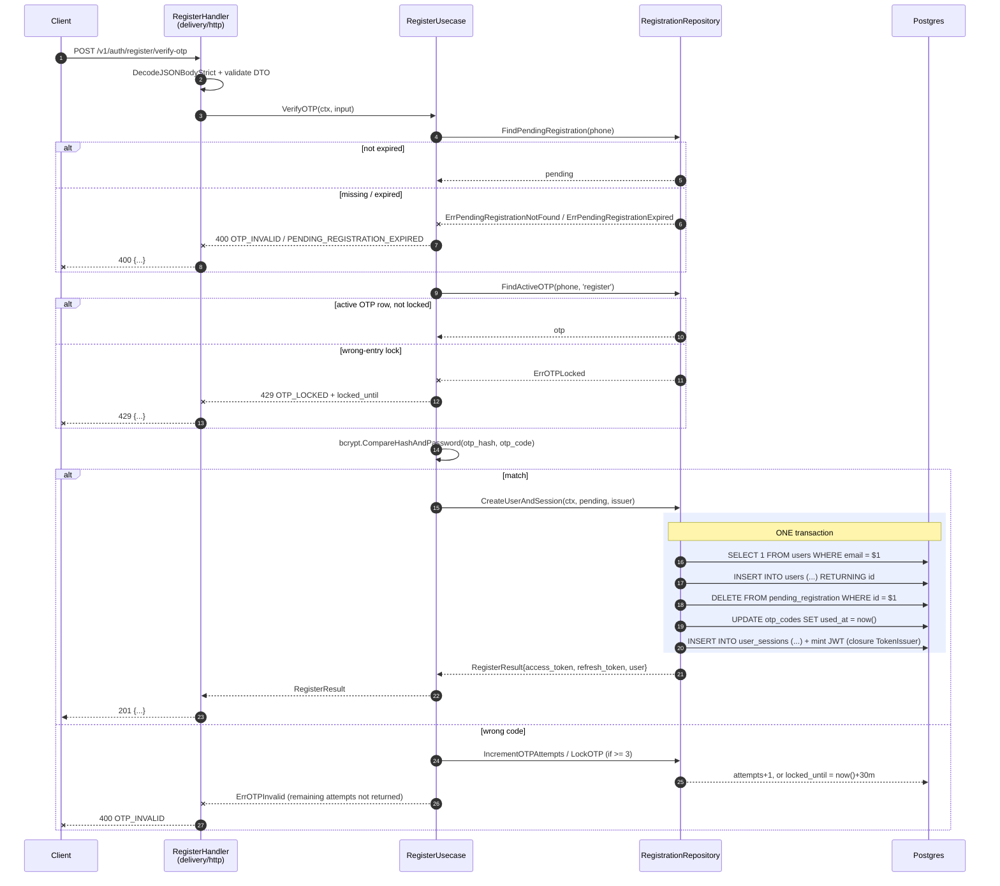

# Flow diagram (`flow.md`)

`flow.md` is the visual of the backend flow, sitting next to the other four spec files in
`docs/specs/features/<feature>/`. It is **not** a place where new logic is born — it is a 1:1 mirror
of the "Step-by-step Flow" sections in `design.md`, drawn in **Mermaid** (matching the `erd.mmd`
precedent).

## When to create `flow.md`

Same condition as rule 5 of `SKILL.md`: **when the feature's main flow makes 2 or more sequential
calls to external systems** (DB query/transaction, external HTTP API, storage, mailer/SMS, cache, MQ).
If `design.md` has a "Step-by-step Flow" section, a matching `flow.md` is **mandatory**, and vice
versa.

A feature with exactly one query, no write, no transaction and no external call → no Step-by-step
Flow → **no `flow.md`**. The "Request flow" (ASCII) section in `design.md` is enough.

## Relationship with `design.md`

- **`design.md` §Step-by-step Flow is the source of truth.** It spells out Trigger / Pre-condition /
  Call / Success / Failure / Transaction boundary in words.
- **`flow.md` redraws exactly that content**, adding no step and dropping none. Every arrow traces
  back to a Step; every Step must appear as a message/note/alt-branch.
- **`design.md` §Request flow** (ASCII) is **replaced by a pointer to `flow.md`** once `flow.md`
  exists — do not keep two drawings of the same thing (one ASCII, one Mermaid), because they will
  drift. If `flow.md` does not exist (single-query feature), keep the ASCII as is.

Generation order: write/finish `design.md` §Step-by-step Flow first, then draw `flow.md` from it. A
flow change always edits `design.md` first, then updates `flow.md` to match — following the cascade
`requirements → design (→ flow) → tasks`. Never edit `flow.md` first and `design.md` afterwards.

## File structure

One `###` section for each "Step-by-step Flow — ..." section of `design.md`, with the same name, in
the same order. Each section is one ` ```mermaid ` block (usually a `sequenceDiagram`).

### Participants (actor/layer)

Use short names, with the real file name in parentheses (use `<br/>` for a line break):

| Alias | Participant | Notes |
|---|---|---|
| `C` | Client | the API caller |
| `H` | `<Feature>Handler` (delivery/http) | decode + validate + map error → status |
| `U` | `<Verb><Feature>Usecase` | validation + orchestration |
| `R` | `<Feature>Repository` | SQL, transaction, row↔entity |
| `DB` | Postgres | |
| `S` / `M` / `G` | `pkg/sms` / `pkg/mailer` / GCS / ... | add only when the flow touches an external service |

Example:

```mermaid
participant C as Client
participant H as RegisterHandler<br/>(delivery/http)
participant U as RegisterUsecase
participant R as RegistrationRepository
participant DB as Postgres
participant S as pkg/sms
```

### Arrows

- `->>` synchronous call (request going out); `-->>` return (response/entity).
- `--x` error return (sentinel error / 4xx / 5xx). Use it for the `else` failure branch.
- `activate` / `deactivate` are optional for drawing the call stack — use them when the flow is 3
  or more layers deep, skip them when it is compact.

### Transaction boundary

Wrap the messages that run in **the same transaction** in `rect` + `Note over`:

```mermaid
rect rgb(235, 240, 255)
    Note over R,DB: ONE transaction
    R->>DB: SELECT 1 FROM users WHERE email = $1
    R->>DB: INSERT INTO users (...) RETURNING id
    R->>DB: DELETE FROM pending_registration WHERE id = $1
    R->>DB: INSERT INTO user_sessions (...)
end
```

If the failure branch rolls back, put the `else` inside the `rect`, with a `--x` arrow and a
`rollback` note.

### Conditional branches

- `alt` / `else` / `end` — success vs failure branch (this is where a Step's Failure case shows).
- `opt` / `end` — a step that runs only under a condition (e.g. "if the phone number is inside a
  send cycle").
- `loop` / `end` — loop / retry.

Every `alt`/`else`/`opt` must trace back to exactly the Success/Failure branch of the matching Step
in `design.md` — do not invent a branch that `design.md` does not state.

### Steps owned by another module

A step that calls an external service (SMS, mailer, GCS) or another module must be called out with a
`Note`:

```mermaid
Note over U,S: owned by pkg/sms, outside this feature's scope
U->>S: SendOTP(phoneNumber, otpCode, purpose)
```

### `⚠️ Not confirmed`

A step that carries a `⚠️ Not confirmed` marker in `design.md` must appear here as a `Note` on the
exact message — **never** drawn as if it were settled:

```mermaid
Note over R,DB: ⚠️ Not confirmed: if the UPDATE fails after the file was uploaded to GCS, is the file deleted?
```

When the user answers, update both `design.md` and `flow.md` in the same version bump.

## When to use a flowchart instead of a sequence diagram

A sequence diagram is strong at "who calls whom, in what order, through which layer". For **pure
branching logic** — a state machine (send limit, wrong-entry lock), a retry loop, a decision table —
a flowchart reads better. In that case add a `### Flowchart — ...` section using `flowchart TB` (or
`LR`), and state which decision table/block of `design.md` it draws.

Flowchart node rules (keep them short, in English):



Do not draw a flowchart **instead of** a sequence diagram when the flow is a chain of calls across
layers — the two complement each other, they do not replace each other.

## Label language

Mermaid keywords (`participant`, `sequenceDiagram`, `alt`, `loop`, `rect`, `flowchart`, `-->`) are
English, and so are the participant/message/note **labels**: short English text, matching the
English prose of the spec (per the Language policy in `CLAUDE.md`). For example, in the message
`U->>R: FindConflicts(phone, email)` the method name stays as is (it is a Go name) and any
accompanying description is English. Older `flow.md` files and the `%%` comments in
`docs/specs/db/erd.mmd` may still have Vietnamese labels; editing such a diagram rewrites its labels
in English. User-facing copy quoted in a label (an error message shown to the user) keeps its own
language.

## Version + changelog participation

`flow.md` carries the same `Version`/`Last updated` header as the other four files, and **bumps with
the shared version** when it changes. Every version bump records a `- flow.md: <what changed>` line
in `changelog.md` (see `versioning_and_changelog.md`). Because `flow.md` mirrors `design.md`, a
version that edits only `design.md` §Step-by-step Flow **must** also update `flow.md` to match in the
same bump — there is no "edit design, let flow drift".

## Worked example (onboarding's verify-otp flow)



Notice how the example above hides **no** step: the email re-check inside the transaction, the
`used_at` update, minting the JWT inside the tx — each is its own line, exactly as `design.md` Steps
5/6 list them. That is the whole point of this file.
