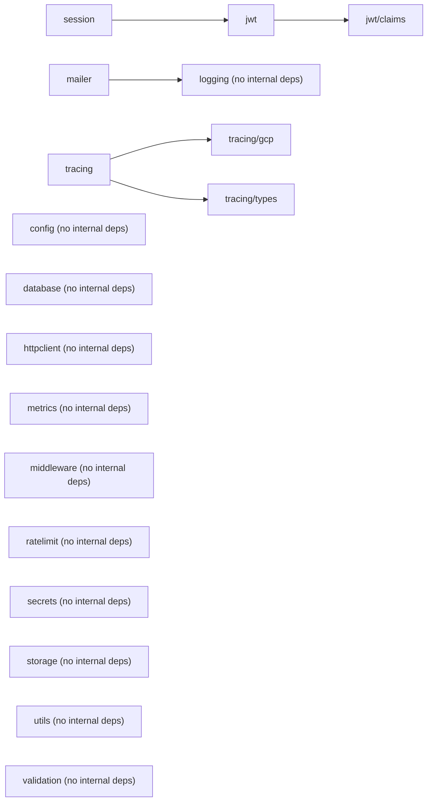
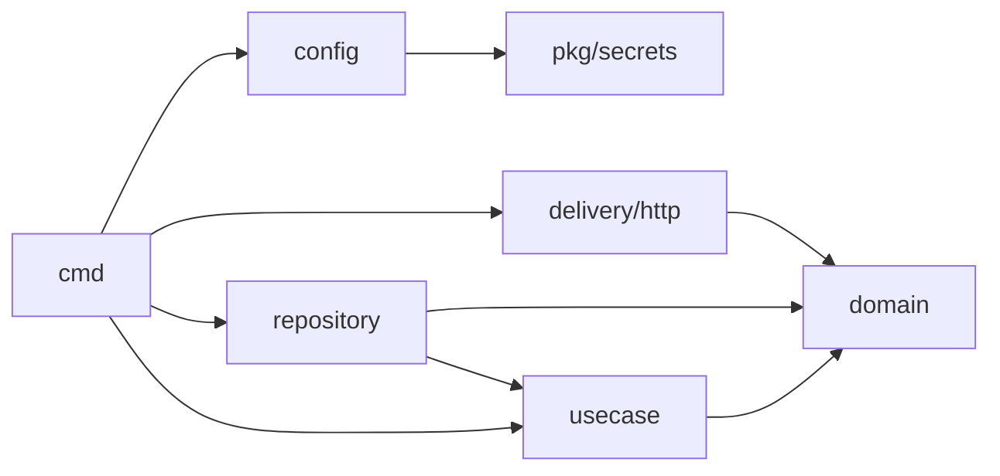

# Kiến trúc dự án — InnerLamp

Tài liệu này là **điểm vào duy nhất** để hiểu kiến trúc thực tế của repo `chjpcoj.com.innerlamp`, liên kết tới toàn bộ `README.md` mô tả từng package/layer. Nội dung dưới đây lấy từ import thật trong code (`grep` cross-import giữa các package), không phải từ giả định — nếu lệch với những gì bạn đọc trong source, tin source.

## 1. Bức tranh tổng: 2 phần

```
pkg/                     shared Go framework — infra packages tái dùng được, provider-agnostic
services/appService/     service duy nhất tiêu thụ pkg/ — Clean Architecture, chạy thật trên Postgres + GCS
```

`pkg/` không phụ thuộc `services/`. `services/appService` phụ thuộc `pkg/` một chiều. Không có service thứ hai trong repo tại thời điểm này.

## 2. `pkg/` — shared framework

### 2.1 Pattern dùng xuyên suốt: interface + factory/registry

Gần như mọi package hạ tầng theo đúng 1 khuôn:

1. Package gốc khai báo interface + `Register(type, FactoryFunc)` / `New(config)`, backed bởi map cấp package.
2. Driver cụ thể nằm ở subpackage, tự đăng ký qua `init()`:
   ```go
   func init() { database.Register(database.MySQL, NewMySQL) }
   ```
3. Consumer kích hoạt driver bằng blank import: `import _ "chjpcoj.com.innerlamp/pkg/database/mysql"`.

Constructor (`New*`) luôn **đồng bộ và chỉ validate config** — không mở kết nối mạng. Kết nối thật qua `Connect(ctx)`/`Start(ctx)` gọi riêng, để service fail-fast lúc khởi động thay vì giữa request.

### 2.2 Sơ đồ phụ thuộc thật giữa các package `pkg/` (từ import, không phải suy đoán)



Chỉ 3 package `pkg/` gốc có cross-import nội bộ thật: `jwt → jwt/claims`, `session → jwt`, `mailer → logging`, `tracing → tracing/gcp, tracing/types`. Mọi package còn lại (`config`, `database`, `httpclient`, `logging`, `metrics`, `middleware`, `ratelimit`, `secrets`, `storage`, `utils`, `validation`) **độc lập lẫn nhau** ở cấp `pkg/` — không import package `pkg/` khác.

> Lưu ý: README của một số package (`httpclient`, `config`, `session`) từng bị tài liệu cũ mô tả sai là phụ thuộc `pkg/ratelimit`/`pkg/logging`/`pkg/metrics`, `pkg/secrets`, `pkg/database`/`pkg/tracing`. Đã xác minh lại bằng grep import thật — các phụ thuộc đó **không tồn tại trong code**. Xem chi tiết trong README từng package (mục "Cấu hình / dependency").

### 2.3 Danh sách package — chi tiết đọc trong README từng package, đừng đọc ở đây

**Config & Secrets**
[`config`](../pkg/config/README.md) · [`secrets`](../pkg/secrets/README.md) ([`env`](../pkg/secrets/env/README.md), [`aws`](../pkg/secrets/aws/README.md), [`gcp`](../pkg/secrets/gcp/README.md), [`examples`](../pkg/secrets/examples/README.md))

**Data access**
[`database`](../pkg/database/README.md) ([`mysql`](../pkg/database/mysql/README.md), [`postgresql`](../pkg/database/postgresql/README.md), [`mongodb`](../pkg/database/mongodb/README.md)) · [`storage`](../pkg/storage/README.md) ([`s3`](../pkg/storage/s3/README.md), [`gcs`](../pkg/storage/gcs/README.md), [`examples`](../pkg/storage/examples/README.md))

**Identity & session**
[`jwt`](../pkg/jwt/README.md) ([`claims`](../pkg/jwt/claims/README.md), [`context`](../pkg/jwt/context/README.md), [`middleware`](../pkg/jwt/middleware/README.md), [`examples`](../pkg/jwt/examples/README.md)) · [`session`](../pkg/session/README.md)

**Cross-cutting (log / metric / trace)**
[`logging`](../pkg/logging/README.md) ([`context`](../pkg/logging/context/README.md), [`formatter`](../pkg/logging/formatter/README.md), [`middleware`](../pkg/logging/middleware/README.md)) · [`metrics`](../pkg/metrics/README.md) ([`gcp`](../pkg/metrics/gcp/README.md), [`middleware`](../pkg/metrics/middleware/README.md), [`examples`](../pkg/metrics/examples/README.md)) · [`tracing`](../pkg/tracing/README.md) ([`gcp`](../pkg/tracing/gcp/README.md), [`middleware`](../pkg/tracing/middleware/README.md), [`types`](../pkg/tracing/types/README.md))

**HTTP / networking**
[`httpclient`](../pkg/httpclient/README.md) · [`ratelimit`](../pkg/ratelimit/README.md) ([`store`](../pkg/ratelimit/store/README.md), [`middleware`](../pkg/ratelimit/middleware/README.md), [`examples`](../pkg/ratelimit/examples/README.md)) · [`middleware`](../pkg/middleware/README.md)

**Utility**
[`utils`](../pkg/utils/README.md) · [`validation`](../pkg/validation/README.md) · [`mailer`](../pkg/mailer/README.md)

## 3. `services/appService` — Clean Architecture

### 3.1 Layer và hướng phụ thuộc thật (từ import)



`domain` không import bất cứ layer nào khác trong `services/` — đúng nguyên tắc Clean Architecture (dependency rule: mọi thứ trỏ vào domain, domain không trỏ ra ngoài). `repository` import `usecase` chỉ để lấy interface hẹp `usecase.AvatarStorage` (interface adapter), không import ngược business logic.

- [`cmd/`](../services/appService/README.md) — không có README riêng (single-file `main.go`, leaf folder), mô tả nằm trong README service.
- [`config/`](../services/appService/config/README.md)
- [`domain/`](../services/appService/domain/README.md)
- [`usecase/`](../services/appService/usecase/README.md)
- [`repository/`](../services/appService/repository/README.md)
- [`delivery/http/`](../services/appService/delivery/http/README.md)

### 3.2 User story đã implement

| User story | Usecase | Handler | Route |
|---|---|---|---|
| US-001 Đăng ký | `RegisterUsecase` | `register_handler.go` | `POST /v1/auth/register` |
| US-002 Đăng nhập | `LoginUsecase` | `login_handler.go` | `POST /v1/auth/login` |
| US-003 Quên mật khẩu | `PasswordResetUsecase` | `forgot_password_handler.go`, `reset_password_handler.go` | `POST /v1/auth/forgot-password`, `POST /v1/auth/reset-password` |
| US-004 Hồ sơ cá nhân | `ProfileUsecase`, `AvatarUsecase` | `profile_handler.go`, `avatar_handler.go` | `GET/PATCH /v1/users/me`, `POST /v1/users/me/avatar` |
| US-005 Danh sách kinh điển | `ListSutrasUsecase` | `sutras_handler.go` | `GET /v1/content/sutras` (public) |
| US-006 Chi tiết một bài kinh | `GetSutraUsecase` | `sutra_detail_handler.go` | `GET /v1/content/sutras/{slug}` (public) |

Spec gốc: [`docs/specs/onboarding/onboarding.md`](specs/onboarding/onboarding.md). Schema DB: [`migrations/README.md`](../migrations/README.md), [`docs/db/register-erd.md`](db/register-erd.md), [`docs/db/content-erd.md`](db/content-erd.md).

## 4. Khoảng hở kiến trúc đã biết (đọc trước khi tưởng đã production-ready)

Những điều này lấy từ đọc source thật, không phải giả định — quan trọng vì có thể khác "thiết kế lý tưởng" mà tài liệu cũ mô tả:

- **`cmd/main.go` chưa gắn JWT auth middleware** vào `/v1/users/me` và `/v1/users/me/avatar`. `pkg/jwt/middleware.NewHTTPAuthMiddleware(...).Authenticate(...)` tồn tại nhưng chưa được wrap quanh 2 route này → mọi request tới đó hiện luôn 401 dù token hợp lệ. Xem [`delivery/http/README.md`](../services/appService/delivery/http/README.md) mục "Lưu ý".
- **Secret resolver đang là dev-only.** `services/appService/config` dùng `NewMockSecretGetterFromYAML` đọc plaintext từ `dev_secrets:` trong YAML thay vì `pkg/secrets/aws` hoặc `pkg/secrets/gcp` thật. Trước khi deploy: đổi `SecretGetter` implementation trong `cmd/main.go`.
- **`pkg/mailer` chưa có provider gửi mail thật** — `cmd/main.go` dùng `mailer.NewLogMailer` (chỉ log, không gửi). `PasswordResetUsecase.ForgotPassword` luôn trả `nil` bất kể mail có gửi được hay không (chủ đích chống user-enumeration, không phải bug).
- **`pkg/tracing` chưa được wire vào `appService`** — package tồn tại và test được nhưng không có consumer thật trong `cmd/main.go`.
- **`pkg/middleware` (Logger/CORS/Recovery) không được dùng ở đâu trong repo** — không nhầm với middleware riêng của từng package domain (`pkg/jwt/middleware`, `pkg/logging/middleware`, `pkg/ratelimit/middleware`, `pkg/metrics/middleware`, `pkg/tracing/middleware`) — các middleware domain-specific đó độc lập với `pkg/middleware`.
- **Import path lệch còn sót ở một số doc phụ** (`QUICK_START.md`, một vài `README.md` cấp subpackage cũ chưa nằm trong đợt cập nhật này) vẫn ghi `base_project/pkg/...` — import path đúng trong repo luôn là `chjpcoj.com.innerlamp/...`. Không copy các đoạn đó.

## 5. Cách AI nên dùng tài liệu này

1. Cần biết package/layer nào tồn tại và quan hệ giữa chúng → đọc file này trước.
2. Cần biết cách gọi API cụ thể của 1 package → đọc `README.md` của package đó (link ở mục 2/3) trước khi đọc source — README ghi rõ API thật, lỗi hay gặp, và có/không dùng ở đâu.
3. Nếu README và source lệch nhau → tin source, coi README là stale, và nên cập nhật lại README theo template ở `CLAUDE.md`.
