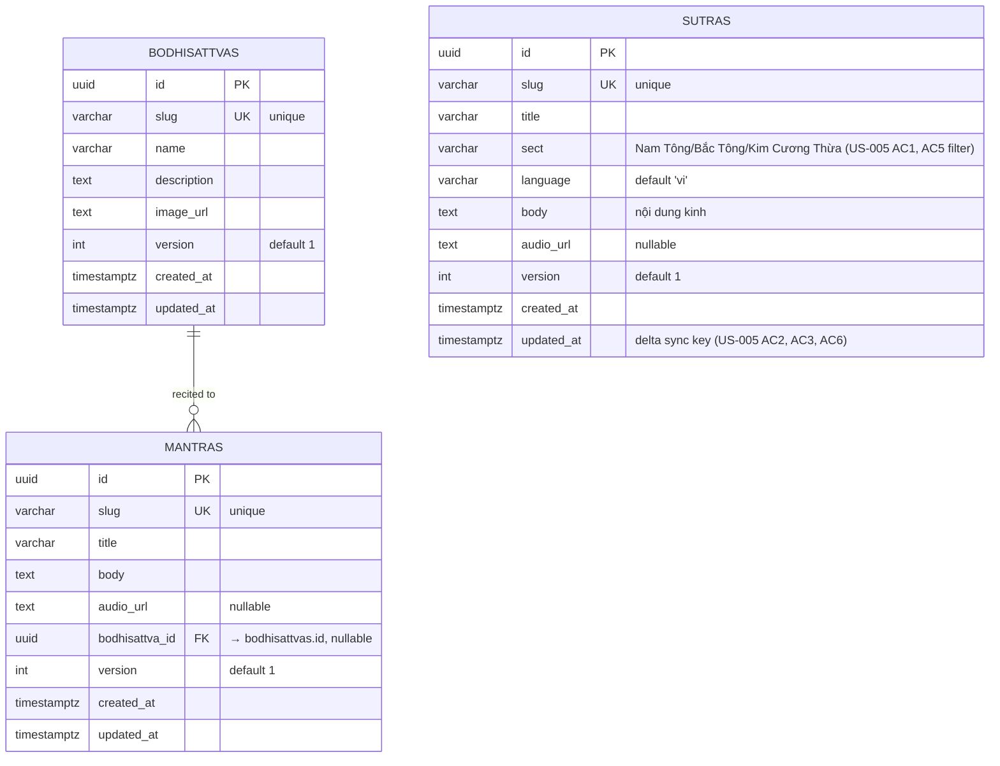

# ERD — Content: Sutras, Mantras, Bodhisattvas (US-005)

Source: `tam-dang-project-notes.md` mục 5 (Module content) — schema thật, thay cho bản nháp trước đó suy ra từ mỗi US-005.

`GET /v1/content/sutras?updated_since=<RFC3339>&sect=<optional>` (US-005, public read, no auth) lists sutras cho client-side cache (SQLite/Hive) với delta sync qua `updated_at`. `mantras` và `bodhisattvas` dùng chung shape (`slug`, `version`, `created_at`/`updated_at`) — cùng module `content`, có thể có API tương tự dù chưa có US riêng.

## Field notes / open items

- `sutras` không có FK tới `bodhisattvas` — độc lập, đúng theo schema gốc.
- `mantras.bodhisattva_id`: **resolved (US-007/US-008 implementation)** — nullable. Một số thần chú (vd. Om Mani Padme Hum khi trì tụng tổng quát) không gắn với vị cụ thể nào — US-007 AC2/US-008 domain field `BodhisattvaID` rỗng khi null. Migration: `migrations/0006_content_bodhisattvas_mantras.sql`.
- `version`: có ở cả 3 bảng, default 1 — dùng để client detect content đã đổi (kết hợp `updated_at`) hoặc optimistic locking khi admin sửa nội dung; US-005 không nói rõ mục đích, chỉ áp lại theo schema gốc.
- `sect` (sutras), `updated_at` (cả 3 bảng): nên có index — `sect` phục vụ AC5 filter, `updated_at` phục vụ delta sync AC2/AC3/AC6.
- `audio_url` (sutras, mantras): nullable — không phải bài kinh/thần chú nào cũng có audio.
- Bảng trước (`content` text, `is_deleted`) đã bỏ — thay bằng field thật `body`/`slug`/`version` từ project notes; không còn suy đoán riêng.
