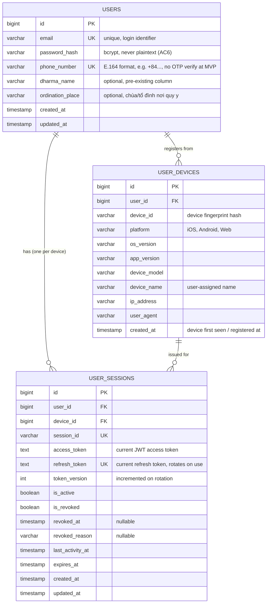

# ERD — Register (US-001)

Source: `docs/specs/onboarding/onboarding.md` (US-001, plus US-002 AC4 for device scope).

Register (`POST /v1/auth/register`) creates a `users` row, records the device it was registered from (US-002 AC4: each device keeps its own login state — "mỗi thiết bị có refresh token riêng"), and issues a session holding the JWT access+refresh token pair (AC1/AC7: register logs the user in immediately). All three tables live in PostgreSQL.

## Field notes / open items

- `email`, `phone_number`: both unique — AC2 requires separate "already used" errors for each, so uniqueness must be checked (and violated) independently, not via a combined constraint.
- `dharma_name`: spec says this column "đã có sẵn" (pre-existing) — not part of this migration, listed here only because it's optional data collected at register.
- `password_hash`: bcrypt per AC6 and per US-002's technical note (`bcrypt.CompareHashAndPassword`).
- `USER_DEVICES`: one row per device a user has registered/logged in from — device fingerprint/metadata only, no token state.
- `USER_SESSIONS`: PostgreSQL table (not the Mongo-backed `pkg/session.Session` — that package's `Manager` interface is Mongo-only today; a Postgres-backed implementation of the same interface would need to be added, or this table consumed directly). Mirrors that struct's fields 1:1 minus the embedded `DeviceInfo` (now a separate `USER_DEVICES` row referenced by `device_id`).
- `expires_at`: refresh token TTL is 7 days, matching `pkg/session.DefaultConfig().RefreshTokenTTL` (`pkg/session/session.go:116-124`) — onboarding spec's technical note was updated to match this default instead of the config being changed to match the spec.
