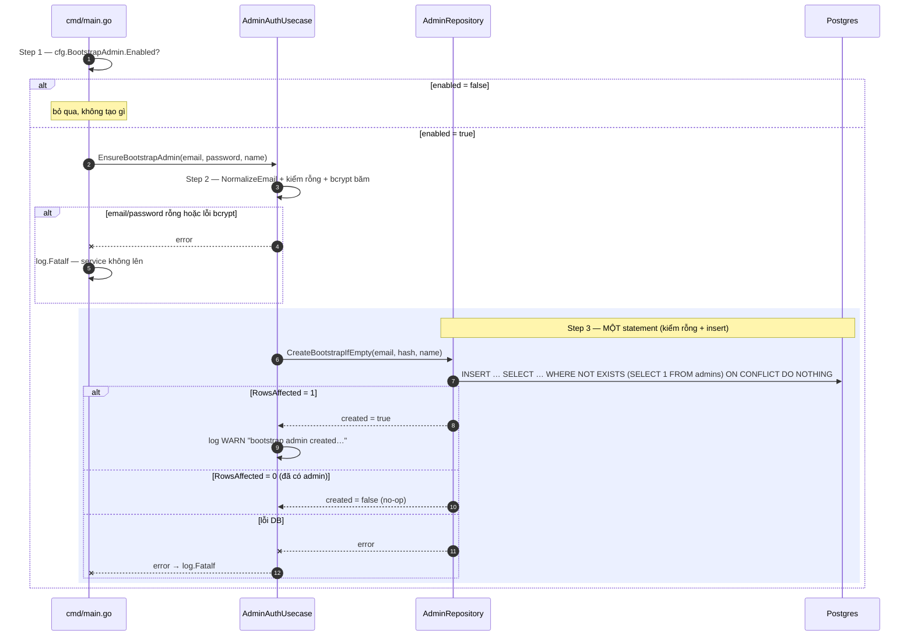
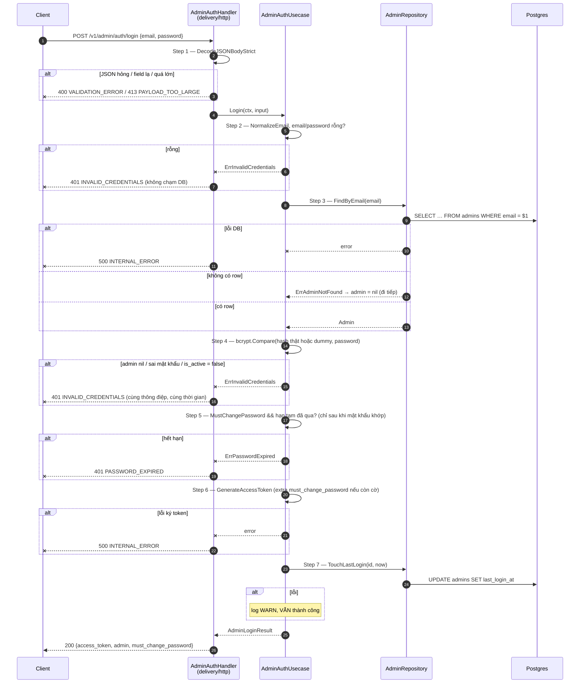
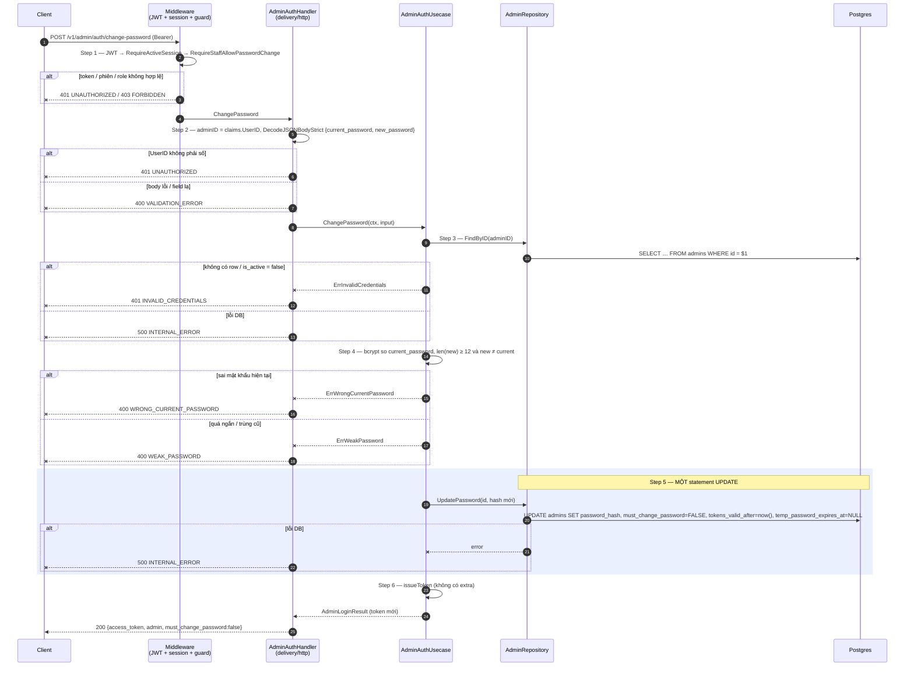
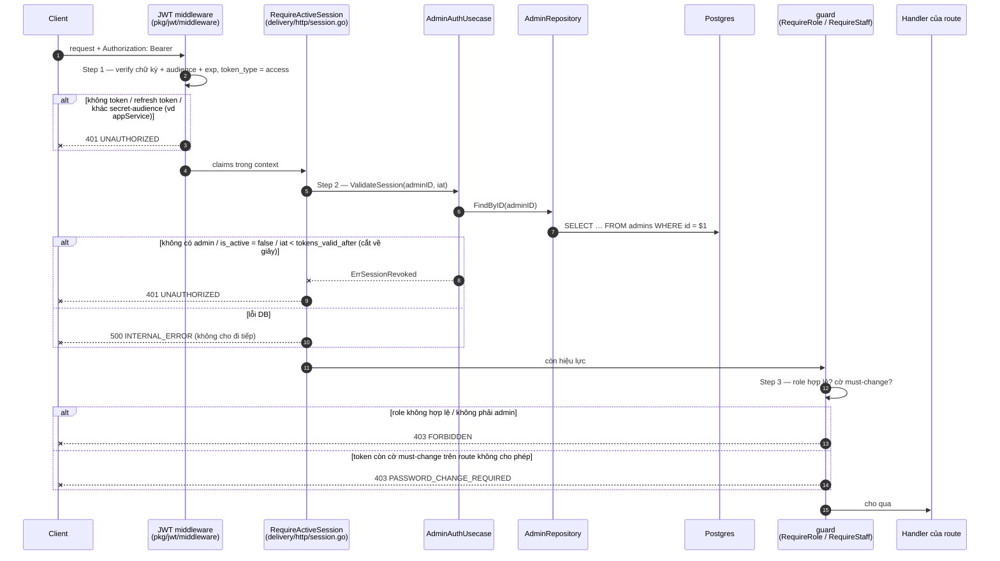
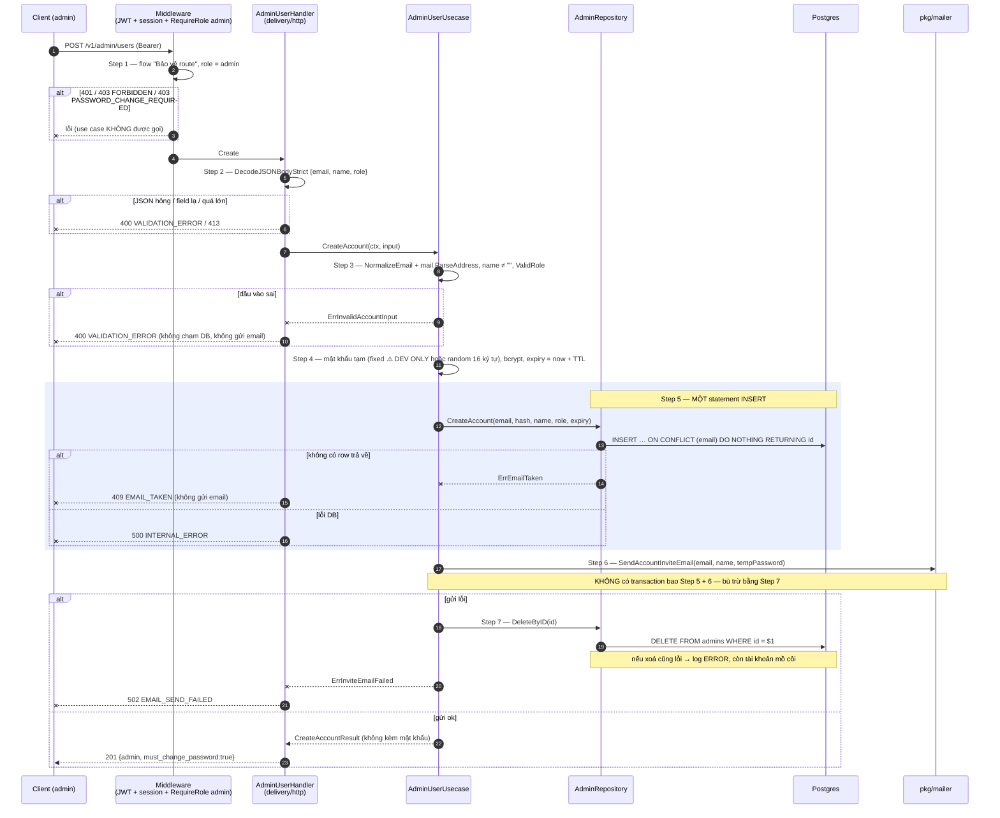
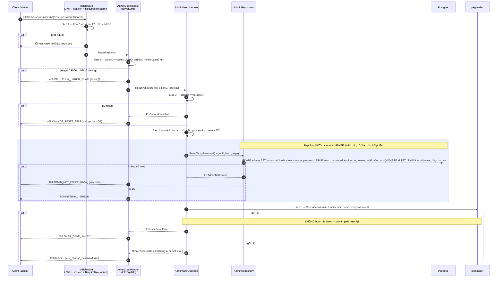

# Flow — admin

Version: 1.0
Last updated: 2026-09-29
Status: implemented (2026-09-29) — vẽ lại đúng sáu "Step-by-step Flow" của `design.md` (Bootstrap, Login, Đổi mật khẩu, Bảo vệ route, Tạo tài khoản, Reset mật khẩu) bằng Mermaid; không thêm, không bớt bước.
Module: `backoffice`

> See `changelog.md` in this folder for the version history of this spec.

Sáu sequence diagram dưới đây là gương 1:1 của sáu section "Step-by-step Flow" trong `design.md` (cùng tên, cùng thứ tự). Mỗi message trace về đúng một Step; ngược lại mọi Step của `design.md` đều xuất hiện ở đây. Các flow "Đổi mật khẩu", "Tạo tài khoản", "Reset mật khẩu" dùng lại flow "Bảo vệ route" ở Step 1 (vẽ gộp thành một message `MW`).

## Sequence — Bootstrap admin khi khởi động

## Sequence — Login: `POST /v1/admin/auth/login`

## Sequence — Đổi mật khẩu: `POST /v1/admin/auth/change-password`

## Sequence — Bảo vệ route: mọi request `/v1/admin/*` trừ login

## Sequence — Tạo tài khoản: `POST /v1/admin/users`

## Sequence — Reset mật khẩu: `POST /v1/admin/users/{id}/reset-password`

