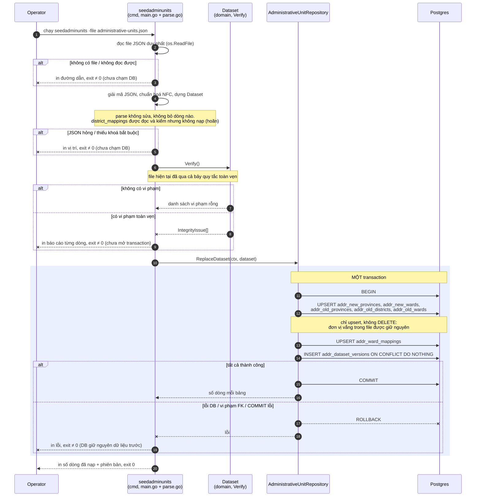

# Flow — administrative-units

Version: 1.4
Last updated: 2026-10-10
Status: mirror `design.md` v1.4 §Step-by-step Flow; Step 3 (`Dataset.Verify`) và Step 4–6 (`ReplaceDataset`, đã chạy trên Postgres thật) đã implement; Step 1–2 và 7 thuộc CLI chưa làm.
Module: `administrative-units`

> See `changelog.md` in this folder for the version history of this spec.

File này là bản vẽ của đúng một section "Step-by-step Flow" trong `design.md` (nạp dữ liệu bằng `cmd/seedadminunits`). Các route đọc chỉ một câu SELECT nên không có sơ đồ ở đây; trace ASCII của chúng nằm ở `design.md` §Request flow.

## Sequence — Nạp bộ dữ liệu hành chính (`cmd/seedadminunits`)

