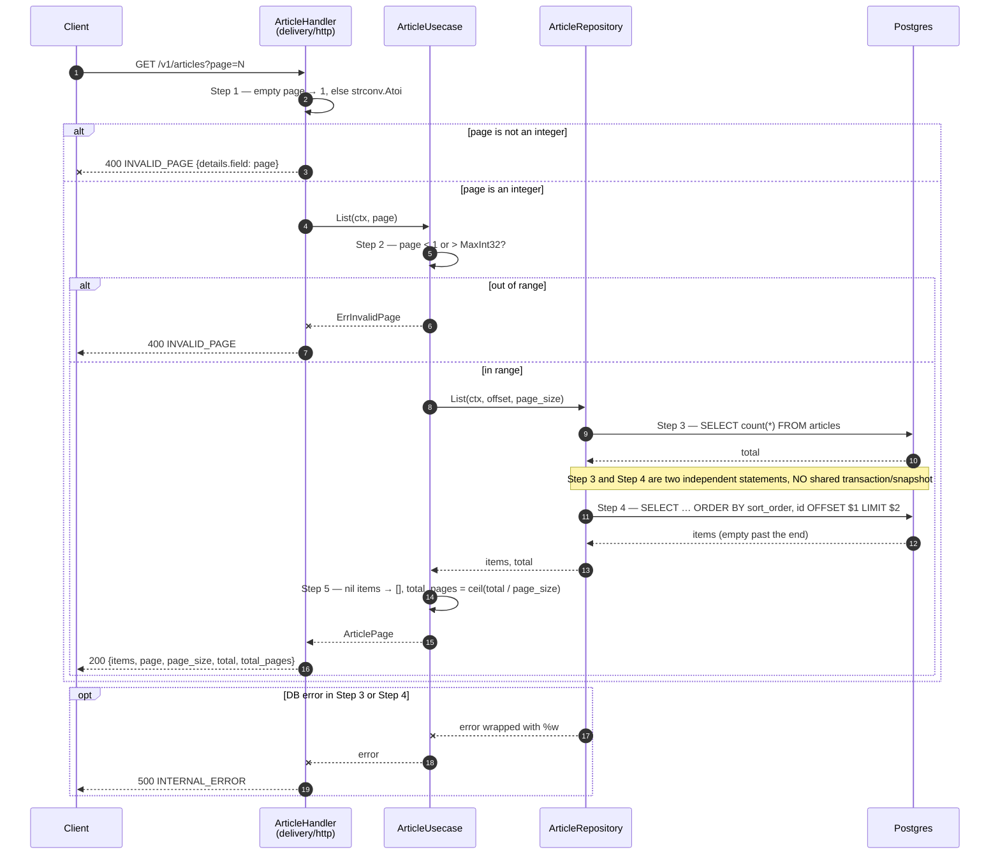
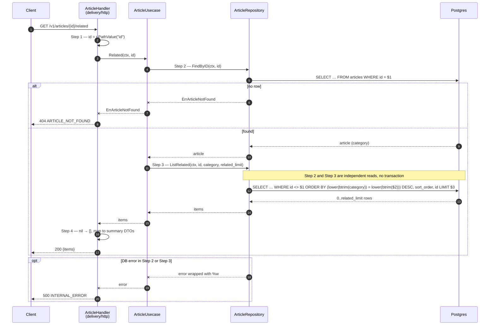
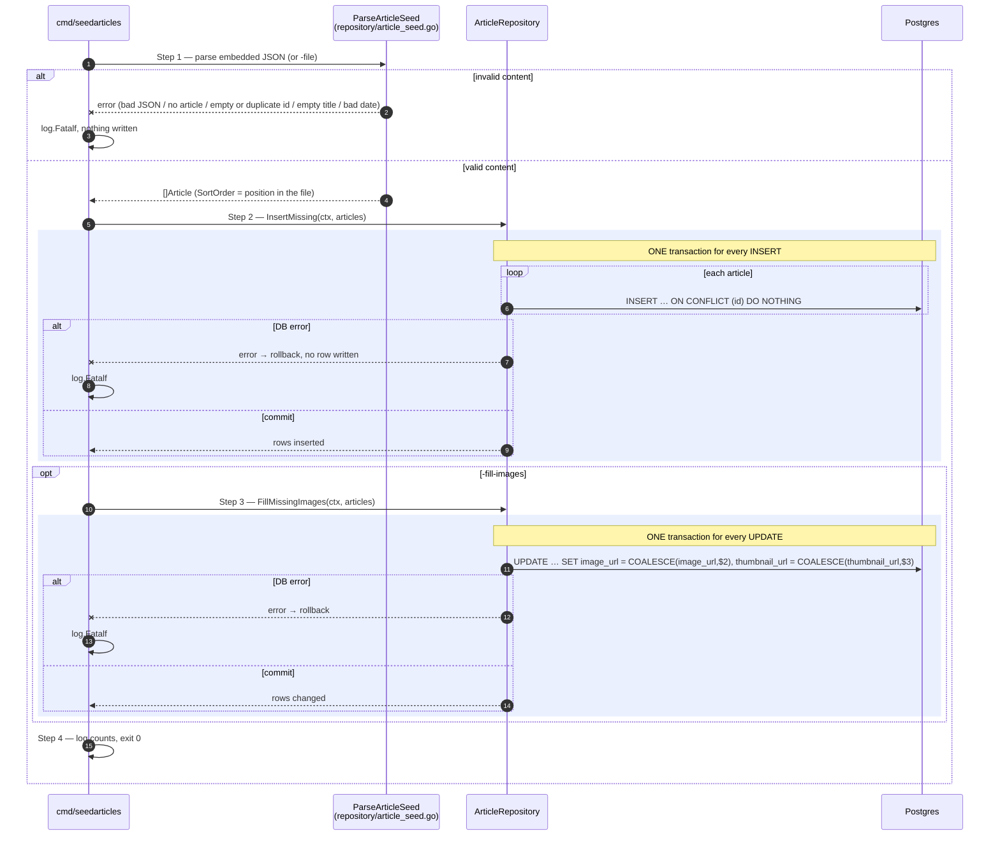

# Flow — article

Version: 3.0
Last updated: 2026-10-15
Status: in-progress — 1:1 mirror of the three Step-by-step Flows in `design.md`; every Step here traces to the Step with the same number. The related-articles flow (v3.0) is not implemented yet.
Module: `content`

> See `changelog.md` in this folder for the version history of this spec.

`top` and `detail` are one SQL statement each, so they have no diagram — see "Request flow" in
`design.md`.

## Sequence — Paged list (`GET /v1/articles?page=N`)

## Sequence — Related articles (`GET /v1/articles/{id}/related`, v3.0)

## Sequence — Seed with the command (`cmd/seedarticles`; the service never seeds)

