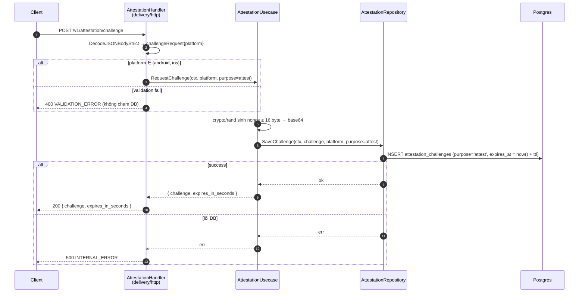
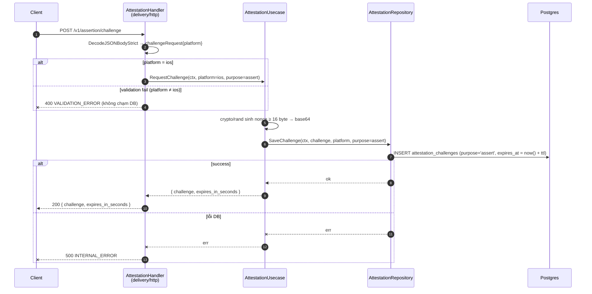
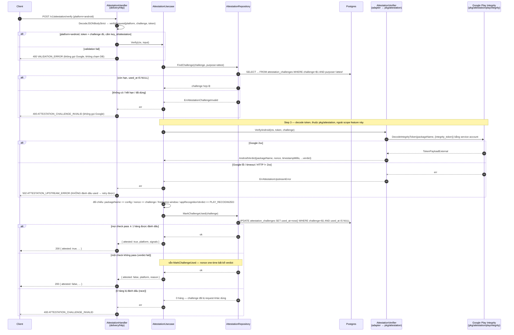
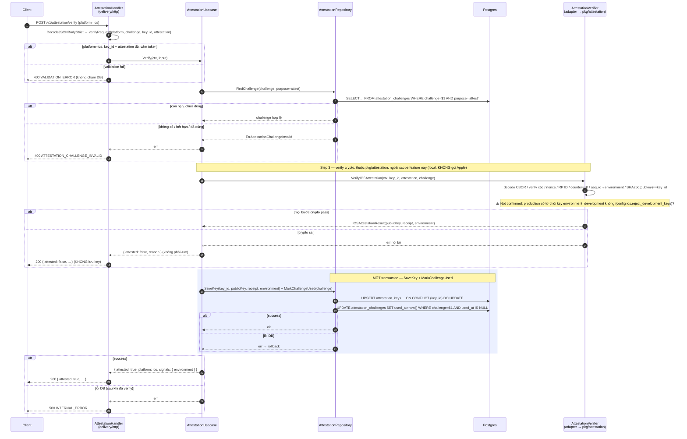
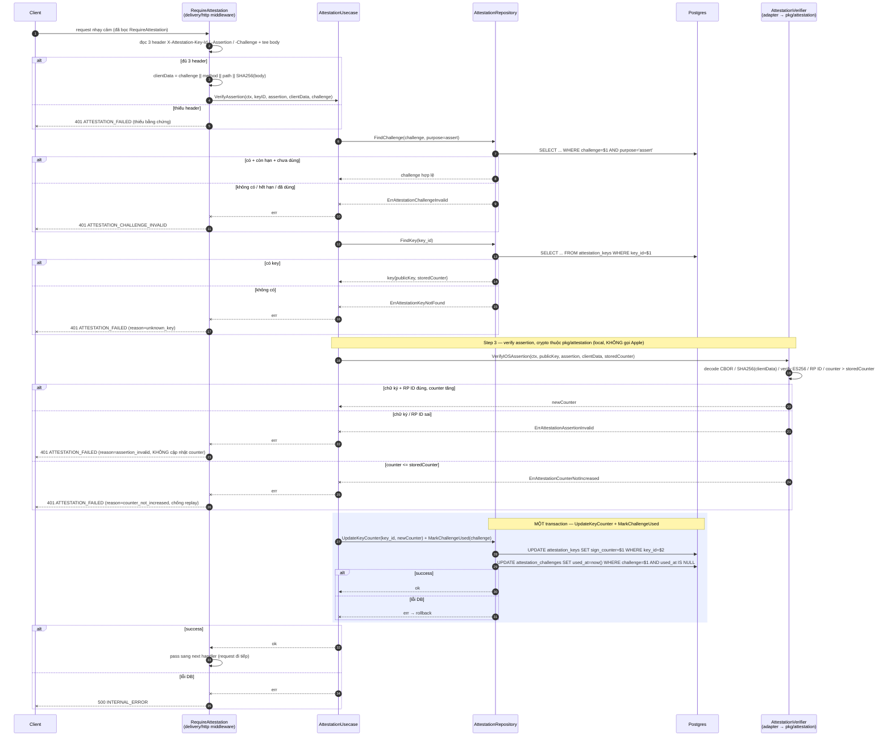

# Flow — attestation

Version: 1.4
Last updated: 2026-09-25
Status: implemented — đủ clean-arch layers + cả 3 driver (mock, playintegrity, appattest); fraud-risk receipt + gate nghiệp vụ deferred
Module: `attestation`

> See `changelog.md` in this folder for the version history of this spec.

<!--
File này là **bản vẽ** (visual) của các section "Step-by-step Flow" trong `design.md`. Nó không
thêm bước mới, không bỏ bước — mỗi mũi tên/message ở đây phải trace 1:1 về một Step trong
`design.md`. Ngược lại, mỗi Step trong `design.md` phải xuất hiện ở đây. Thấy chỗ lệch là bug của
chính file này. Quy ước đầy đủ: xem `references/flow_diagram.md`.

Quy tắc của file này:
- Một section `###` cho MỖI section "Step-by-step Flow — ..." trong `design.md` (cùng tên, cùng thứ
  tự). Không gộp nhiều flow vào một diagram, không tách một flow ra nhiều diagram.
- Mặc định là **sequence diagram**. Chỉ thêm **flowchart** cho nhánh rẽ logic mà sequence vẽ gượng.
- Nhãn message/participant viết tiếng Việt ngắn; keyword Mermaid (`participant`, `alt`, `loop`, ...)
  giữ tiếng Anh — khớp quy ước mixed-language của spec và comment `%%` của `erd.mmd`.
- Mọi `⚠️ Not confirmed` ở một bước trong `design.md` xuất hiện ở đây dưới dạng `Note` trên đúng
  message tương ứng — không được vẽ nó như thể đã chốt.
-->

## Sequence — Cấp challenge (attestation)

## Sequence — Cấp challenge (assertion, iOS)

## Sequence — Verify Android (Play Integrity)

## Sequence — Verify iOS pha `attest` (đăng ký khoá)

## Sequence — Assertion iOS (middleware `RequireAttestation`)

