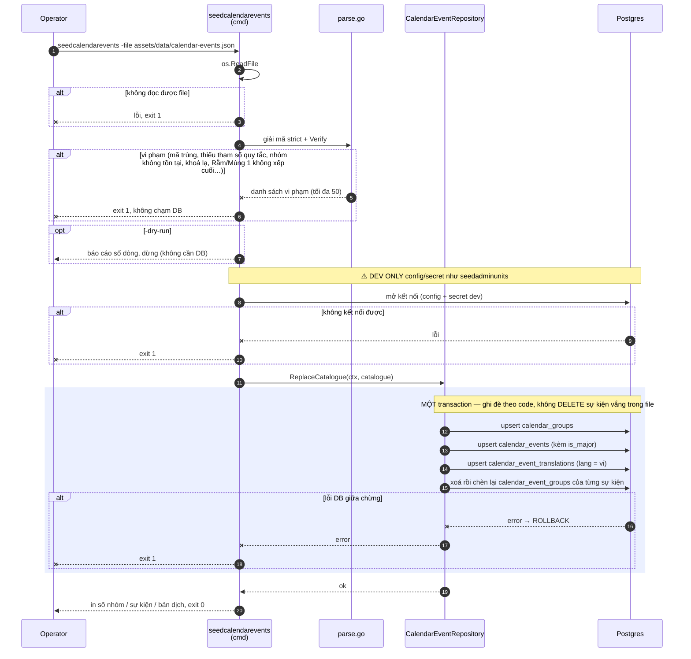

# Flow — calendar

Version: 3.2
Last updated: 2026-10-17
Status: mirror `design.md` v3.0; bước 1a/1b (route công khai) đã triển khai
Module: `calendar`

> See `changelog.md` in this folder for the version history of this spec.

File này vẽ lại 1:1 hai section "Step-by-step Flow" của `design.md` (US-CAL-002). Route ảnh (US-CAL-001) không có flow.

## Sequence — Lấy sự kiện của một năm (`GET /v1/calendar/events`)

```mermaid
sequenceDiagram
    autonumber
    participant C as Client
    participant K as webAPIKey<br/>(RequireWebAPIKey)
    participant L as calendarEventLimit<br/>(ClientIPRateLimit)
    participant H as CalendarEventHandler<br/>(delivery/http)
    participant U as CalendarEventUsecase
    participant R as CalendarEventRepository
    participant DB as Postgres

    Note over C,K: v3.0: route công khai, không đọc Authorization
    C->>K: GET /v1/calendar/events?year=... [X-API-Key tuỳ chọn]
    alt có X-API-Key nhưng sai
        K--xC: 401
    end
    alt X-API-Key đúng (website)
        K->>H: Events (không qua giới hạn IP)
    else không có header (app di động)
        K->>L: đếm theo IP
        alt IP vượt calendar.events_rate_limit
            L--xC: 429
        end
        L->>H: Events
    end

    H->>U: EventsForYear(ctx, year)
    U->>U: year rỗng → năm hiện tại (calendar.timezone); parse + kiểm tra 1900..2100
    alt năm không hợp lệ
        U--xH: ErrInvalidYear
        H-->>C: 400 INVALID_YEAR (details.field = year)
    end

    Note over U,DB: hai lần đọc, KHÔNG bọc transaction (chỉ đọc)
    U->>R: ListGroups(ctx)
    R->>DB: SELECT code, name FROM calendar_groups ORDER BY sort_order, code
    alt lỗi DB
        R--xU: error
        U--xH: error
        H-->>C: 500
    end
    U->>R: ListActiveEvents(ctx, lang)
    R->>DB: SELECT sự kiện is_active JOIN bản dịch + mảng mã nhóm
    alt lỗi DB
        R--xU: error
        U--xH: error
        H-->>C: 500
    end

    Note over U: thuần, không I/O: ResolveOccurrences(events, year)
    U->>U: áp RecurrenceRule, tính ngày âm/dương, lọc năm dương, sắp xếp
    opt tham số quy tắc không hợp lệ
        U->>U: bỏ sự kiện, log cảnh báo kèm code
    end

    U-->>H: {year, groups, events, occurrences}
    H->>H: giữ sự kiện có occurrence; map DTO (+ is_major, sort_order, recurrence)
    H->>H: Cache-Control: year rõ ràng → public, max-age; bỏ trống → no-cache
    H-->>C: 200 {year, groups, events, occurrences}
```

## Sequence — Nạp danh mục sự kiện (`cmd/seedcalendarevents`)


