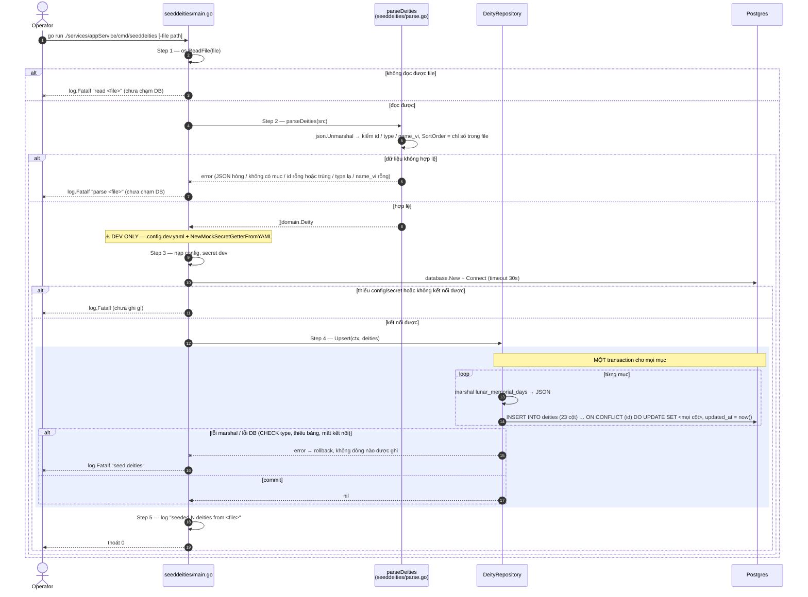

# Flow — deity

Version: 2.3
Last updated: 2026-10-12
Status: implemented (2026-09-30) — mirror 1:1 của hai Step-by-step Flow trong `design.md`, mỗi Step ở đây trace về đúng Step cùng số. v2.2: sơ đồ phân trang thêm tham số `type` (đã implement).
Module: `content`

> See `changelog.md` in this folder for the version history of this spec.

`top` và `detail` chỉ một câu SQL nên không có diagram — xem "Request flow" trong `design.md`.

## Sequence — Danh sách Phật và Bồ tát phân trang (`GET /v1/deities?type=&page=N`)

```mermaid
sequenceDiagram
    autonumber
    participant C as Client
    participant H as DeityHandler<br/>(delivery/http)
    participant U as DeityUsecase
    participant R as DeityRepository
    participant DB as Postgres

    C->>H: GET /v1/deities?type=&page=N
    H->>H: Step 1 — page rỗng → 1, ngược lại strconv.Atoi; type lấy chuỗi thô (v2.2)
    alt page không phải số nguyên
        H--xC: 400 INVALID_PAGE {details.field: page}
    else page hợp lệ về kiểu
        H->>U: ListDeities(ctx, deityType, page)
        U->>U: Step 2 — page < 1 hoặc > MaxInt32? rồi type khác rỗng mà không hợp lệ? (v2.2)
        alt page ngoài khoảng
            U--xH: ErrInvalidPage
            H-->>C: 400 INVALID_PAGE
        else type lạ (v2.2)
            U--xH: ErrInvalidDeityType
            H-->>C: 400 INVALID_DEITY_TYPE {details.field: type}
        else hợp lệ
            U->>R: List(ctx, deityType, offset, page_size)
            R->>DB: Step 3 — SELECT count(*) FROM deities [WHERE type = $1]
            DB-->>R: total (khớp bộ lọc)
            Note over R,DB: Step 3 và Step 4 là hai câu lệnh độc lập, KHÔNG chung transaction/snapshot
            R->>DB: Step 4 — SELECT … [WHERE type = $1] ORDER BY sort_order, id OFFSET LIMIT
            DB-->>R: items (rỗng nếu vượt cuối)
            R-->>U: items, total
            U->>U: Step 5 — items nil → [], total_pages = ceil(total / page_size)
            U-->>H: DeityPage
            H-->>C: 200 {items, page, page_size, total, total_pages}
        end
    end
    opt lỗi DB / scan ở Step 3 hoặc Step 4
        R--xU: error bọc %w
        U--xH: error
        H-->>C: 500 INTERNAL_ERROR
    end
```

## Sequence — Nạp dữ liệu bằng `cmd/seeddeities`


