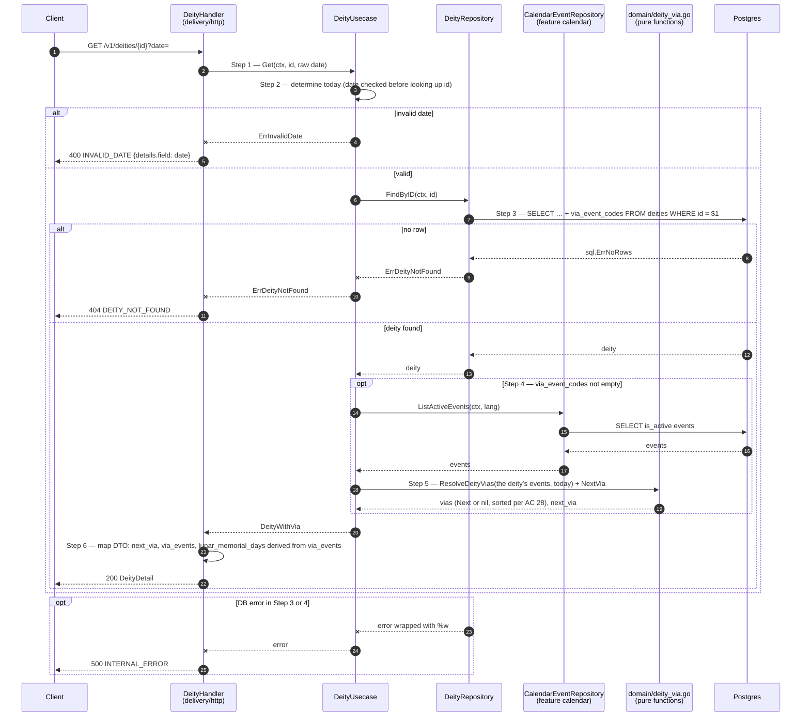

# Flow — deity

Version: 3.1
Last updated: 2026-10-15
Status: in-progress — a 1:1 mirror of the four Step-by-step Flows in `design.md`; each Step here traces to the Step with the same number. Parts marked (v3.0) are design, with no code yet.
Module: `deity`

> See `changelog.md` in this folder for the version history of this spec.

From v3.0 all three read routes have several steps (read deities → read the calendar catalogue → compute vía, i.e. the deity's commemoration day, ngày vía), so each route has one diagram.

## Sequence — Paged list of Buddhas and Bodhisattvas (`GET /v1/deities?type=&page=N&date=`)

```mermaid
sequenceDiagram
    autonumber
    participant C as Client
    participant H as DeityHandler<br/>(delivery/http)
    participant U as DeityUsecase
    participant R as DeityRepository
    participant CR as CalendarEventRepository<br/>(feature calendar)
    participant D as domain/deity_via.go<br/>(pure functions)
    participant DB as Postgres

    C->>H: GET /v1/deities?type=&page=N&date=
    H->>H: Step 1 — empty page → 1, otherwise strconv.Atoi; type, date taken as raw strings
    alt page is not an integer
        H--xC: 400 INVALID_PAGE {details.field: page}
    else page has a valid type
        H->>U: ListDeities(ctx, deityType, page, date)
        U->>U: Step 2 — page out of range? then unknown type? then invalid date? (v3.0); empty date → today in calendar.timezone
        alt page out of range
            U--xH: ErrInvalidPage
            H-->>C: 400 INVALID_PAGE
        else unknown type
            U--xH: ErrInvalidDeityType
            H-->>C: 400 INVALID_DEITY_TYPE {details.field: type}
        else invalid date (v3.0)
            U--xH: ErrInvalidDate
            H-->>C: 400 INVALID_DATE {details.field: date}
        else valid
            U->>R: List(ctx, deityType, offset, page_size=12)
            R->>DB: Step 3 — SELECT count(*) FROM deities [WHERE type = $1]
            DB-->>R: total (matching the filter)
            Note over R,DB: Step 3 and Step 4 are two independent statements, NOT sharing a transaction/snapshot
            R->>DB: Step 4 — SELECT … + via_event_codes (v3.0) [WHERE type = $1] ORDER BY sort_order, id OFFSET LIMIT
            DB-->>R: items (empty if past the end)
            R-->>U: items, total
            opt Step 5 (v3.0) — some deity has via_event_codes
                U->>CR: ListActiveEvents(ctx, calendar.default_language)
                CR->>DB: SELECT is_active events + rule + name + sort_order
                DB-->>CR: events
                CR-->>U: events
                U->>D: Step 6 — per deity: filter events by code → ResolveDeityVias(events, today) → NextVia
                D-->>U: next_via (or nil)
            end
            U->>U: Step 7 — nil items → [], total_pages = ceil(total / page_size)
            U-->>H: DeityWithVia page
            H-->>C: 200 {items (+ next_via), page, page_size, total, total_pages}
        end
    end
    opt DB / scan error in Step 3, 4 or 5
        R--xU: error wrapped with %w
        U--xH: error
        H-->>C: 500 INTERNAL_ERROR
    end
```

## Sequence — Featured Buddhas and Bodhisattvas (`GET /v1/deities/top?date=`) (v3.0)

```mermaid
sequenceDiagram
    autonumber
    participant C as Client
    participant H as DeityHandler<br/>(delivery/http)
    participant U as DeityUsecase
    participant R as DeityRepository
    participant CR as CalendarEventRepository<br/>(feature calendar)
    participant D as domain/deity_via.go<br/>(pure functions)
    participant DB as Postgres

    C->>H: GET /v1/deities/top?date=
    H->>U: Step 1 — Top(ctx, raw date)
    U->>U: Step 2 — empty date → today in calendar.timezone; otherwise parse YYYY-MM-DD (1900..2100)
    alt invalid date
        U--xH: ErrInvalidDate
        H-->>C: 400 INVALID_DATE {details.field: date}
    else valid
        U->>R: ListTop(ctx, top_limit=10)
        R->>DB: Step 3 — SELECT … + via_event_codes FROM deities ORDER BY sort_order, id LIMIT $1
        DB-->>R: items
        R-->>U: items
        opt Step 4 — some deity has via_event_codes
            U->>CR: ListActiveEvents(ctx, lang)
            CR->>DB: SELECT is_active events
            DB-->>CR: events
            CR-->>U: events
            U->>D: Step 5 — ResolveDeityVias + NextVia for each deity
            D-->>U: next_via (or nil)
        end
        U-->>H: []DeityWithVia
        H-->>C: Step 6 — 200 {items (+ next_via)}
    end
    opt DB / scan error in Step 3 or 4
        R--xU: error wrapped with %w
        U--xH: error
        H-->>C: 500 INTERNAL_ERROR
    end
```

## Sequence — Detail of one deity (`GET /v1/deities/{id}?date=`) (v3.0)



## Sequence — Loading data with `cmd/seeddeities`

```mermaid
sequenceDiagram
    autonumber
    actor O as Operator
    participant M as seeddeities/main.go
    participant P as parseDeities<br/>(seeddeities/parse.go)
    participant R as DeityRepository
    participant DB as Postgres

    O->>M: go run ./services/appService/cmd/seeddeities [-file path]
    M->>M: Step 1 — os.ReadFile(file) (v3.0: the file is in git)
    alt file cannot be read
        M--xO: log.Fatalf "read <file>" (DB not touched yet)
    else file read
        M->>P: Step 2 — parseDeities(src)
        P->>P: json.Unmarshal → check id / type / name_vi; v3.0 via_event_codes non-empty, no duplicates; SortOrder = index
        alt invalid data
            P--xM: error
            M--xO: log.Fatalf "parse <file>" (DB not touched yet)
        else valid
            P-->>M: []domain.Deity
            Note over M: ⚠️ DEV ONLY — config.dev.yaml + NewMockSecretGetterFromYAML
            M->>M: Step 3 — load config, dev secrets
            M->>DB: database.New + Connect (timeout 30s)
            alt missing config/secret or cannot connect
                M--xO: log.Fatalf (nothing written yet)
            else connected
                M->>R: Step 4 (v3.0) — MissingCalendarEvents(ctx, every vía code)
                R->>DB: SELECT codes not present in calendar_events
                alt some codes missing or DB error
                    R-->>M: [missing codes] / error
                    M--xO: log.Fatalf listing the missing codes (nothing written)
                else all present
                    R-->>M: []
                    M->>R: Step 5 — Upsert(ctx, deities)
                    rect rgb(235, 240, 255)
                        Note over R,DB: ONE transaction for every entry and every vía link
                        loop each entry
                            R->>DB: INSERT INTO deities (…) ON CONFLICT (id) DO UPDATE SET <every column>, updated_at = now()
                        end
                        R->>DB: v3.0 — DELETE FROM deity_via_events WHERE deity_id = ANY($ids)
                        R->>DB: v3.0 — INSERT INTO deity_via_events (deity_id, event_code) …
                        alt DB error (CHECK type, FK event_code, missing table, lost connection)
                            R--xM: error → rollback, nothing written
                            M--xO: log.Fatalf "seed deities"
                        else commit
                            R-->>M: nil
                        end
                    end
                    M->>M: Step 6 — log "seeded N deities from <file>"
                    M-->>O: exit 0
                end
            end
        end
    end
```
