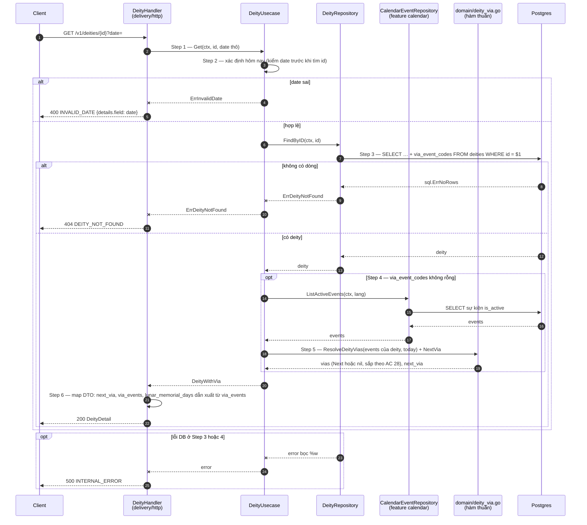

# Flow — deity

Version: 3.0
Last updated: 2026-10-15
Status: in-progress — mirror 1:1 của bốn Step-by-step Flow trong `design.md`, mỗi Step ở đây trace về đúng Step cùng số. Phần đánh dấu (v3.0) là thiết kế, chưa có code.
Module: `deity`

> See `changelog.md` in this folder for the version history of this spec.

Từ v3.0 cả ba route đọc đều có nhiều bước (đọc deity → đọc catalogue lịch → tính vía) nên mỗi route có một diagram.

## Sequence — Danh sách Phật và Bồ tát phân trang (`GET /v1/deities?type=&page=N&date=`)

```mermaid
sequenceDiagram
    autonumber
    participant C as Client
    participant H as DeityHandler<br/>(delivery/http)
    participant U as DeityUsecase
    participant R as DeityRepository
    participant CR as CalendarEventRepository<br/>(feature calendar)
    participant D as domain/deity_via.go<br/>(hàm thuần)
    participant DB as Postgres

    C->>H: GET /v1/deities?type=&page=N&date=
    H->>H: Step 1 — page rỗng → 1, ngược lại strconv.Atoi; type, date lấy chuỗi thô
    alt page không phải số nguyên
        H--xC: 400 INVALID_PAGE {details.field: page}
    else page hợp lệ về kiểu
        H->>U: ListDeities(ctx, deityType, page, date)
        U->>U: Step 2 — page ngoài khoảng? rồi type lạ? rồi date sai? (v3.0); date rỗng → hôm nay theo calendar.timezone
        alt page ngoài khoảng
            U--xH: ErrInvalidPage
            H-->>C: 400 INVALID_PAGE
        else type lạ
            U--xH: ErrInvalidDeityType
            H-->>C: 400 INVALID_DEITY_TYPE {details.field: type}
        else date sai (v3.0)
            U--xH: ErrInvalidDate
            H-->>C: 400 INVALID_DATE {details.field: date}
        else hợp lệ
            U->>R: List(ctx, deityType, offset, page_size=12)
            R->>DB: Step 3 — SELECT count(*) FROM deities [WHERE type = $1]
            DB-->>R: total (khớp bộ lọc)
            Note over R,DB: Step 3 và Step 4 là hai câu lệnh độc lập, KHÔNG chung transaction/snapshot
            R->>DB: Step 4 — SELECT … + via_event_codes (v3.0) [WHERE type = $1] ORDER BY sort_order, id OFFSET LIMIT
            DB-->>R: items (rỗng nếu vượt cuối)
            R-->>U: items, total
            opt Step 5 (v3.0) — có deity mang via_event_codes
                U->>CR: ListActiveEvents(ctx, calendar.default_language)
                CR->>DB: SELECT sự kiện is_active + rule + tên + sort_order
                DB-->>CR: events
                CR-->>U: events
                U->>D: Step 6 — mỗi deity: lọc events theo mã → ResolveDeityVias(events, today) → NextVia
                D-->>U: next_via (hoặc nil)
            end
            U->>U: Step 7 — items nil → [], total_pages = ceil(total / page_size)
            U-->>H: trang DeityWithVia
            H-->>C: 200 {items (+ next_via), page, page_size, total, total_pages}
        end
    end
    opt lỗi DB / scan ở Step 3, 4 hoặc 5
        R--xU: error bọc %w
        U--xH: error
        H-->>C: 500 INTERNAL_ERROR
    end
```

## Sequence — Phật và Bồ tát nổi bật (`GET /v1/deities/top?date=`) (v3.0)

```mermaid
sequenceDiagram
    autonumber
    participant C as Client
    participant H as DeityHandler<br/>(delivery/http)
    participant U as DeityUsecase
    participant R as DeityRepository
    participant CR as CalendarEventRepository<br/>(feature calendar)
    participant D as domain/deity_via.go<br/>(hàm thuần)
    participant DB as Postgres

    C->>H: GET /v1/deities/top?date=
    H->>U: Step 1 — Top(ctx, date thô)
    U->>U: Step 2 — date rỗng → hôm nay theo calendar.timezone; ngược lại parse YYYY-MM-DD (1900..2100)
    alt date sai
        U--xH: ErrInvalidDate
        H-->>C: 400 INVALID_DATE {details.field: date}
    else hợp lệ
        U->>R: ListTop(ctx, top_limit=10)
        R->>DB: Step 3 — SELECT … + via_event_codes FROM deities ORDER BY sort_order, id LIMIT $1
        DB-->>R: items
        R-->>U: items
        opt Step 4 — có deity mang via_event_codes
            U->>CR: ListActiveEvents(ctx, lang)
            CR->>DB: SELECT sự kiện is_active
            DB-->>CR: events
            CR-->>U: events
            U->>D: Step 5 — ResolveDeityVias + NextVia cho từng deity
            D-->>U: next_via (hoặc nil)
        end
        U-->>H: []DeityWithVia
        H-->>C: Step 6 — 200 {items (+ next_via)}
    end
    opt lỗi DB / scan ở Step 3 hoặc 4
        R--xU: error bọc %w
        U--xH: error
        H-->>C: 500 INTERNAL_ERROR
    end
```

## Sequence — Chi tiết một vị (`GET /v1/deities/{id}?date=`) (v3.0)



## Sequence — Nạp dữ liệu bằng `cmd/seeddeities`

```mermaid
sequenceDiagram
    autonumber
    actor O as Operator
    participant M as seeddeities/main.go
    participant P as parseDeities<br/>(seeddeities/parse.go)
    participant R as DeityRepository
    participant DB as Postgres

    O->>M: go run ./services/appService/cmd/seeddeities [-file path]
    M->>M: Step 1 — os.ReadFile(file) (v3.0: file có trong git)
    alt không đọc được file
        M--xO: log.Fatalf "read <file>" (chưa chạm DB)
    else đọc được
        M->>P: Step 2 — parseDeities(src)
        P->>P: json.Unmarshal → kiểm id / type / name_vi; v3.0 via_event_codes không rỗng, không trùng; SortOrder = chỉ số
        alt dữ liệu không hợp lệ
            P--xM: error
            M--xO: log.Fatalf "parse <file>" (chưa chạm DB)
        else hợp lệ
            P-->>M: []domain.Deity
            Note over M: ⚠️ DEV ONLY — config.dev.yaml + NewMockSecretGetterFromYAML
            M->>M: Step 3 — nạp config, secret dev
            M->>DB: database.New + Connect (timeout 30s)
            alt thiếu config/secret hoặc không kết nối được
                M--xO: log.Fatalf (chưa ghi gì)
            else kết nối được
                M->>R: Step 4 (v3.0) — MissingCalendarEvents(ctx, mọi mã vía)
                R->>DB: SELECT mã không có trong calendar_events
                alt có mã thiếu hoặc lỗi DB
                    R-->>M: [mã thiếu] / error
                    M--xO: log.Fatalf liệt kê mã thiếu (không ghi gì)
                else đủ
                    R-->>M: []
                    M->>R: Step 5 — Upsert(ctx, deities)
                    rect rgb(235, 240, 255)
                        Note over R,DB: MỘT transaction cho mọi mục và mọi liên kết vía
                        loop từng mục
                            R->>DB: INSERT INTO deities (…) ON CONFLICT (id) DO UPDATE SET <mọi cột>, updated_at = now()
                        end
                        R->>DB: v3.0 — DELETE FROM deity_via_events WHERE deity_id = ANY($ids)
                        R->>DB: v3.0 — INSERT INTO deity_via_events (deity_id, event_code) …
                        alt lỗi DB (CHECK type, FK event_code, thiếu bảng, mất kết nối)
                            R--xM: error → rollback, không gì được ghi
                            M--xO: log.Fatalf "seed deities"
                        else commit
                            R-->>M: nil
                        end
                    end
                    M->>M: Step 6 — log "seeded N deities from <file>"
                    M-->>O: thoát 0
                end
            end
        end
    end
```
