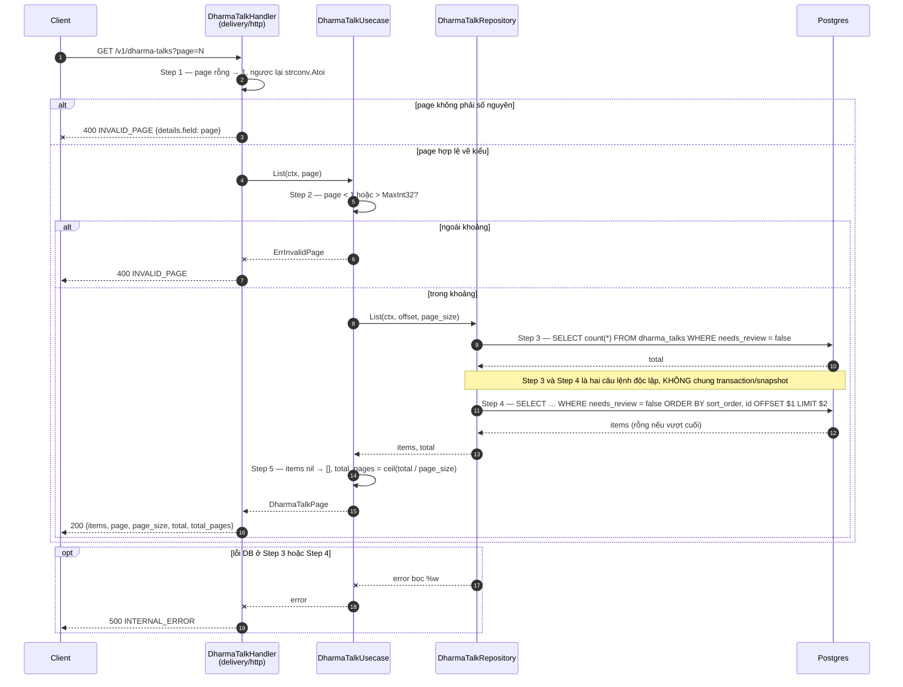
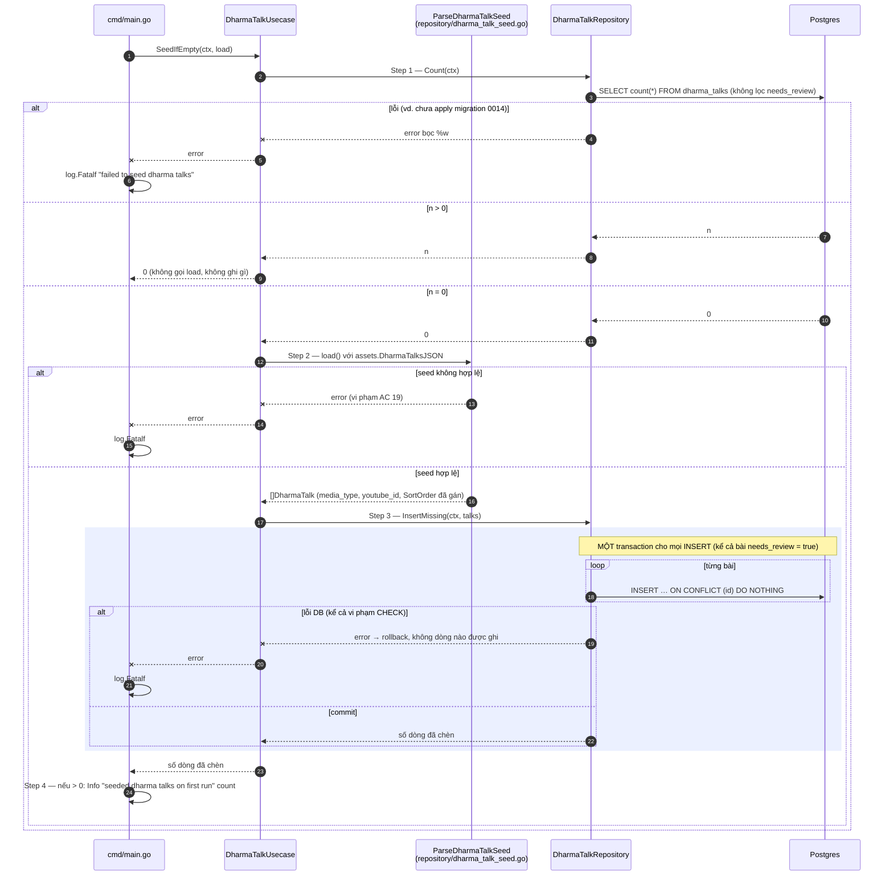

# Flow — dharmatalk

Version: 2.0
Last updated: 2026-10-11
Status: implemented (2026-10-03) — mirror 1:1 của hai Step-by-step Flow trong `design.md`, mỗi Step ở đây trace về đúng Step cùng số. Code đã implement khớp (E2E kiểm chứng seed lần đầu, lần hai không ghi, và bảng toàn bài bị cờ không bị coi là rỗng).
Module: `content`

> See `changelog.md` in this folder for the version history of this spec.

`Get` chỉ một câu SQL nên không có diagram — xem "Request flow" trong `design.md`.

## Sequence — Danh sách phân trang (`GET /v1/dharma-talks?page=N`)

## Sequence — Seed bằng lệnh (cmd/seeddharmatalks; service không tự nạp)

