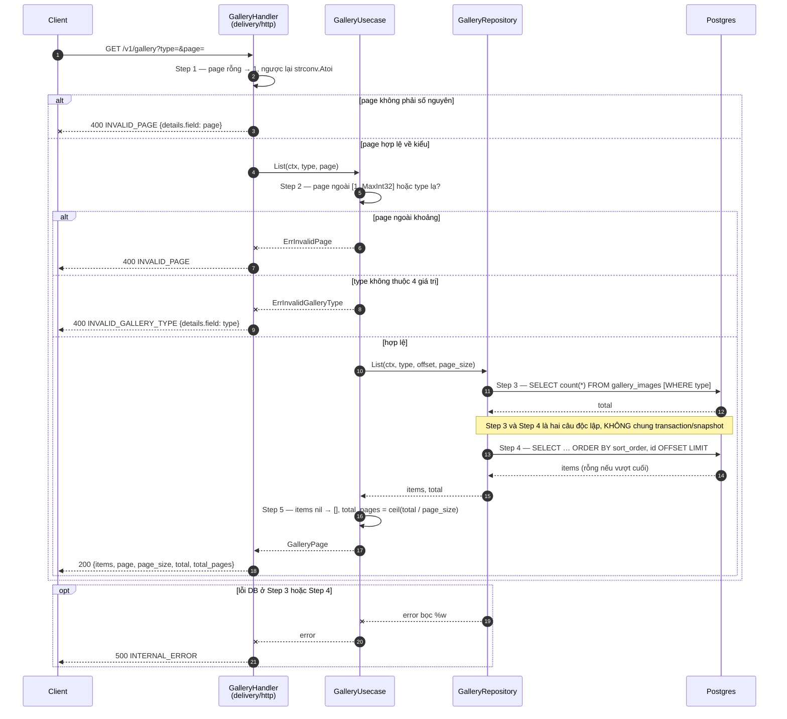
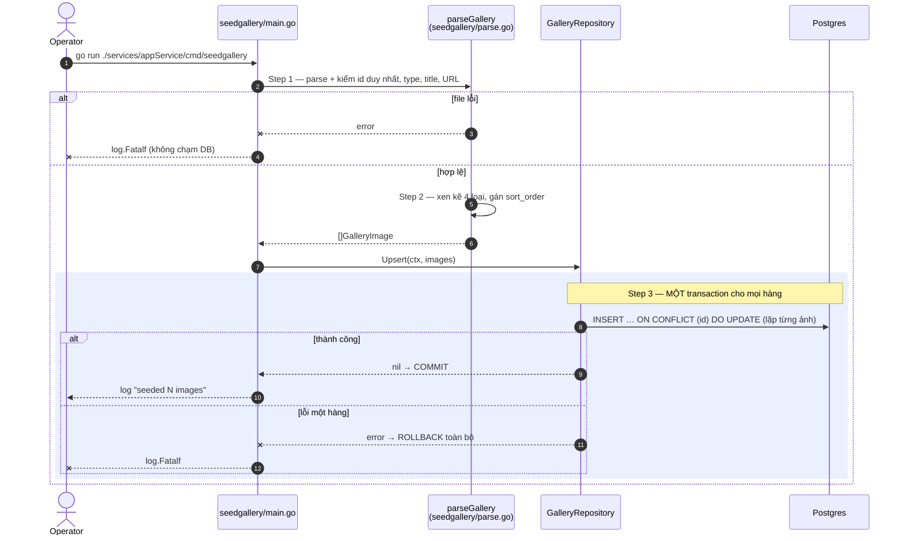

# Flow — gallery

Version: 1.1
Last updated: 2026-10-07
Status: implemented (2026-10-06) — mirror 1:1 của hai Step-by-step Flow trong `design.md`.
Module: `content`

> See `changelog.md` in this folder for the version history of this spec.

`top` và `detail` chỉ một câu SQL nên không có diagram — xem "Request flow" trong `design.md`.

## Sequence — Danh sách phân trang (`GET /v1/gallery?type=&page=`)

## Sequence — Nạp dữ liệu bằng `cmd/seedgallery`

