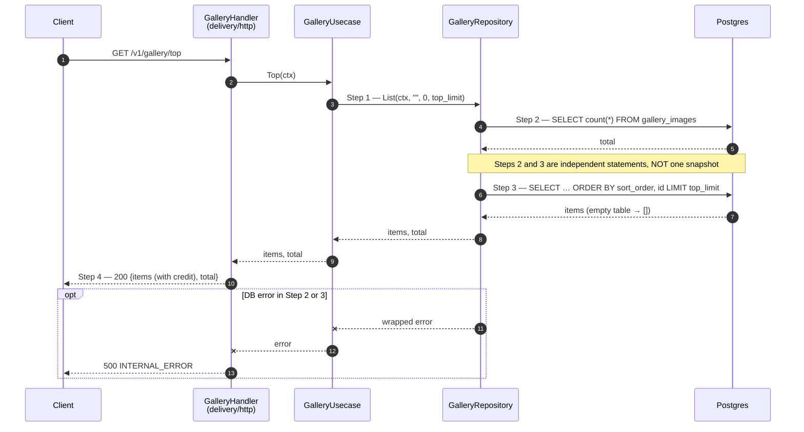
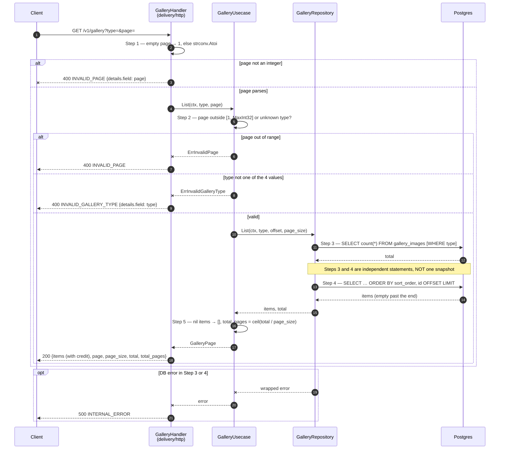
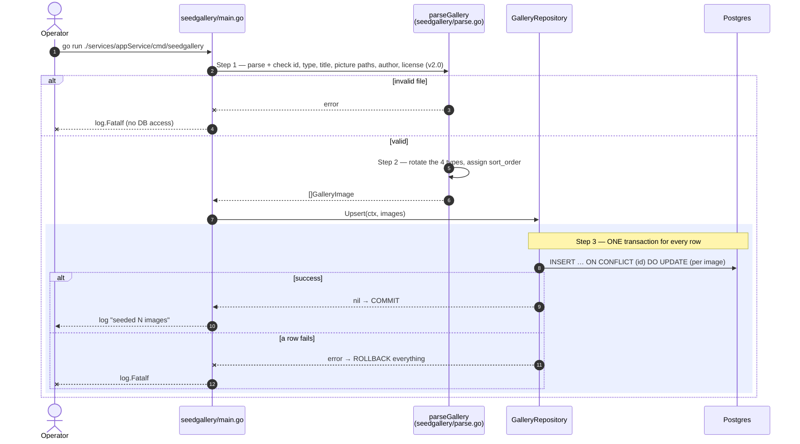

# Flow — gallery

Version: 2.0
Last updated: 2026-10-15
Status: in-progress — mirrors the three Step-by-step Flow sections of `design.md` 1:1; the `top` flow is **v2.0** (not implemented).
Module: `gallery`

> See `changelog.md` in this folder for the version history of this spec.

The detail route is a single SQL statement, so it has no diagram — see "Request flow" in `design.md`.

## Sequence — Featured photos (`GET /v1/gallery/top`) — v2.0

## Sequence — Paged list (`GET /v1/gallery?type=&page=`)

## Sequence — Content load (`cmd/seedgallery`)

