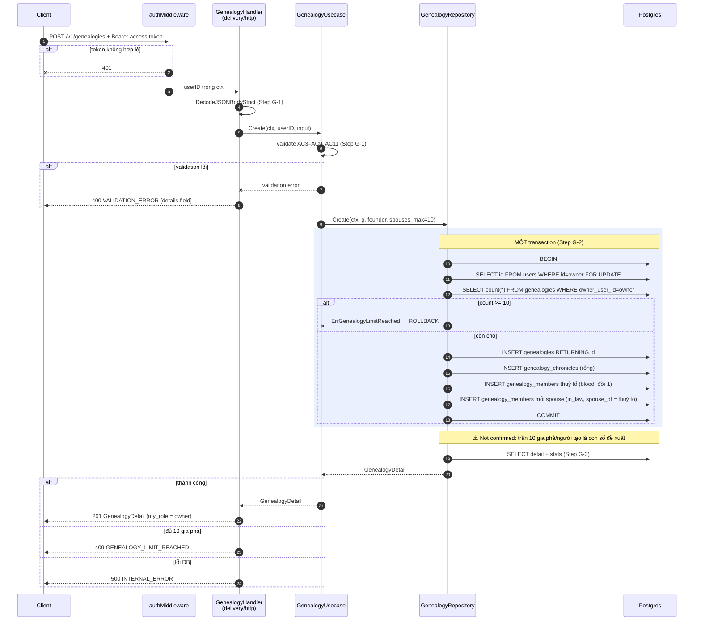
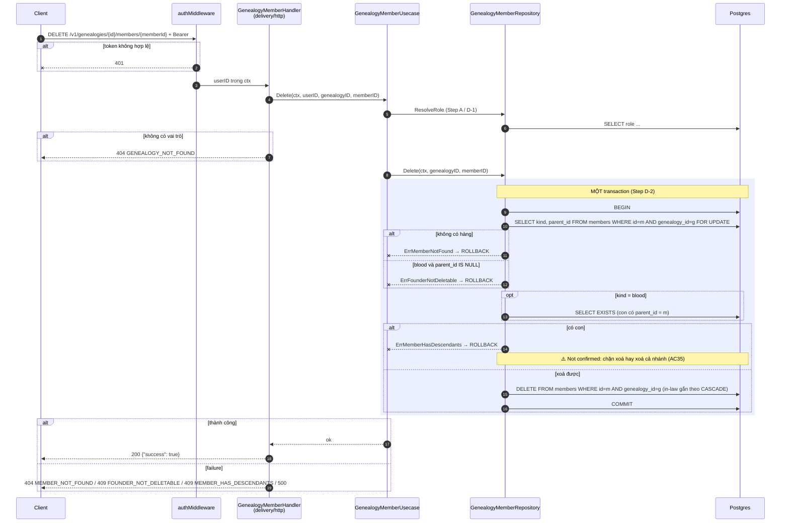
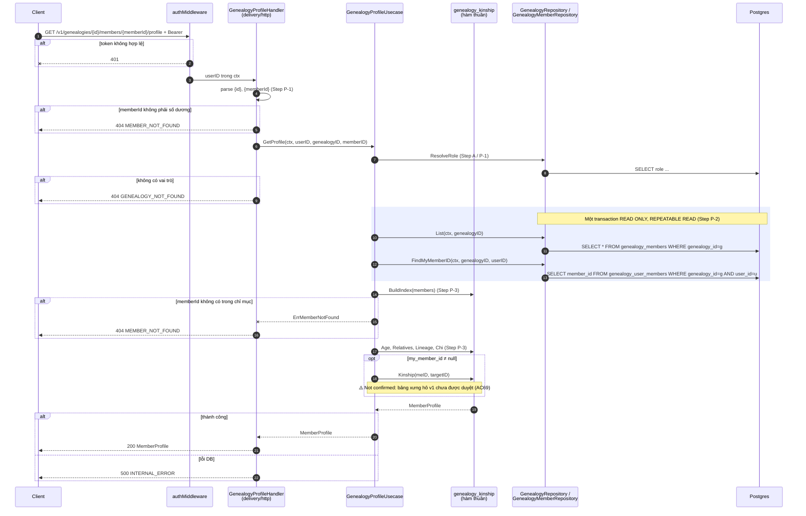

# Flow — genealogy

Version: 3.0
Last updated: 2026-10-08
Status: not started — sơ đồ dự kiến, mirror `design.md` v3.0.
Module: `genealogy`

> See `changelog.md` in this folder for the version history of this spec.

Bản vẽ của sáu section "Step-by-step Flow" trong `design.md` (cùng tên, cùng thứ tự). Mỗi message trace 1:1 về một Step (kể cả Step A dùng chung); không thêm/bỏ bước.

## Sequence — Tạo gia phả (POST /v1/genealogies)



## Sequence — Thêm thành viên (POST /v1/genealogies/{id}/members)

```mermaid
sequenceDiagram
    autonumber
    participant C as Client
    participant M as authMiddleware
    participant H as GenealogyMemberHandler<br/>(delivery/http)
    participant U as GenealogyMemberUsecase
    participant R as GenealogyRepository /<br/>GenealogyMemberRepository
    participant DB as Postgres

    C->>M: POST /v1/genealogies/{id}/members + Bearer
    alt token không hợp lệ
        M--xC: 401
    end
    M->>H: userID trong ctx
    H->>U: Add(ctx, userID, genealogyID, input)
    U->>R: ResolveRole(genealogyID, userID) (Step A / M-1)
    R->>DB: SELECT role FROM genealogies LEFT JOIN genealogy_collaborators
    alt không có vai trò
        R--xU: ErrGenealogyNotFound
        H-->>C: 404 GENEALOGY_NOT_FOUND
    end
    H->>H: DecodeJSONBodyStrict + validate AC4–AC8, AC18, AC21, AC26 (Step M-1)
    alt validation lỗi
        H-->>C: 400 VALIDATION_ERROR {details.field}
    end
    U->>R: Add(ctx, genealogyID, relation, relatedID, member, limits)

    rect rgb(235, 240, 255)
        Note over R,DB: MỘT transaction (Step M-2)
        R->>DB: BEGIN
        R->>DB: SELECT id FROM genealogies WHERE id=g FOR UPDATE
        R->>DB: SELECT kind, generation, gender FROM members WHERE id=related AND genealogy_id=g
        alt không có hàng
            R--xU: ErrMemberNotFound → ROLLBACK
        end
        R->>DB: SELECT count(*) FROM members WHERE genealogy_id=g
        opt relation = spouse
            R->>DB: SELECT count(*) FROM members WHERE spouse_of_id=related
        end
        opt relation = child và có other_parent_id
            R->>DB: SELECT 1 FROM members WHERE id=other AND genealogy_id=g AND kind='in_law' AND spouse_of_id=related
            alt không có hàng
                R--xU: validation other_parent_id → ROLLBACK
            end
        end
        opt relation = child và không gửi birth_order
            R->>DB: SELECT coalesce(max(birth_order),0)+1 FROM members WHERE parent_id=related
        end
        alt vi phạm giới hạn / related là in-law / đời > 60
            R--xU: validation hoặc ErrMemberLimitReached → ROLLBACK
        else hợp lệ
            R->>DB: INSERT genealogy_members RETURNING id, created_at, updated_at
            R->>DB: COMMIT
        end
    end
    Note over R,DB: ⚠️ Not confirmed: trần 5000 thành viên, 60 đời; con của thành viên nữ

    R-->>U: Member
    U->>U: tính in_law_label từ gender người được gắn (Step M-3)
    alt thành công
        U-->>H: Member
        H-->>C: 201 Member
    else failure
        U--xH: sentinel error
        H-->>C: 400 / 404 MEMBER_NOT_FOUND / 409 MEMBER_LIMIT_REACHED / 500
    end
```

## Sequence — Mời người cùng sửa bằng số điện thoại (POST /v1/genealogies/{id}/collaborators)

```mermaid
sequenceDiagram
    autonumber
    participant C as Client
    participant M as authMiddleware
    participant H as GenealogyAccessHandler<br/>(delivery/http)
    participant U as GenealogyAccessUsecase
    participant R as InvitationRepository
    participant DB as Postgres

    C->>M: POST /v1/genealogies/{id}/collaborators {phone_number} + Bearer
    alt token không hợp lệ
        M--xC: 401
    end
    M->>H: userID trong ctx
    H->>U: Invite(ctx, userID, genealogyID, phone)
    U->>R: ResolveRole (Step A / C-1)
    R->>DB: SELECT role ...
    alt không có vai trò
        H-->>C: 404 GENEALOGY_NOT_FOUND
    else role ≠ owner
        H-->>C: 403 GENEALOGY_FORBIDDEN
    end
    U->>U: chuẩn hoá phone_number (hàm của register) (Step C-1)
    Note over U: Không tra user ở bước này — response không phụ thuộc số đã đăng ký (AC45)
    alt sai định dạng
        H-->>C: 400 VALIDATION_ERROR {phone_number}
    end
    U->>R: Create(ctx, genealogyID, phone, invitedBy, max=20)

    rect rgb(235, 240, 255)
        Note over R,DB: MỘT transaction (Step C-2)
        R->>DB: BEGIN
        R->>DB: SELECT id FROM genealogies WHERE id=g FOR UPDATE
        R->>DB: UPDATE genealogy_invitations SET status='expired' (lời mời cũ của số này đã quá hạn)
        R->>DB: kiểm số này không thuộc owner/clan_head/editor (join users theo phone_number)
        R->>DB: kiểm chưa có lời mời pending chưa hết hạn cho số này
        R->>DB: SELECT count(editor) + count(lời mời pending chưa hết hạn)
        alt đã có vai trò
            R--xU: ErrCollaboratorExists → ROLLBACK
        else đã có lời mời chờ
            R--xU: ErrInvitationAlreadyPending → ROLLBACK
        else đủ 20 (editor + lời mời chờ)
            R--xU: ErrCollaboratorLimitReached → ROLLBACK
            Note over R,DB: ⚠️ Not confirmed: trần 20 và việc tính lời mời chờ (AC47)
        else hợp lệ
            R->>DB: INSERT genealogy_invitations (expires_at = now + 30 ngày)
            Note over R,DB: ⚠️ Not confirmed: thời hạn 30 ngày (AC75)
            R->>DB: COMMIT
        end
    end

    alt thành công
        U-->>H: Invitation
        H-->>C: 201 Invitation (chưa cấp quyền; giống nhau dù số đã hay chưa đăng ký)
    else failure
        H-->>C: 409 COLLABORATOR_ALREADY_EXISTS / INVITATION_ALREADY_PENDING / COLLABORATOR_LIMIT_REACHED / 500
    end
```

## Sequence — Chấp nhận lời mời (POST /v1/invitations/{id}/accept)


## Sequence — Xoá thành viên (DELETE /v1/genealogies/{id}/members/{memberId})



## Sequence — Hồ sơ thành viên (GET /v1/genealogies/{id}/members/{memberId}/profile)


