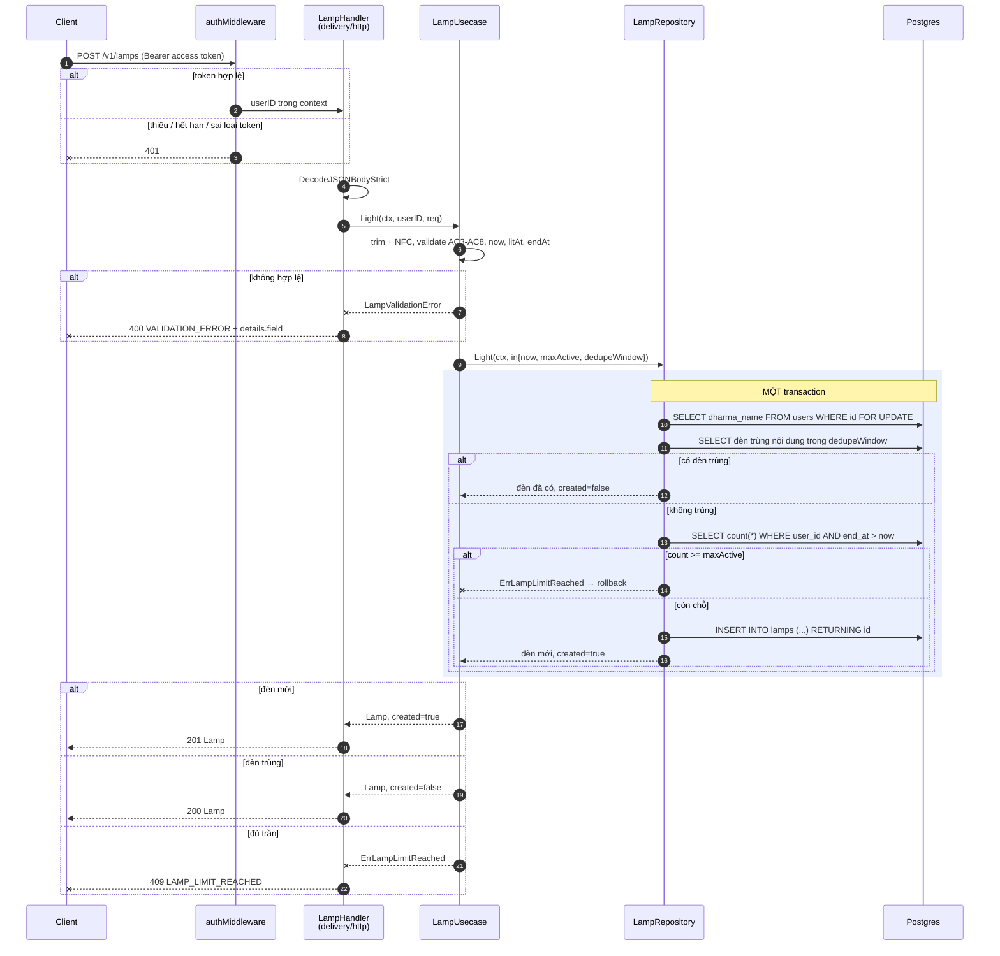
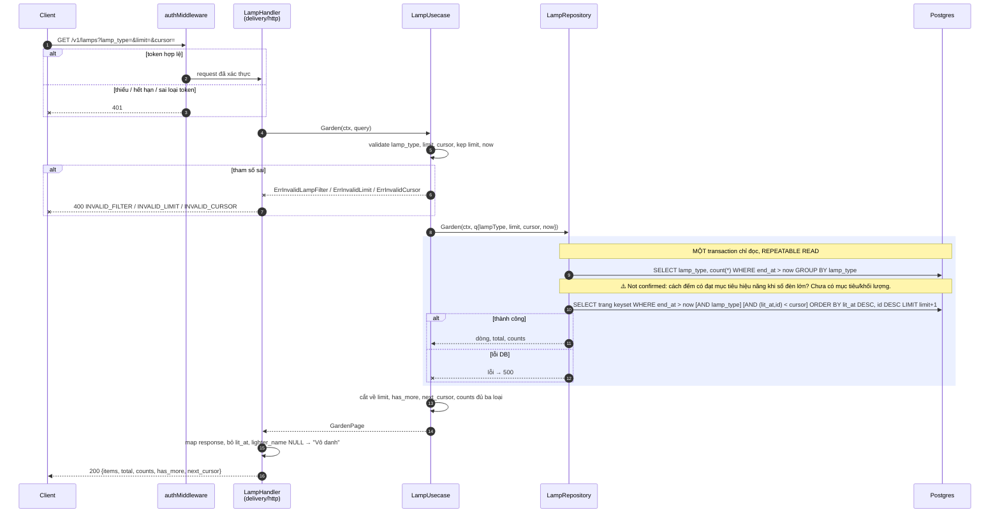

# Flow — lamp

Version: 1.2
Last updated: 2026-10-10
Status: implemented — mirror 1:1 của `design.md` v1.2 (flow thắp đèn và vườn đèn không đổi so với v1.1).
Module: `lamp`

> See `changelog.md` in this folder for the version history of this spec.

## Sequence — Thắp đèn (POST /v1/lamps)

Vẽ lại Step L-1 → L-4 của `design.md`.

## Sequence — Xem vườn đèn (GET /v1/lamps)

Vẽ lại Step G-1 → G-4 của `design.md`.

