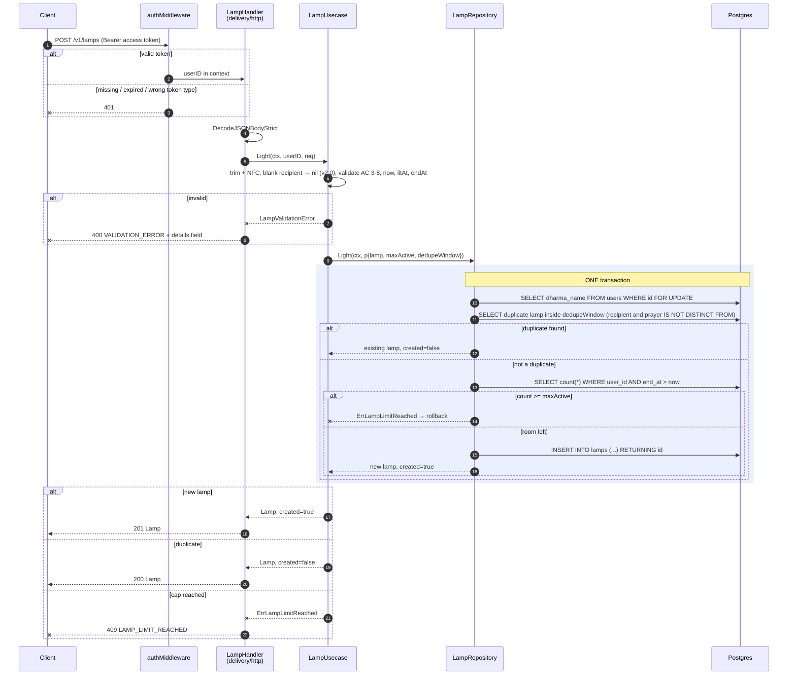
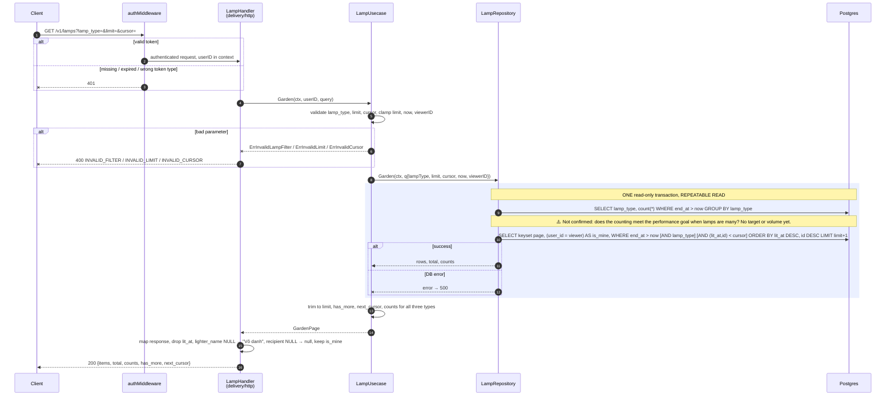

# Flow — lamp

Version: 2.0
Last updated: 2026-10-17
Status: v1 flows implemented; v2.0 changes (blank recipient → `nil`, `IS NOT DISTINCT FROM` on the recipient, `is_mine` in the garden query) are design only. 1:1 mirror of `design.md` v2.0.
Module: `lamp`

> See `changelog.md` in this folder for the version history of this spec.

## Sequence — Light a lamp (POST /v1/lamps)

Redraws Step L-1 → L-4 of `design.md`.

## Sequence — See the lamp garden (GET /v1/lamps)

Redraws Step G-1 → G-4 of `design.md`.

