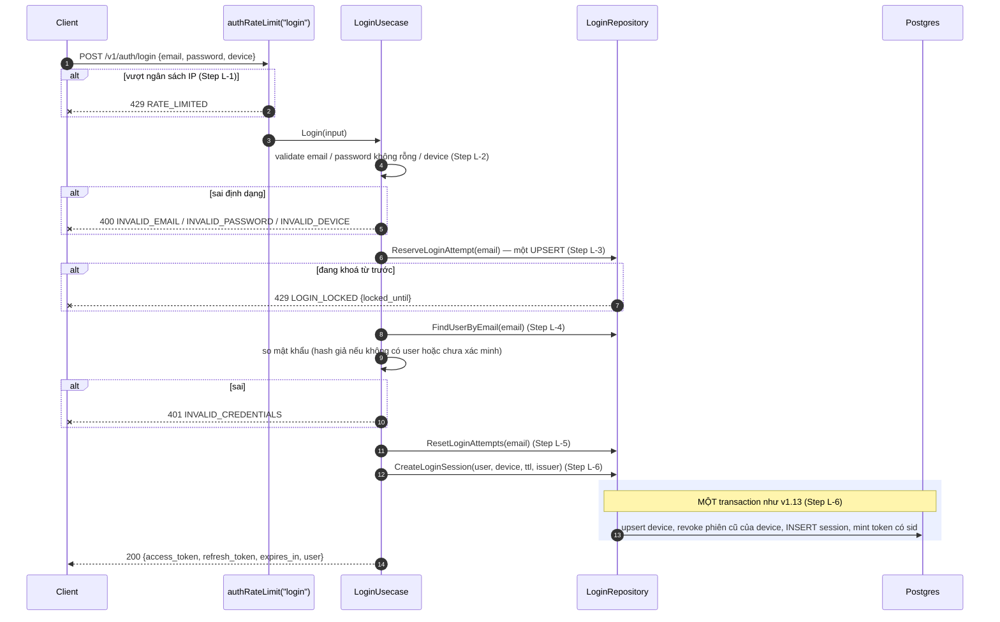
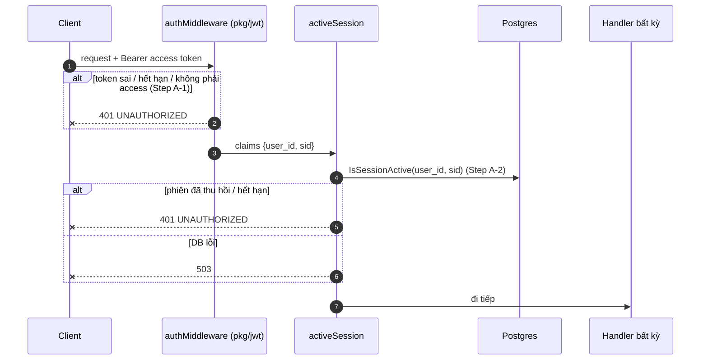
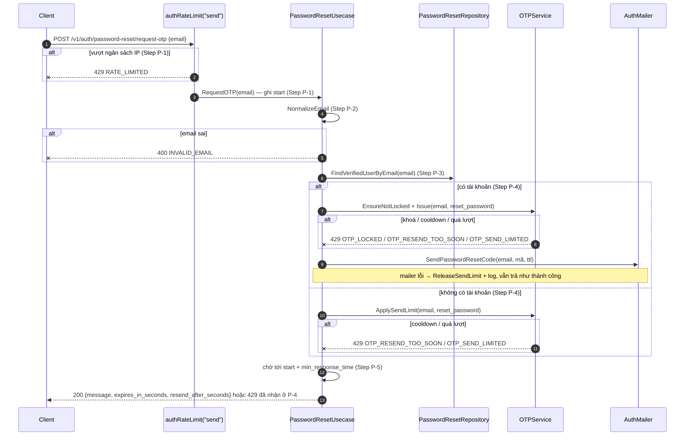
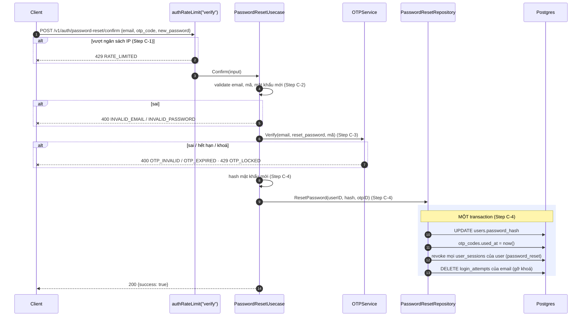

# Flow — login

Version: 2.2
Last updated: 2026-10-14
Status: prospective (v2.0) — đăng nhập bằng email, kiểm phiên còn sống, quên mật khẩu; chưa có code. Sơ đồ refresh/logout của v1.13 không đổi (xem git history bản v1.13 nếu cần).
Module: `identity`

> See `changelog.md` in this folder for the version history of this spec.

Bản vẽ của bốn section "Step-by-step Flow" trong `design.md` (cùng tên, cùng thứ tự). Mỗi message trace
1:1 về một Step; không thêm/bỏ bước.

## Sequence — Login

## Sequence — Kiểm phiên còn sống (mọi route Bearer)

## Sequence — Xin mã đặt lại mật khẩu

## Sequence — Đặt mật khẩu mới

