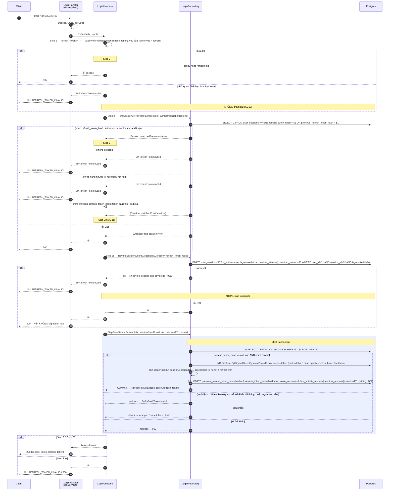
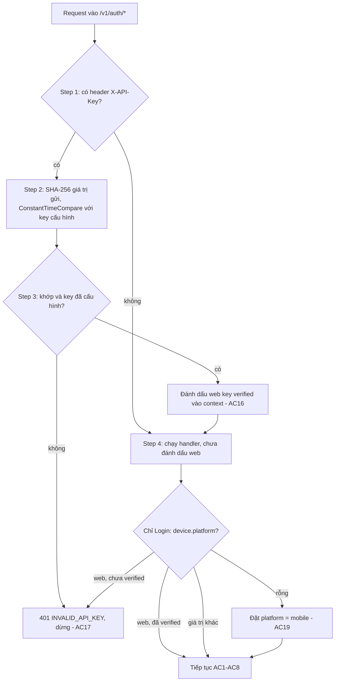
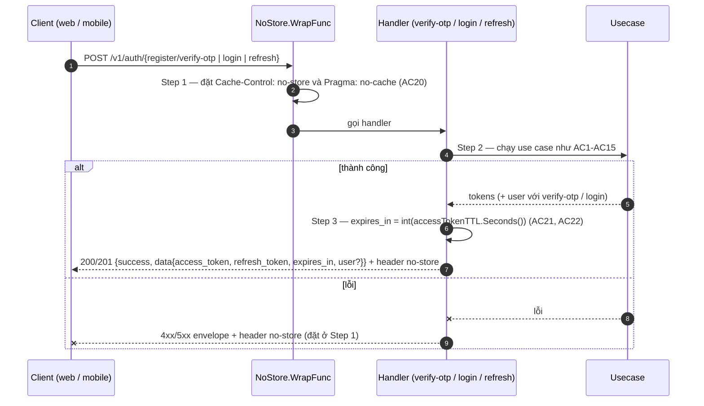

# Flow — login

Version: 1.13
Last updated: 2026-10-10
Status: implemented (2026-09-21) — vẽ lại đúng ba "Step-by-step Flow" của `design.md` (Login,
Refresh, Logout) bằng Mermaid; không thêm, không bớt bước so với `design.md`.
Module: `identity`

> See `changelog.md` in this folder for the version history of this spec.

Ba sequence diagram dưới đây là gương 1:1 của ba section "Step-by-step Flow" trong `design.md`
(cùng tên, cùng thứ tự). Mỗi mũi tên/note trace về đúng một Step (hoặc sub-step `(a)`–`(f)`) của
`design.md`; ngược lại mọi Step của `design.md` đều xuất hiện ở đây. `design.md` §Request flow trỏ
sang file này thay vì giữ song song một bản ASCII.

## Sequence — Login: `POST /v1/auth/login`

```mermaid
sequenceDiagram
    autonumber
    participant C as Client
    participant H as LoginHandler<br/>(delivery/http)
    participant U as LoginUsecase
    participant R as LoginRepository
    participant DB as Postgres

    C->>H: POST /v1/auth/login
    H->>H: DecodeJSONBodyStrict + điền Device.IPAddress/UserAgent từ *http.Request
    H->>U: Login(ctx, input)

    U->>U: Step 1 — NormalizePhone + password != "" + device.platform/device_model != ""
    alt định dạng hợp lệ
        Note over U: → Step 2
    else định dạng sai
        U--xH: ErrInvalidPhone / ErrInvalidPassword / ErrInvalidDevice
        H--xC: 400 INVALID_PHONE / INVALID_PASSWORD / INVALID_DEVICE
        Note over U,DB: KHÔNG chạm DB, KHÔNG đếm login_attempts (AC5, AC6)
    end

    U->>R: Step 2 — FindLoginAttempt(phone)
    R->>DB: SELECT phone_number, failed_count, locked_until, last_failed_at FROM login_attempts WHERE phone_number = $1
    alt không có hàng / locked_until IS NULL / locked_until <= now()
        R-->>U: nil hoặc attempt hết hạn
        Note over U: → Step 3
    else locked_until > now()
        R-->>U: LoginAttempt{LockedUntil}
        U--xH: LoginLockedError{LockedUntil}
        H--xC: 429 LOGIN_LOCKED {locked_until}
        Note over U,R: DỪNG — không tra user, không so mật khẩu (AC7)
    end

    U->>R: Step 3 — FindUserByPhone(phone)
    R->>DB: SELECT <cột tường minh> FROM users WHERE phone_number = $1
    alt có hàng
        R-->>U: user + password_hash thật
    else không có hàng (chưa đăng ký / chỉ pending_registration)
        R-->>U: ErrUserNotFound (nội bộ)
        U->>U: dùng dummyPasswordHash thay password_hash thật
    else lỗi DB
        R--xU: wrapped "find user: %w"
        U--xH: lỗi
        H--xC: 500 INTERNAL_ERROR
    end

    U->>U: Step 4 — bcrypt.CompareHashAndPassword(hash, password) — luôn đúng 1 lần (AC2, timing)
    alt khớp (user tồn tại AND bcrypt khớp)
        Note over U: → Step 6
    else không khớp / user không tồn tại
        U->>R: Step 5 — RecordLoginFailure(phone, maxAttempts=5, lockDuration=15m, resetWindow=15m)
        R->>DB: INSERT INTO login_attempts (...) VALUES (...) ON CONFLICT (phone_number) DO UPDATE SET failed_count=.., locked_until=.. RETURNING failed_count, locked_until
        alt success
            R-->>U: failed_count, locked_until
            U--xH: ErrInvalidCredentials
            H--xC: 401 INVALID_CREDENTIALS
        else lỗi DB
            R--xU: wrapped "record login failure: %w"
            U--xH: lỗi
            H--xC: 500
        end
    end

    U->>R: Step 6 — CreateLoginSession(ctx, user, device, sessionTTL, issuer)
    rect rgb(235, 240, 255)
        Note over R,DB: MỘT transaction
        R->>R: (a) fingerprint = SHA-256(platform|os_version|device_model|user_agent) — tính ở repository, không nhận từ client
        R->>DB: (b) INSERT user_devices (...) ON CONFLICT (user_id, device_id) DO UPDATE ... RETURNING id
        R->>DB: (c) UPDATE user_sessions SET is_revoked=true, revoked_reason='superseded_by_login' WHERE device_id=<id từ b> AND is_revoked=false
        R->>R: (d) sessionID = uuid.NewString(); issuer(userID, sessionID) → access{sid} + refresh — mint TRONG tx
        R->>DB: (e) INSERT user_sessions (user_id, device_id, session_id, refresh_token_hash, token_version=1, expires_at)
        R->>DB: (f) DELETE FROM login_attempts WHERE phone_number = $1 (reset đếm, AC7)
        alt COMMIT
            R-->>U: LoginResult{access_token, refresh_token, user}
        else issuer lỗi
            R--xU: rollback (b)-(f) → wrapped "issue tokens: %w"
        else unique violation (refresh_token_hash / uq_user_sessions_active_device)
            R--xU: rollback → 500 (bug, không phải lỗi người dùng)
        else lỗi DB khác
            R--xU: rollback → wrapped "create login session: %w"
        end
    end

    alt Step 6 COMMIT
        U-->>H: LoginResult
        H-->>C: Step 7 — 200 {access_token, refresh_token, user}
    else Step 6 lỗi
        U--xH: lỗi
        H--xC: 500
    end
```

## Sequence — Refresh: `POST /v1/auth/refresh`



## Sequence — Logout: `POST /v1/auth/logout`

```mermaid
sequenceDiagram
    autonumber
    participant C as Client
    participant M as HTTPAuthMiddleware<br/>(pkg/jwt/middleware)
    participant H as LoginHandler<br/>(delivery/http)
    participant U as LoginUsecase
    participant R as LoginRepository
    participant DB as Postgres

    C->>M: POST /v1/auth/logout (Authorization: Bearer <access_token>)
    M->>M: Step 1 — extract Bearer → jwtService.ValidateToken → kiểm TokenType == access
    alt hợp lệ
        M->>H: WithClaims / WithUserID → Logout
    else thiếu header / token sai / hết hạn / là refresh token
        M--xC: 401 UNAUTHORIZED (ErrorHandler = WriteAuthError)
        Note over M,DB: KHÔNG chạm DB (AC15)
    end

    H->>H: Step 2 — jwtcontext.GetClaims(ctx) → userID = claims.UserID; sid = claims.Extra["sid"].(string)
    alt sid là string không rỗng
        H->>U: Logout(ctx, LogoutInput{UserID, SessionID: sid})
    else thiếu claims, hoặc sid thiếu/sai kiểu (vd token cấp trước khi sửa US-001)
        H--xC: 401 UNAUTHORIZED
        Note over H,DB: KHÔNG chạm DB (AC15)
    end

    U->>R: Step 3 — RevokeSession(ctx, userID, sessionID, reason='logout')
    R->>DB: UPDATE user_sessions SET is_active=false, is_revoked=true, revoked_at=now(), revoked_reason='logout' WHERE user_id=$1 AND session_id=$2 AND is_revoked=false
    alt 1 hàng đổi
        R-->>U: ok
        U-->>H: ok
        H-->>C: 200 {"success": true}
    else 0 hàng đổi (đã revoke / không tồn tại)
        R-->>U: ok — idempotent, không đổi state (AC14)
        U-->>H: ok
        H-->>C: 200 {"success": true}
    else lỗi DB
        R--xU: wrapped "revoke session: %w"
        U--xH: lỗi
        H--xC: 500
    end
```

## Web `X-API-Key` — mọi route `/v1/auth/*` (v1.12)

Vẽ lại 1:1 §Cross-cutting: web `X-API-Key` của `design.md`. Dùng flowchart vì đây là logic rẽ nhánh, không phải chuỗi gọi qua lại.



## Response cấp token — `verify-otp`, `login`, `refresh` (v1.13)

Vẽ lại 1:1 §Cross-cutting: response cấp token của `design.md`.


