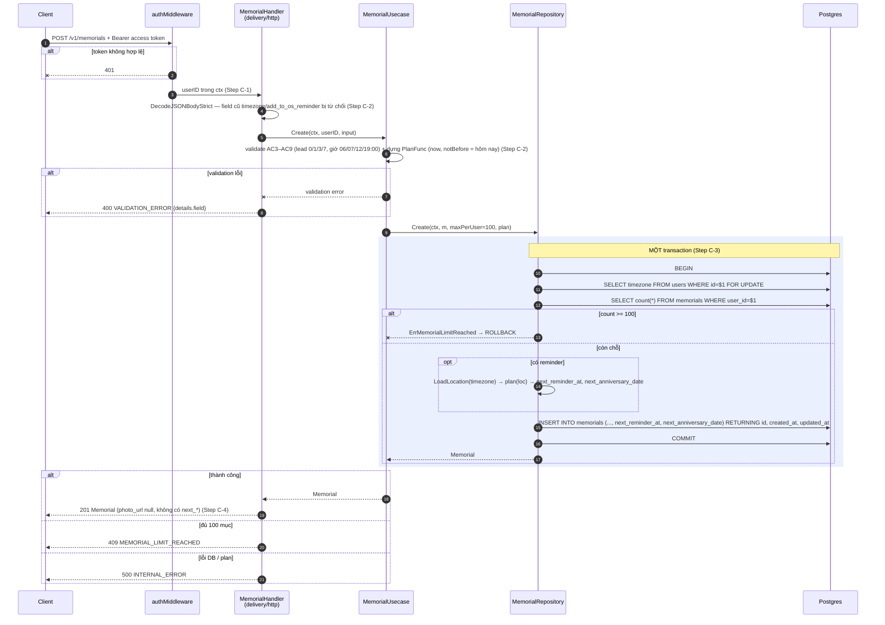
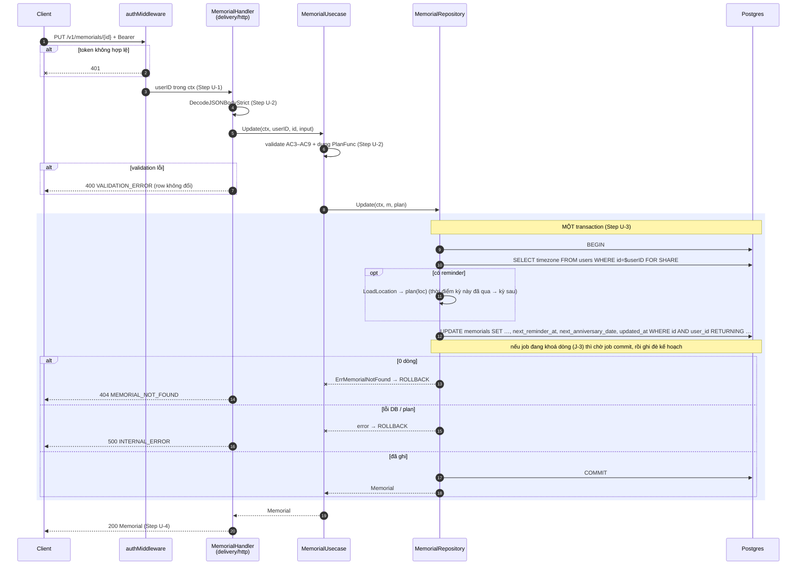
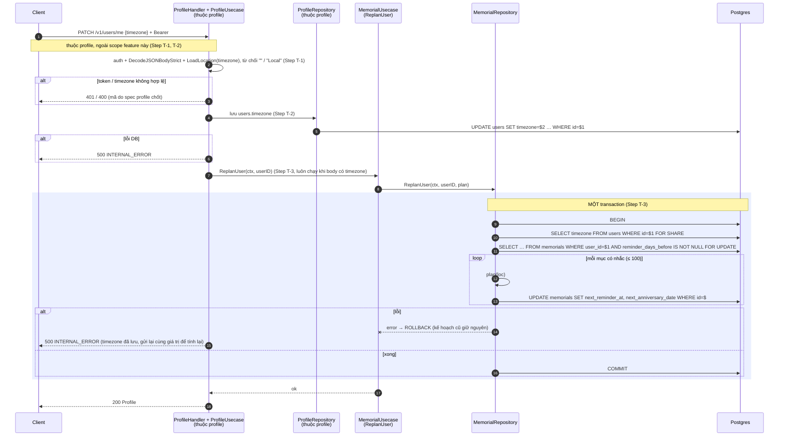
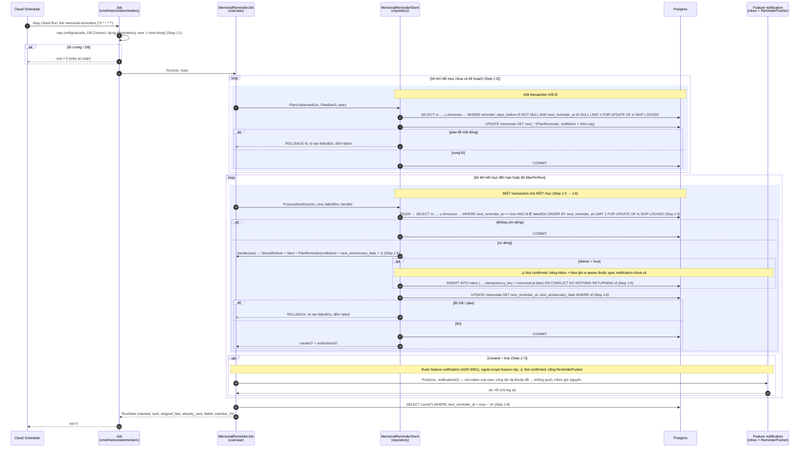
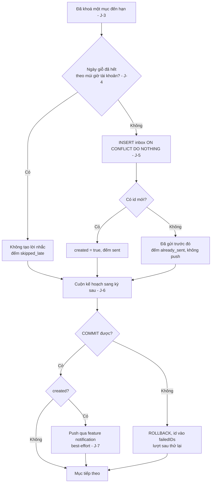
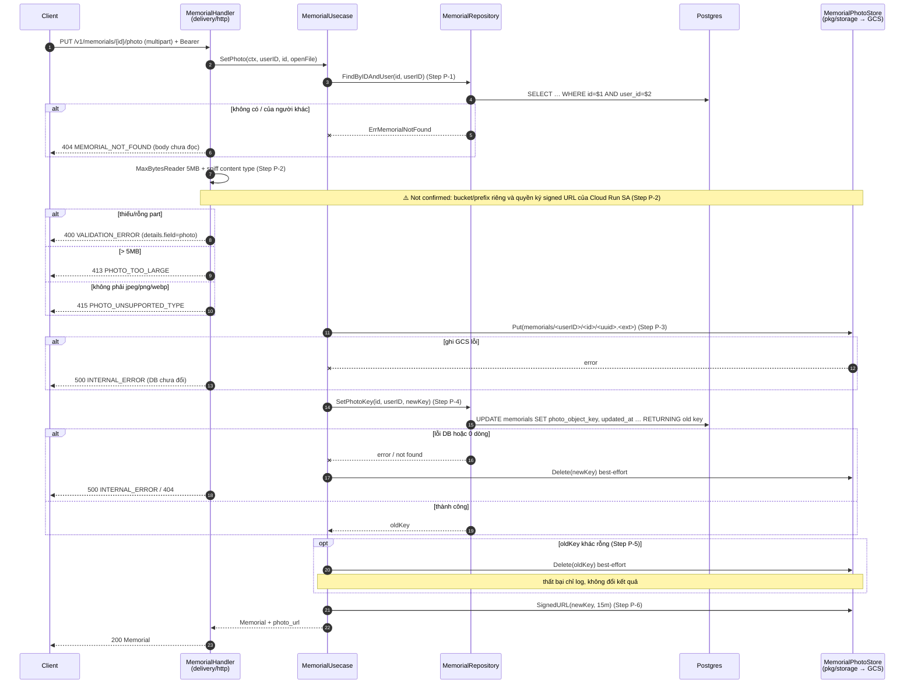
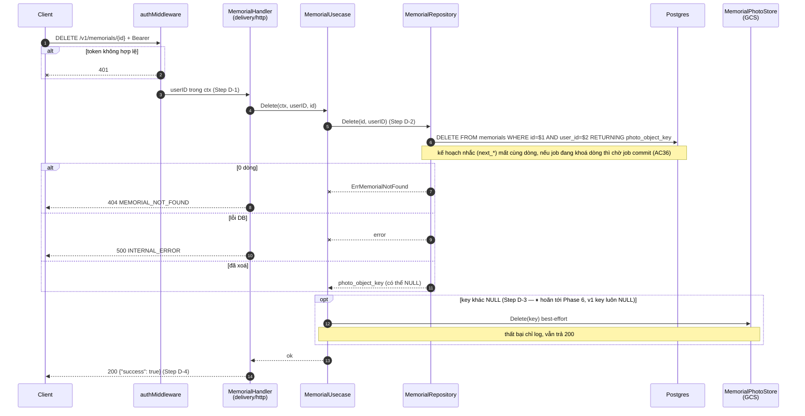

# Flow — memorial

Version: 4.0
Last updated: 2026-10-14
Status: sơ đồ tạo (bản v1) và xoá đã được implement; v4.0 đổi Step C-3 của sơ đồ tạo và thêm sơ đồ Sửa, Báo múi giờ, Job gửi nhắc (chưa implement; J-5/J-7 chờ feature notification); sơ đồ tải/thay ảnh ⏸ hoãn (Phase 6).
Module: `memorial`

> See `changelog.md` in this folder for the version history of this spec.

Bản vẽ của sáu section "Step-by-step Flow" trong `design.md` (cùng tên, cùng thứ tự), cộng một flowchart cho nhánh quyết định của job (J-4..J-7). Mỗi message trace 1:1 về một Step; không thêm/bỏ bước.

## Sequence — Thêm người vào sổ giỗ (POST /v1/memorials)

## Sequence — Sửa một mục (PUT /v1/memorials/{id}) — v4.0

## Sequence — Báo múi giờ tài khoản (PATCH /v1/users/me, field timezone) — v4.0

## Sequence — Job gửi nhắc giỗ hằng giờ (cmd/memorialreminders) — v4.0

## Flowchart — Quyết định cho một mục đến hạn (Step J-4 → J-7)

## Sequence — Tải/thay ảnh (PUT /v1/memorials/{id}/photo)

> ⏸ **HOÃN (Phase 6)** — mirror của flow cùng tên trong `design.md`; chưa implement.

## Sequence — Xoá một mục (DELETE /v1/memorials/{id})

