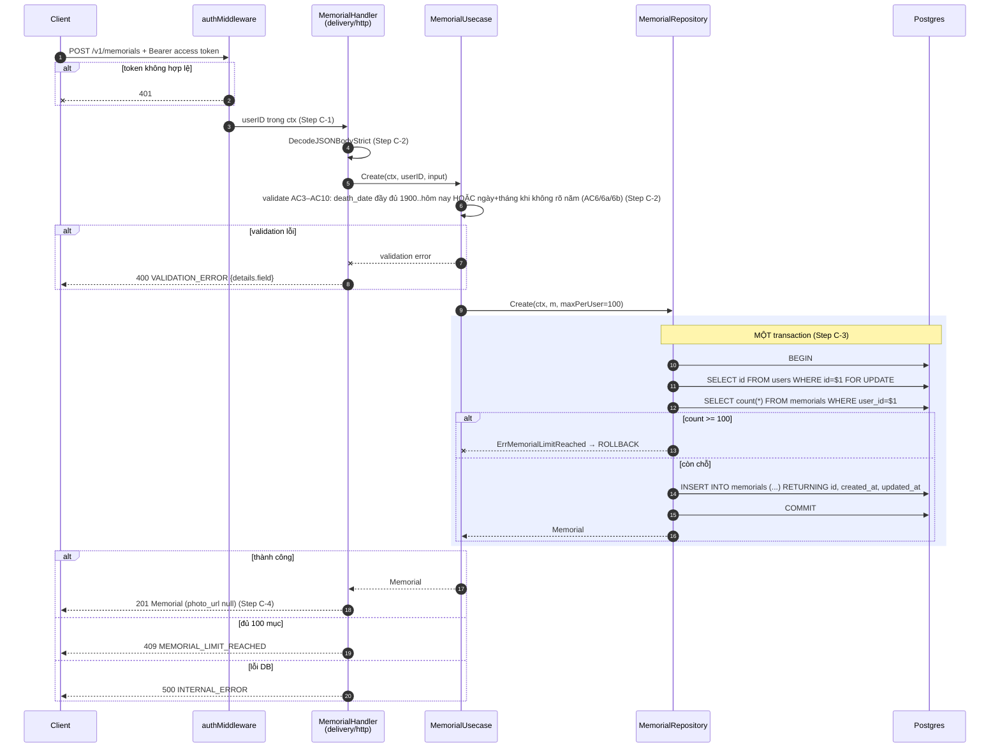
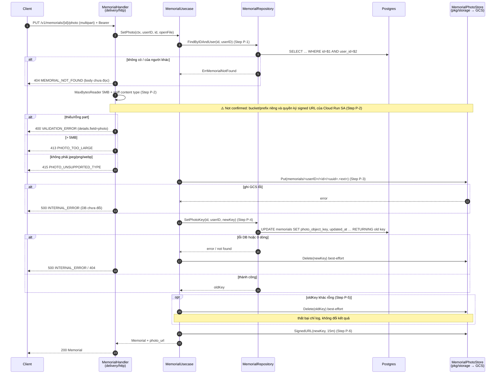

# Flow — memorial

Version: 2.4
Last updated: 2026-10-07
Status: sơ đồ tạo và xoá đã được implement (v1, bước xoá-object ⏸ hoãn); sơ đồ tải/thay ảnh ⏸ hoãn (Phase 6).
Module: `memorial`

> See `changelog.md` in this folder for the version history of this spec.

Bản vẽ của ba section "Step-by-step Flow" trong `design.md` (cùng tên, cùng thứ tự). Mỗi message trace 1:1 về một Step; không thêm/bỏ bước.

## Sequence — Thêm người vào sổ giỗ (POST /v1/memorials)



## Sequence — Tải/thay ảnh (PUT /v1/memorials/{id}/photo)

> ⏸ **HOÃN (Phase 6)** — mirror của flow cùng tên trong `design.md`; v1 không implement.



## Sequence — Xoá một mục (DELETE /v1/memorials/{id})

```mermaid
sequenceDiagram
    autonumber
    participant C as Client
    participant M as authMiddleware
    participant H as MemorialHandler<br/>(delivery/http)
    participant U as MemorialUsecase
    participant R as MemorialRepository
    participant DB as Postgres
    participant S as MemorialPhotoStore<br/>(GCS)

    C->>M: DELETE /v1/memorials/{id} + Bearer
    alt token không hợp lệ
        M--xC: 401
    end
    M->>H: userID trong ctx (Step D-1)
    H->>U: Delete(ctx, userID, id)
    U->>R: Delete(id, userID) (Step D-2)
    R->>DB: DELETE FROM memorials WHERE id=$1 AND user_id=$2 RETURNING photo_object_key
    alt 0 dòng
        R--xU: ErrMemorialNotFound
        H-->>C: 404 MEMORIAL_NOT_FOUND
    else lỗi DB
        R--xU: error
        H-->>C: 500 INTERNAL_ERROR
    else đã xoá
        R-->>U: photo_object_key (có thể NULL)
    end

    opt key khác NULL (Step D-3 — ⏸ hoãn tới Phase 6; v1 key luôn NULL)
        U->>S: Delete(key) best-effort
        Note over U,S: thất bại chỉ log, vẫn trả 200
    end

    U-->>H: ok
    H-->>C: 200 {"success": true} (Step D-4)
```
