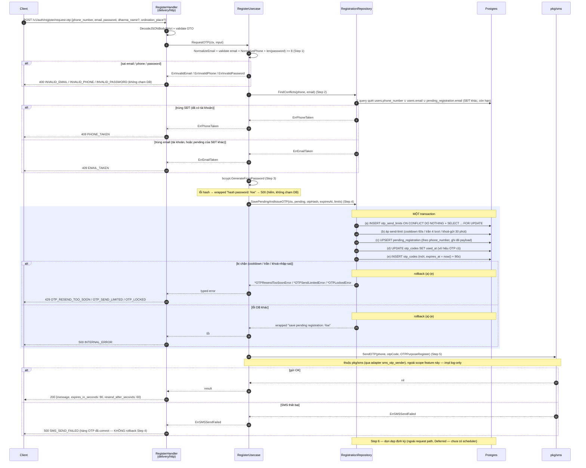
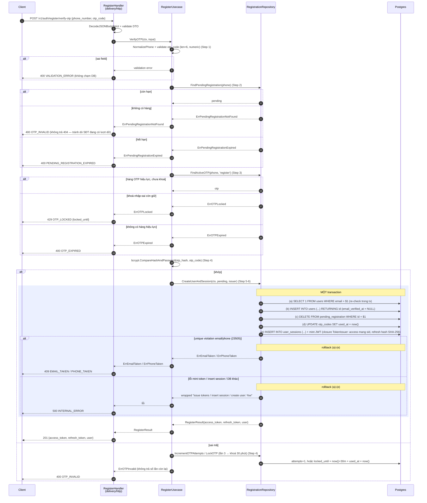

# Flow — onboarding

Version: 6.1
Last updated: 2026-09-25
Status: implemented (US-001) — bản vẽ Mermaid mirror 1:1 ba section "Step-by-step Flow" của `design.md`
Module: `identity`
Code: `services/appService/`
Feature folder: `services/appService/` + `docs/specs/features/onboarding/`

> See `changelog.md` in this folder for the version history of this spec.

<!--
File này là **bản vẽ** (visual) của các section "Step-by-step Flow" trong `design.md`. Nó không thêm
bước mới, không bỏ bước — mỗi mũi tên/message ở đây trace 1:1 về một Step trong `design.md`. Ngược
lại, mỗi Step trong `design.md` phải xuất hiện ở đây. Thấy chỗ lệch là bug của chính file này.

Quy ước:
- Một section `### Sequence — ...` cho MỖI section "Step-by-step Flow — ..." của `design.md` (cùng
  tên, cùng thứ tự). Feature này có **ba** flow: request-otp, verify-otp, resend-otp.
- Transaction của repository được bọc bằng `rect` + `Note over R,DB: MỘT transaction`.
- Bước gửi SMS ghi `Note` "thuộc pkg/sms, ngoài scope feature này" (impl log-only) — không vẽ nội bộ
  của `pkg/sms`.
- Nhãn participant/message viết tiếng Việt ngắn; keyword Mermaid giữ tiếng Anh.
-->

## Sequence — Đăng ký bước 1: yêu cầu OTP (`POST /v1/auth/register/request-otp`)



## Sequence — Đăng ký bước 2: xác thực OTP và tạo tài khoản (`POST /v1/auth/register/verify-otp`)



## Sequence — Gửi lại OTP: `POST /v1/auth/resend-otp`

```mermaid
sequenceDiagram
    autonumber
    participant C as Client
    participant H as RegisterHandler<br/>(delivery/http)
    participant U as RegisterUsecase
    participant R as RegistrationRepository
    participant DB as Postgres
    participant S as pkg/sms

    C->>H: POST /v1/auth/resend-otp {phone_number, purpose}
    H->>H: DecodeJSONBodyStrict + validate DTO
    H->>U: ResendOTP(ctx, input)

    U->>U: NormalizePhone + validate purpose (oneof) (Step 1)
    Note over U: purpose != 'register' → ErrUnsupportedOTPPurpose → 400 (ngoài scope US-001)
    alt sai field
        U--xH: ErrInvalidPhone / validation error
        H--xC: 400 INVALID_PHONE / VALIDATION_ERROR (không chạm DB)
    end

    U->>R: FindPendingRegistration(phone) (Step 2 — chỉ nhánh purpose='register')
    alt còn hạn
        R-->>U: pending
    else không có hàng
        R--xU: ErrPendingRegistrationNotFound
        U--xH: ErrPendingRegistrationNotFound
        H--xC: 400 OTP_INVALID
    else hết hạn (quá 24h)
        R--xU: ErrPendingRegistrationExpired
        U--xH: ErrPendingRegistrationExpired
        H--xC: 400 PENDING_REGISTRATION_EXPIRED
    end

    U->>R: FindActiveOTP(phone, purpose) (Step 3 — chỉ kiểm khoá-nhập-sai)
    alt khoá-nhập-sai còn giữ
        R--xU: ErrOTPLocked
        U--xH: ErrOTPLocked
        H--xC: 429 OTP_LOCKED {locked_until}
    end

    U->>R: ReissueOTP(ctx, phone, purpose, otpHash, expiresAt, limits) (Step 4)
    rect rgb(235, 240, 255)
        Note over R,DB: MỘT transaction
        R->>DB: (a) INSERT otp_send_limits ON CONFLICT DO NOTHING + SELECT ... FOR UPDATE
        R->>DB: (b) áp send-limit (cooldown 60s / trần 4 lượt / khoá-gửi 30 phút)
        R->>DB: (c) UPDATE otp_codes SET used_at (vô hiệu OTP cũ)
        R->>DB: (d) INSERT otp_codes (mới, expires_at = now() + 90s; KHÔNG đụng pending_registration)
        alt bị chặn (cooldown / trần / khoá-gửi)
            Note over R,DB: rollback (a)-(d)
            R--xU: *OTPResendTooSoonError / *OTPSendLimitedError
            U--xH: typed error
            H--xC: 429 OTP_RESEND_TOO_SOON / OTP_SEND_LIMITED
        else lỗi DB khác
            Note over R,DB: rollback (a)-(d)
            R--xU: wrapped "reissue otp: %w"
            U--xH: lỗi
            H--xC: 500 INTERNAL_ERROR
        end
    end

    U->>S: SendOTP(phone, otpCode, purpose) (Step 5)
    Note over U,S: thuộc pkg/sms (qua adapter sms_otp_sender), ngoài scope feature này — impl log-only
    alt gửi OK
        S-->>U: nil
        U-->>H: result
        H-->>C: 200 {message, expires_in_seconds: 90, resend_after_seconds: 60, resend_remaining}
    else SMS thất bại
        S--xU: ErrSMSSendFailed
        U--xH: ErrSMSSendFailed
        H--xC: 500 SMS_SEND_FAILED (send_count đã tăng + OTP cũ đã vô hiệu — KHÔNG rollback)
    end
```
