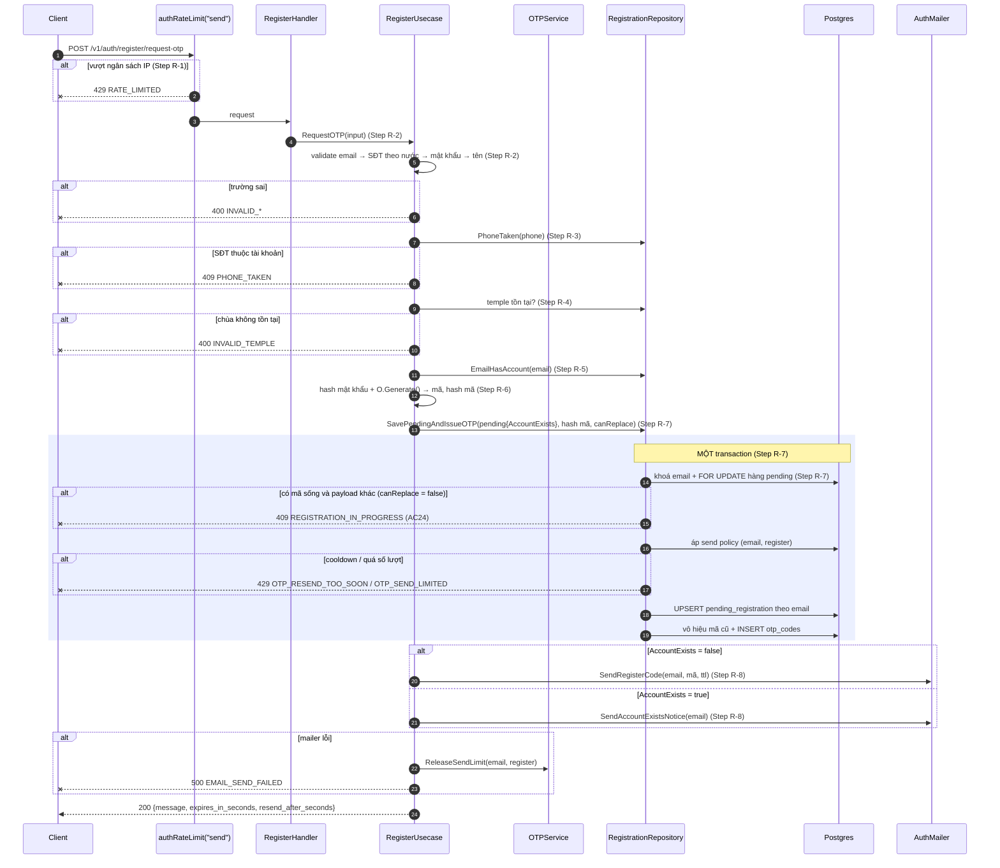
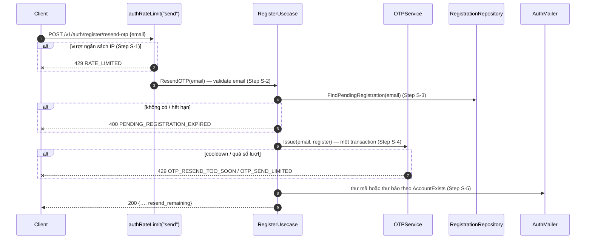
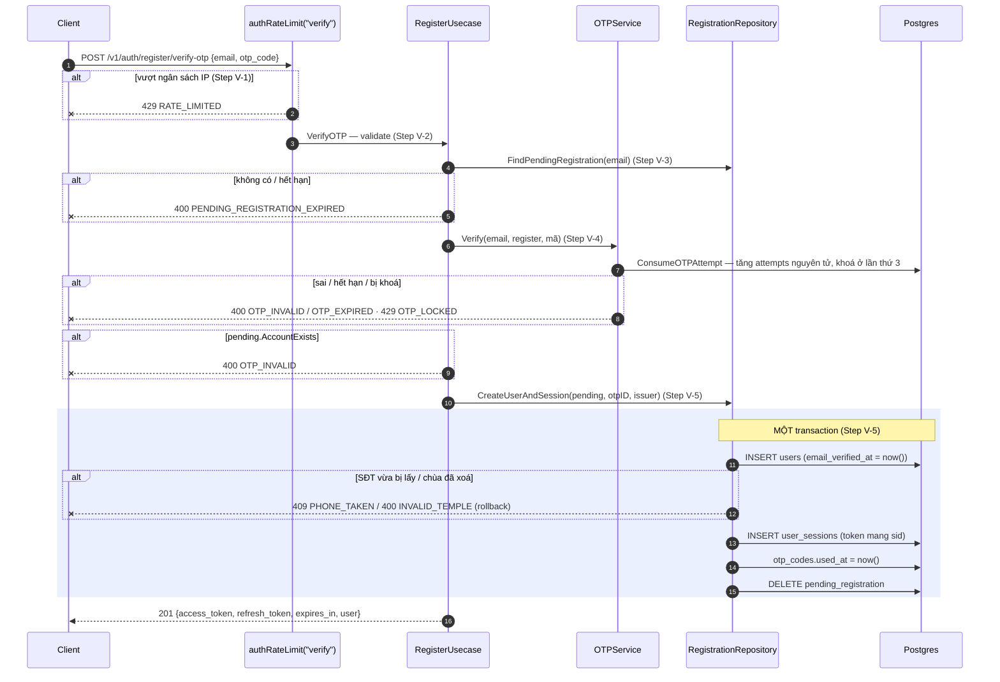

# Flow — onboarding

Version: 8.2
Last updated: 2026-10-16
Status: implemented (v8.2) — đăng ký xác minh bằng email chạy thật (mailer `log` ở dev). Còn mở: giới hạn theo IP (AC22, login Phase 5), `erd.svg`, OpenAPI, OKF — xem `tasks.md`.
Module: `identity`

> See `changelog.md` in this folder for the version history of this spec.

Bản vẽ của ba section "Step-by-step Flow" trong `design.md` (cùng tên, cùng thứ tự). Mỗi message trace
1:1 về một Step; không thêm/bỏ bước.

## Sequence — Bước 1: request-otp

## Sequence — resend-otp

## Sequence — Bước 2: verify-otp

