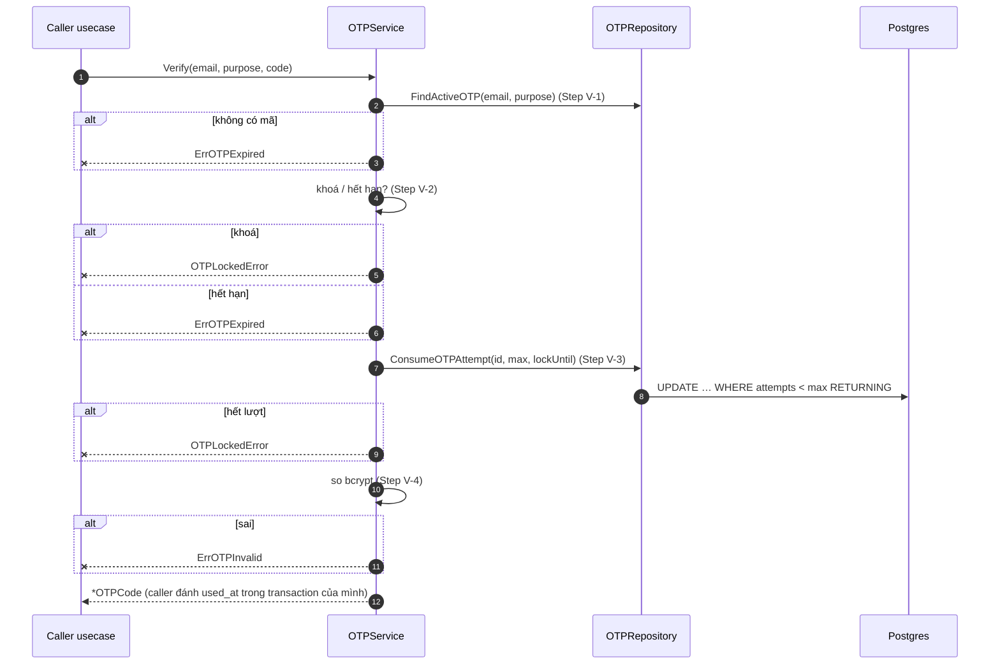

# Flow — otp-mechanism

Version: 2.1
Last updated: 2026-10-16
Status: implemented (v2.1) — cơ chế OTP khoá theo email, gửi qua `AuthMailer`, mã `crypto/rand` (mã cố định chỉ ở dev), đếm lượt nguyên tử bằng `ConsumeOTPAttempt`.
Module: `otp`

> See `changelog.md` in this folder for the version history of this spec.

Bản vẽ của hai section "Step-by-step Flow" trong `design.md`. Mỗi message trace 1:1 về một Step.

## Sequence — Issue

```mermaid
sequenceDiagram
    autonumber
    participant UC as Caller usecase<br/>(register / password reset)
    participant S as OTPService
    participant R as OTPRepository
    participant DB as Postgres

    UC->>S: Issue(email, purpose)
    S->>S: Generate() — crypto/rand hoặc mã dev + bcrypt (Step I-1)
    S->>R: IssueOTP(email, purpose, hash, expiresAt, limits) (Step I-2)
    rect rgb(235, 240, 255)
        Note over R,DB: MỘT transaction (Step I-2)
        R->>DB: applySendLimits (email, purpose) FOR UPDATE
        alt cooldown / quá lượt
            R--xUC: OTPResendTooSoonError / OTPSendLimitedError (rollback)
        end
        R->>DB: invalidateActiveOTP
        R->>DB: insertOTP
    end
    S-->>UC: {Code, ExpiresAt, ResendRemaining} (Step I-3)
    Note over UC: caller gửi thư; lỗi → ReleaseSendLimit
```

## Sequence — Verify


