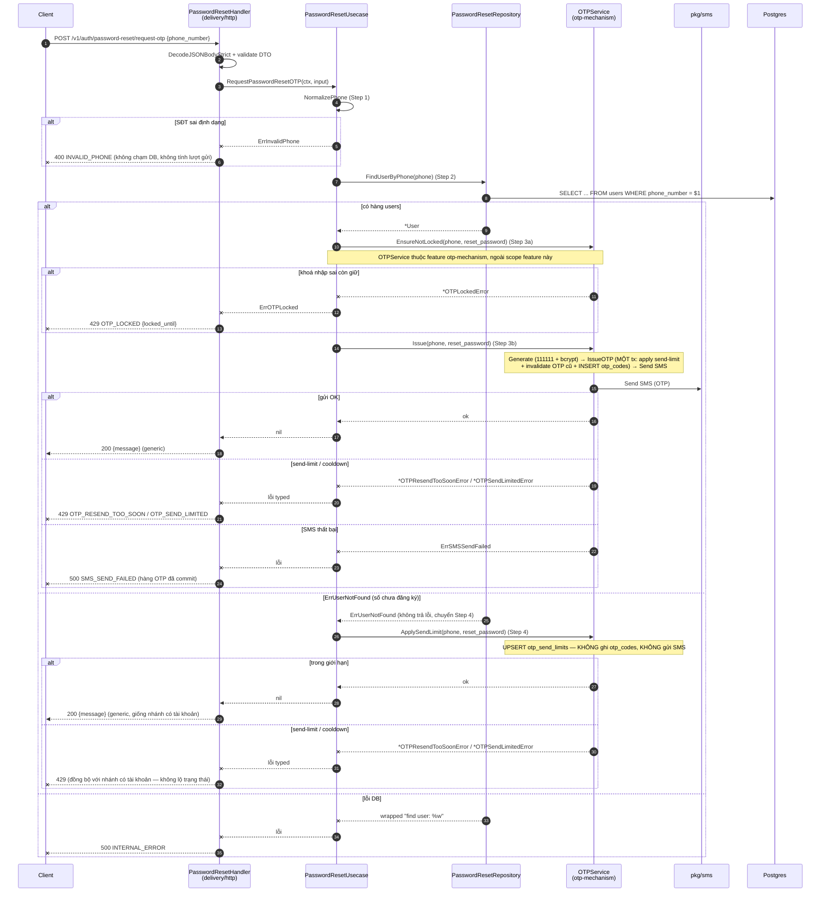
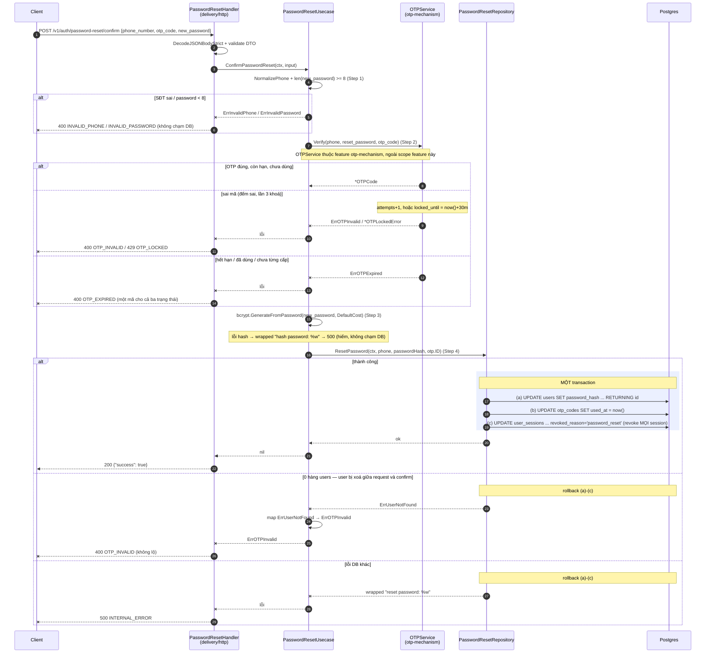

# Flow — password-reset

Version: 1.1
Last updated: 2026-09-25
Status: prospective — chưa có code; bản vẽ Mermaid mirror 1:1 các section "Step-by-step Flow" trong `design.md`
Module: `identity`
Code: `services/appService/`
Feature folder: `services/appService/` + `docs/specs/features/password-reset/`

> See `changelog.md` in this folder for the version history of this spec.

<!--
File này là **bản vẽ** (visual) của các section "Step-by-step Flow" trong `design.md`. Nó không thêm
bước mới, không bỏ bước — mỗi mũi tên/message ở đây trace 1:1 về một Step trong `design.md`. Ngược
lại, mỗi Step trong `design.md` phải xuất hiện ở đây. Thấy chỗ lệch là bug của chính file này.

Quy ước:
- Một section `### Sequence — ...` cho MỖI section "Step-by-step Flow — ..." của `design.md` (cùng
  tên, cùng thứ tự).
- `OTPService` là cơ chế dùng chung thuộc feature `otp-mechanism` — bước gọi sang nó được ghi rõ
  bằng `Note` là "ngoài scope feature này", không vẽ nội bộ SQL của nó (đó là việc của spec
  `otp-mechanism`). Chỉ transaction của chính feature này (`ResetPassword`) được vẽ bằng `rect`.
- Nhãn participant/message viết tiếng Việt ngắn; keyword Mermaid giữ tiếng Anh.
-->

## Sequence — Request OTP: `POST /v1/auth/password-reset/request-otp`

## Sequence — Confirm: `POST /v1/auth/password-reset/confirm`

