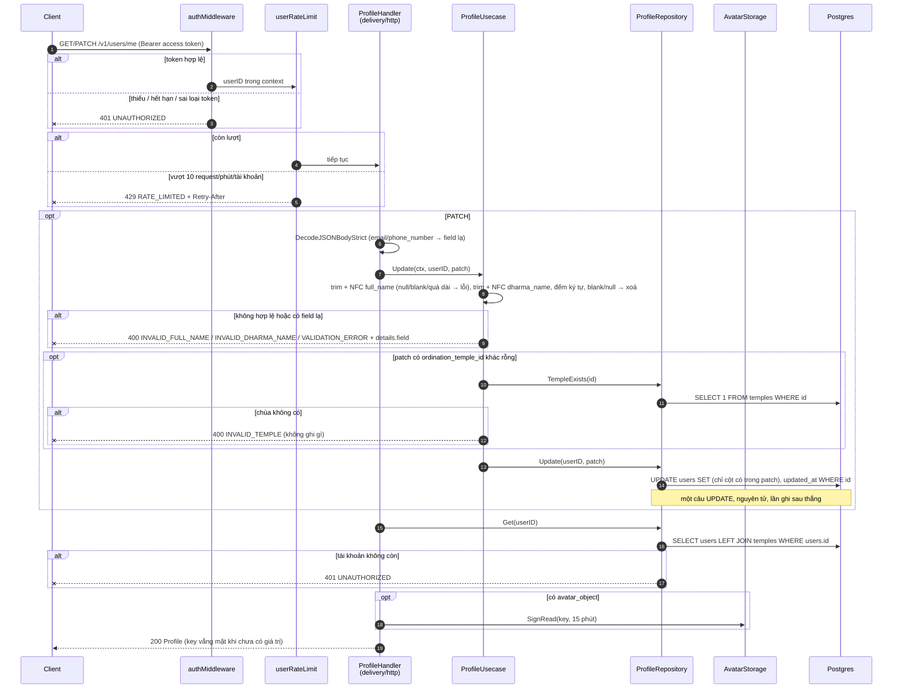
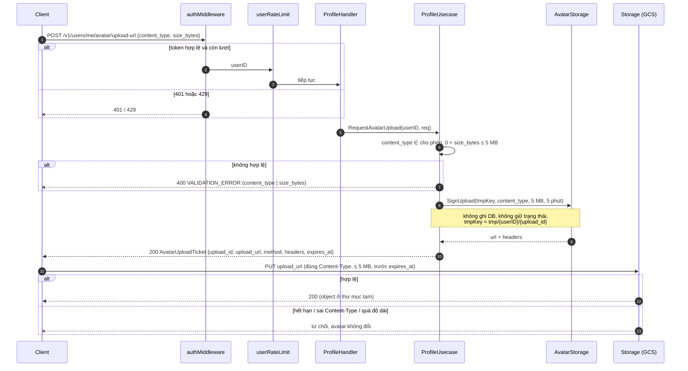
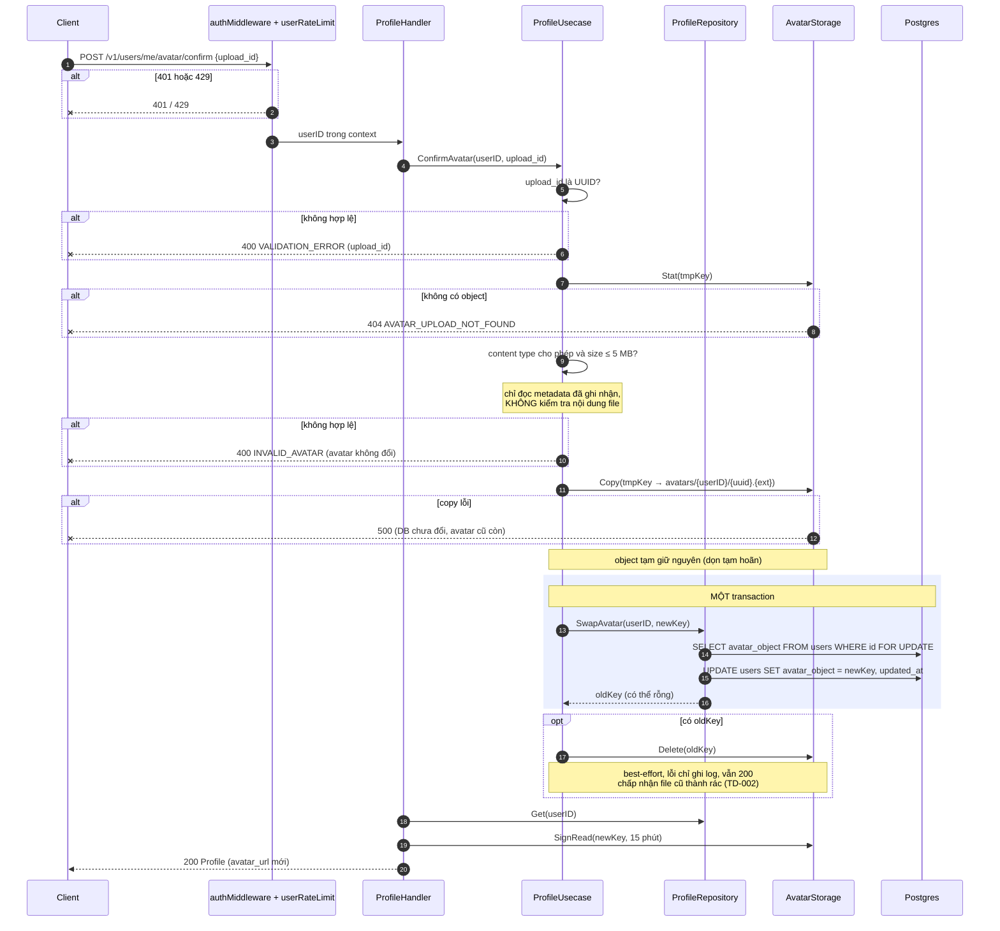
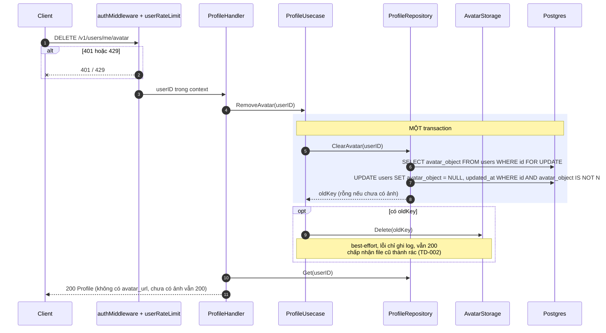

# Flow — profile

Version: 1.5
Last updated: 2026-10-11
Status: implemented — mirror 1:1 của `design.md` v1.4 (không đổi bước nào so với v1.0).
Module: `profile`

> See `changelog.md` in this folder for the version history of this spec.

## Sequence — Đọc và sửa hồ sơ (GET / PATCH /v1/users/me)

Vẽ lại Step P-1 → P-7 của `design.md`.

## Sequence — Xin quyền upload avatar (POST /v1/users/me/avatar/upload-url)

Vẽ lại Step U-1 → U-6 của `design.md`.

## Sequence — Xác nhận avatar (POST /v1/users/me/avatar/confirm)

Vẽ lại Step C-1 → C-8 của `design.md`.

## Sequence — Gỡ avatar (DELETE /v1/users/me/avatar)

Vẽ lại Step D-1 → D-4 của `design.md`.

