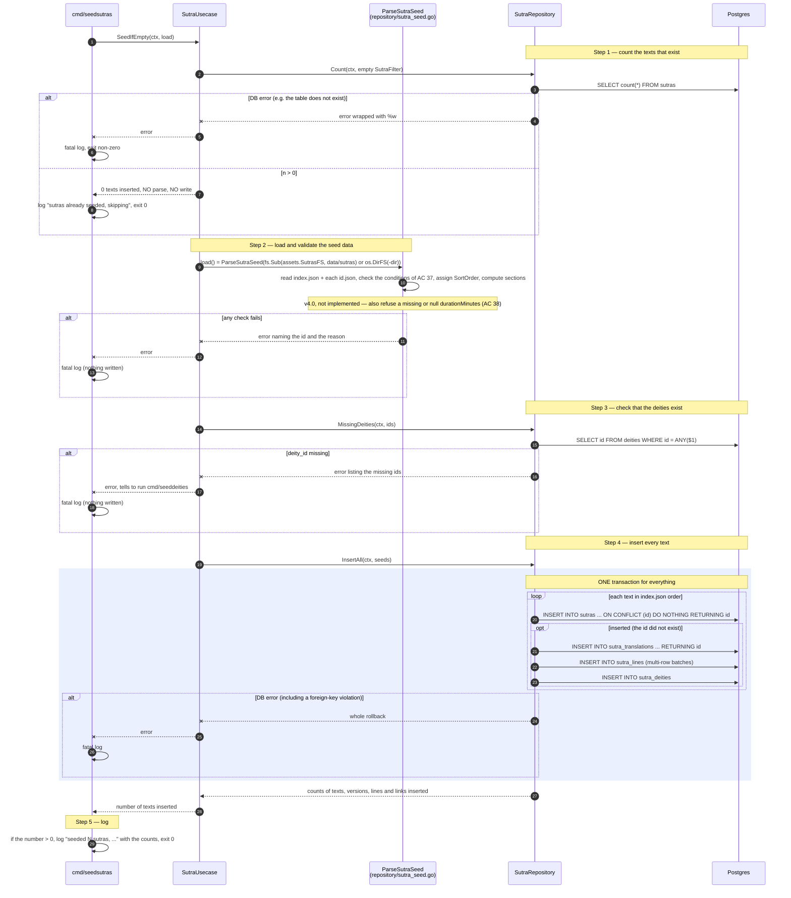
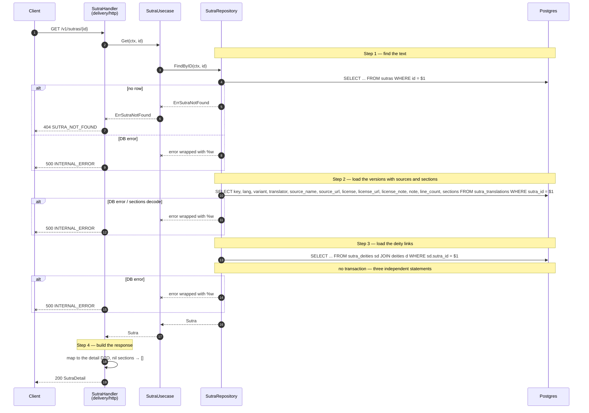
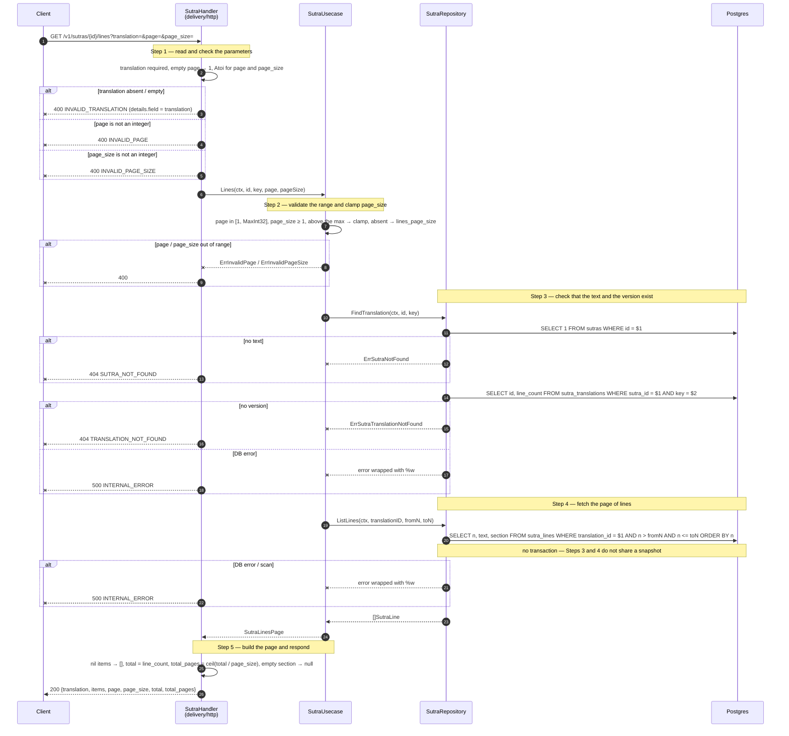
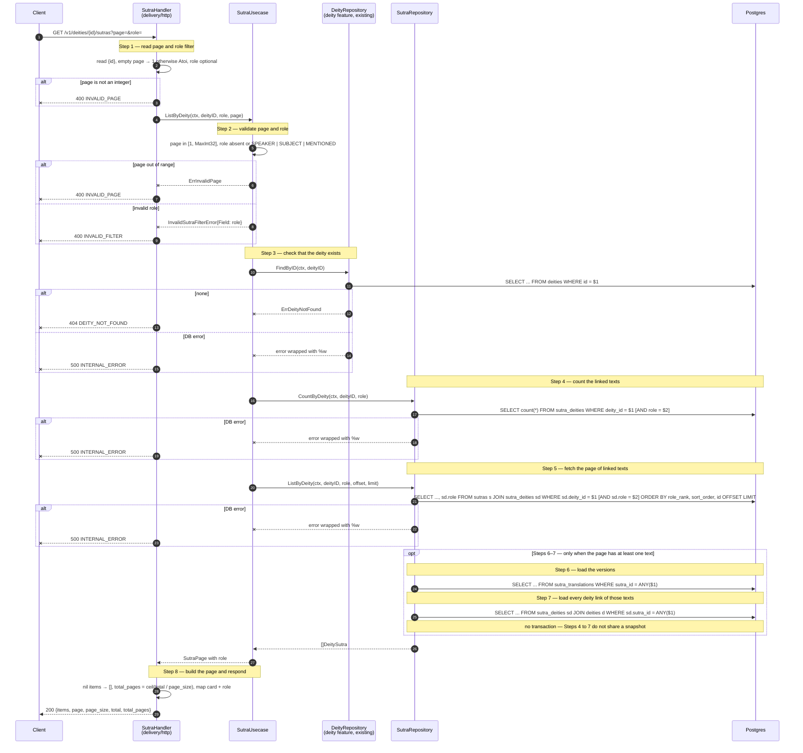

# Flow — sutra

Version: 4.0
Last updated: 2026-10-16
Status: implemented — 1:1 mirror of the five Step-by-step Flow sections of `design.md`; each Step here traces to the Step with the same number there. The v4.0 part (Step 2 of the load also refuses a missing `durationMinutes`, AC 38) is drawn as a `Note` and is not implemented.
Module: `sutra`

> See `changelog.md` in this folder for the version history of this spec.

All four read routes make two or more sequential DB calls, so every one has a diagram. The diagrams follow the implemented code (checked step by step against `usecase/sutra_usecase.go`, `repository/postgres_sutra_repository.go` and `delivery/http/sutra_handler.go`).

## Sequence — Load the library (cmd/seedsutras; the service does not seed)



## Sequence — List, filter and search (`GET /v1/sutras`)

```mermaid
sequenceDiagram
    autonumber
    participant C as Client
    participant H as SutraHandler<br/>(delivery/http)
    participant U as SutraUsecase
    participant R as SutraRepository
    participant DB as Postgres

    C->>H: GET /v1/sutras?page=&tradition=&kind=&collection=&purpose=&daily=&max_minutes=&lang=&q=
    Note over H: Step 1 — read page and filters
    H->>H: empty page → 1, otherwise Atoi; read the filters and q
    alt page is not an integer
        H--xC: 400 INVALID_PAGE (details.field = page)
    end
    H->>U: List(ctx, filter, page)

    Note over U: Step 2 — validate the page range and the filter values
    U->>U: page in [1, MaxInt32], enums, daily, max_minutes ≥ 1, no empty value, q trimmed to 1–100 runes
    alt page out of range
        U--xH: ErrInvalidPage
        H--xC: 400 INVALID_PAGE
    else invalid filter (including q)
        U--xH: InvalidSutraFilterError{Field}
        H--xC: 400 INVALID_FILTER (details.field)
    end

    Note over R,DB: Step 3 — count the matching texts
    U->>R: Count(ctx, filter)
    R->>DB: SELECT count(*) FROM sutras WHERE (filters ANDed, q via unaccent LIKE on titles, collection, reference)
    alt DB error
        R--xU: error wrapped with %w
        H--xC: 500 INTERNAL_ERROR
    end

    Note over R,DB: Step 4 — fetch the page of texts
    U->>R: List(ctx, filter, offset, limit)
    R->>DB: SELECT ... FROM sutras WHERE (same conditions) ORDER BY sort_order, id OFFSET LIMIT
    alt DB error
        R--xU: error wrapped with %w
        H--xC: 500 INTERNAL_ERROR
    end

    opt Steps 5–6 — only when the page has at least one text
        Note over R,DB: Step 5 — load the versions
        R->>DB: SELECT key, lang, variant, translator, license, line_count FROM sutra_translations WHERE sutra_id = ANY($1)
        Note over R,DB: Step 6 — load the deity links
        R->>DB: SELECT ... FROM sutra_deities sd JOIN deities d WHERE sd.sutra_id = ANY($1)
        Note over R,DB: no transaction — Steps 3 to 6 do not share a snapshot
    end
    R-->>U: []Sutra
    U-->>H: SutraPage

    Note over U,H: Step 7 — build the page and respond
    H->>H: nil items → [], total_pages = ceil(total / page_size), nil arrays → [], nil duration → null (until v4.0)
    H-->>C: 200 {items, page, page_size, total, total_pages}
```

## Sequence — Sutra detail (`GET /v1/sutras/{id}`)



## Sequence — Read a version page by page (`GET /v1/sutras/{id}/lines`)



## Sequence — Sutras of a Buddha or bodhisattva (`GET /v1/deities/{id}/sutras`)


