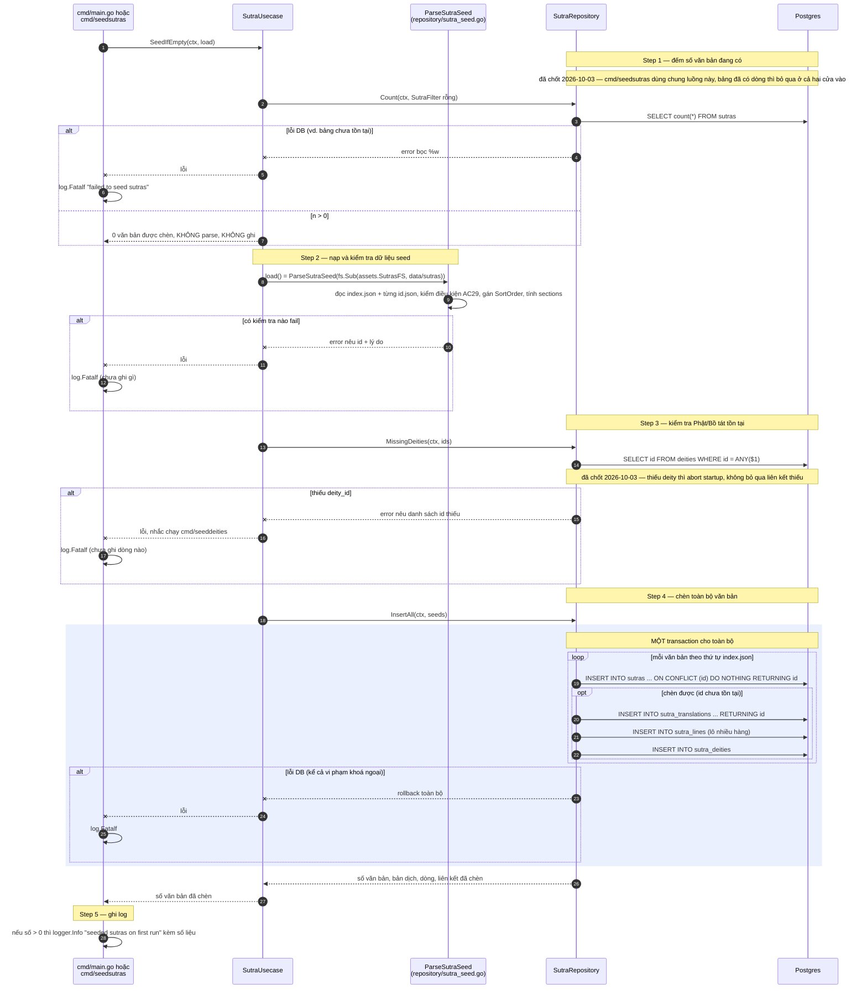
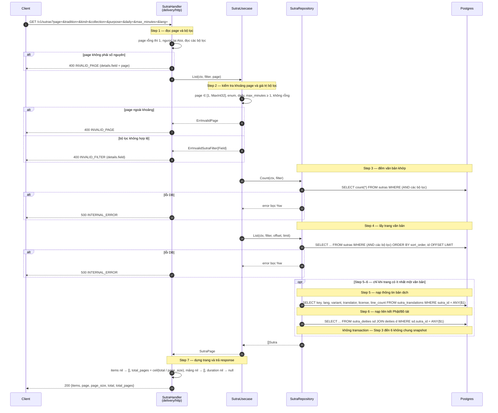
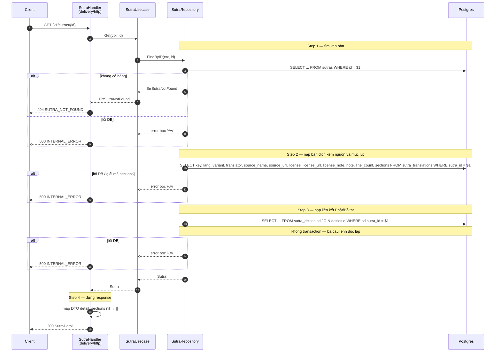
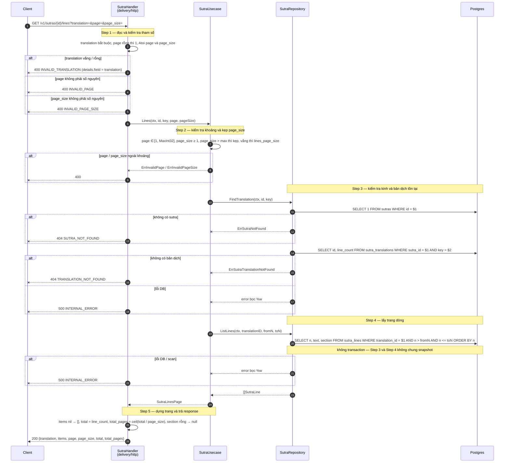
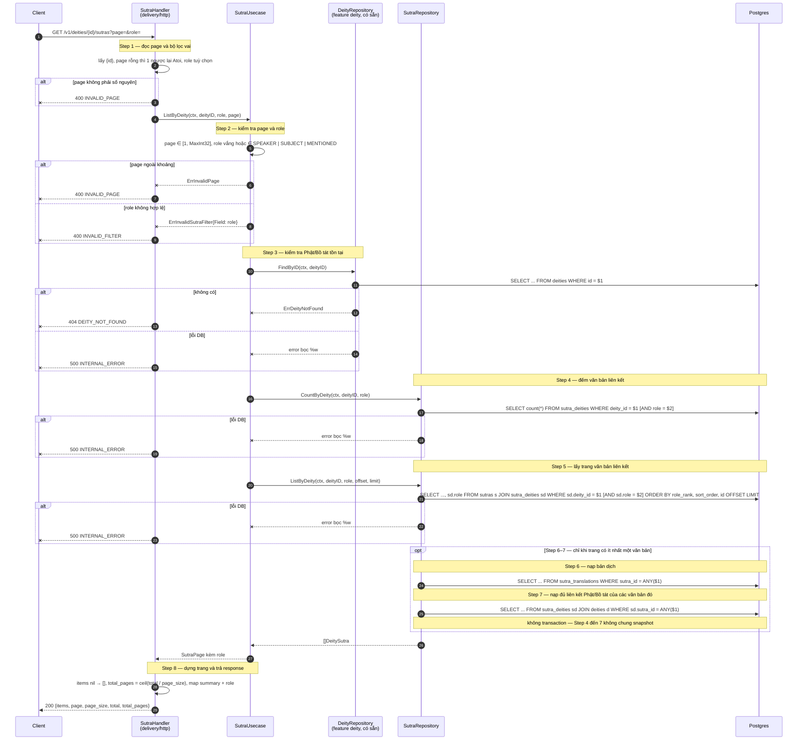

# Flow — sutra

Version: 2.13
Last updated: 2026-10-07
Status: implemented (2026-10-03) — mirror 1:1 của năm Step-by-step Flow trong `design.md`, mỗi Step ở đây trace về đúng Step cùng số; cả năm flow đã được đối chiếu với code, và chạy thật qua binary + Postgres trong `e2e/sutra_e2e_test.go` (nạp dữ liệu, danh sách, chi tiết, đọc dòng, tra ngược).
Module: `content`

> See `changelog.md` in this folder for the version history of this spec.

Cả bốn route đọc đều có từ hai lời gọi DB nối tiếp trở lên nên đều có diagram. Sơ đồ vẽ đúng code đã implement (đối chiếu từng bước với `usecase/sutra_usecase.go`, `repository/postgres_sutra_repository.go` và `delivery/http/sutra_handler.go`).

## Sequence — Nạp dữ liệu lần đầu khi khởi động

## Sequence — Danh sách và bộ lọc (`GET /v1/sutras`)

## Sequence — Chi tiết một kinh (`GET /v1/sutras/{id}`)

## Sequence — Đọc nội dung theo trang dòng (`GET /v1/sutras/{id}/lines`)

## Sequence — Kinh theo Phật/Bồ tát (`GET /v1/deities/{id}/sutras`)

