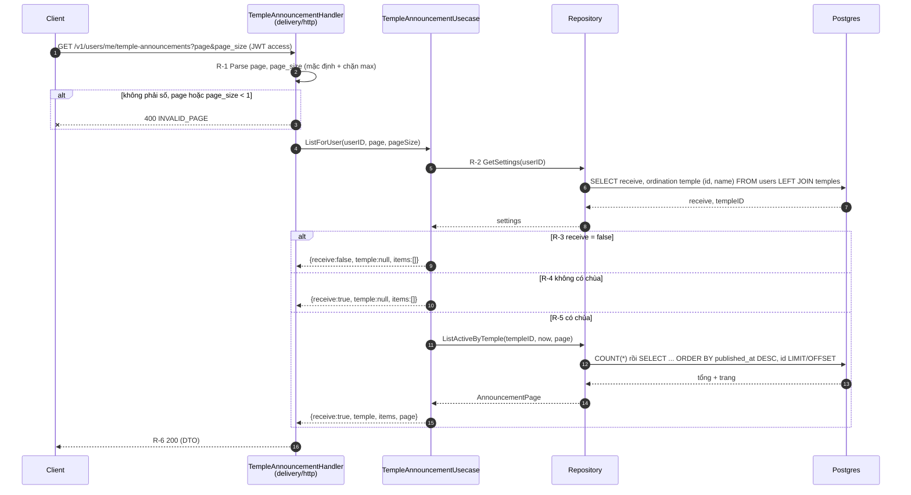
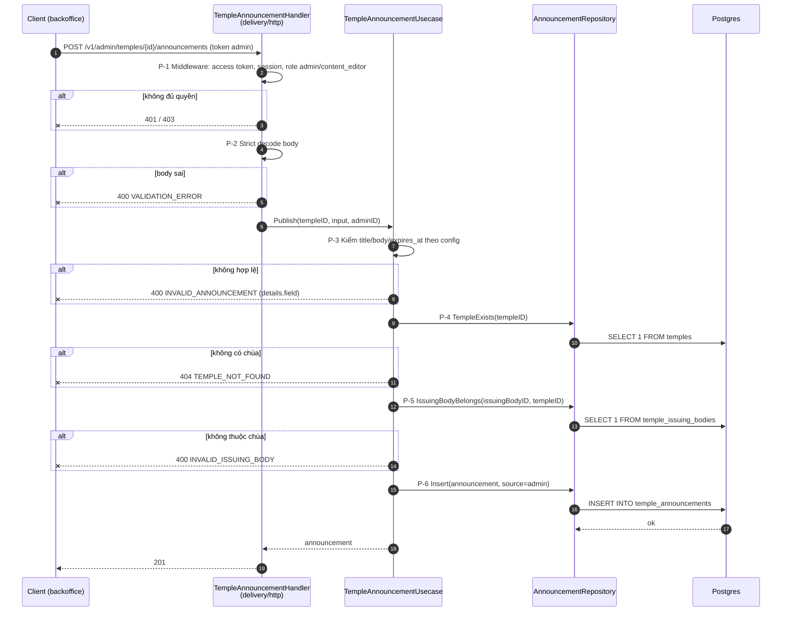

# Flow — temple-announcement

Version: 1.2
Last updated: 2026-10-14
Status: implemented (code + test pass; OKF concept chưa viết, xem `tasks.md`)
Module: `temple-announcement`

> See `changelog.md` in this folder for the version history of this spec.

Bản vẽ của hai section "Step-by-step Flow" trong `design.md`; mỗi mũi tên trace 1:1 về một Step.

## Sequence — Đọc thông báo của tôi (appService)

## Sequence — Đăng thông báo (backofficeService)

