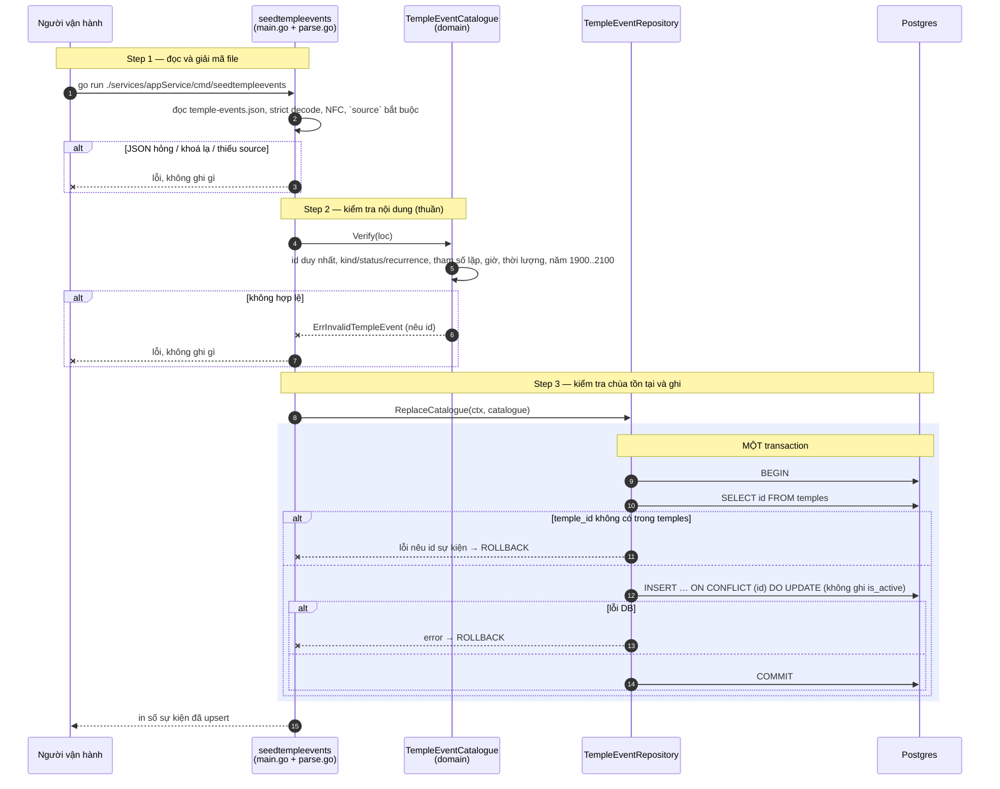

# Flow — temple-event

Version: 1.1
Last updated: 2026-10-13
Status: đã code; mirror `design.md`
Module: `temple-event`

> See `changelog.md` in this folder for the version history of this spec.

File này vẽ lại 1:1 hai section "Step-by-step Flow" của `design.md`. Số bước và thứ tự khớp nhau.

## Sequence — Lấy sự kiện của một chùa (`GET /v1/temples/{id}/events`)

```mermaid
sequenceDiagram
    autonumber
    participant C as Client
    participant A as authMiddleware<br/>(jwt/middleware)
    participant H as TempleEventHandler<br/>(delivery/http)
    participant U as TempleEventUsecase
    participant TR as TempleRepository
    participant R as TempleEventRepository
    participant DB as Postgres

    Note over C,A: Step 1 — xác thực
    C->>A: GET /v1/temples/{id}/events?from&to
    alt token access hợp lệ
        A->>H: Events (user_id trong context)
    else thiếu / hết hạn / sai loại
        A--xC: 401 (middleware)
    end

    Note over H: Step 2 — parse request
    H->>U: EventsForTemple(ctx, id, from, to)

    Note over U: Step 3 — dựng và kiểm tra cửa sổ (thuần)
    U->>U: from rỗng → hôm nay; to rỗng → from + default_window_months
    U->>U: parse YYYY-MM-DD, năm 1900..2100, to ≥ from, độ dài ≤ max_window_months
    alt định dạng / năm sai
        U--xH: ErrInvalidDate
        H-->>C: 400 INVALID_DATE
    else to < from
        U--xH: ErrInvalidDateRange
        H-->>C: 400 INVALID_DATE_RANGE
    else quá dài
        U--xH: ErrDateRangeTooLarge
        H-->>C: 400 DATE_RANGE_TOO_LARGE
    end

    Note over U,DB: Step 4 và 5 là hai lần đọc độc lập, KHÔNG bọc transaction (chỉ đọc)
    Note over U,DB: Step 4 — kiểm tra chùa tồn tại
    U->>TR: FindByID(ctx, id)
    TR->>DB: SELECT … FROM temples WHERE id = $1
    alt không có dòng
        TR--xU: ErrTempleNotFound
        U--xH: ErrTempleNotFound
        H-->>C: 404 TEMPLE_NOT_FOUND
    else lỗi DB
        TR--xU: error
        U--xH: error
        H-->>C: 500
    end

    Note over U,DB: Step 5 — đọc sự kiện của chùa
    U->>R: ListActiveByTemple(ctx, templeID, window)
    R->>DB: SELECT … FROM temple_events WHERE temple_id AND is_active AND (khoảng thô)
    alt lỗi DB
        R--xU: error
        U--xH: error
        H-->>C: 500
    end

    Note over U: Step 6 — sinh occurrence (thuần, không I/O)
    U->>U: ResolveTempleOccurrences(events, window, now, loc)
    U->>U: mở rộng quy tắc lặp, bỏ occurrence đã kết thúc, lọc cửa sổ, tính ngày âm, sắp xếp
    opt tham số lặp không hợp lệ
        U->>U: bỏ sự kiện, log cảnh báo kèm id
    end

    Note over H,C: Step 7 — trả kết quả
    U-->>H: events + occurrences
    H-->>C: 200 {temple_id, from, to, events, occurrences} + Cache-Control: no-cache
```

## Sequence — Nạp dữ liệu sự kiện chùa (`cmd/seedtempleevents`)


