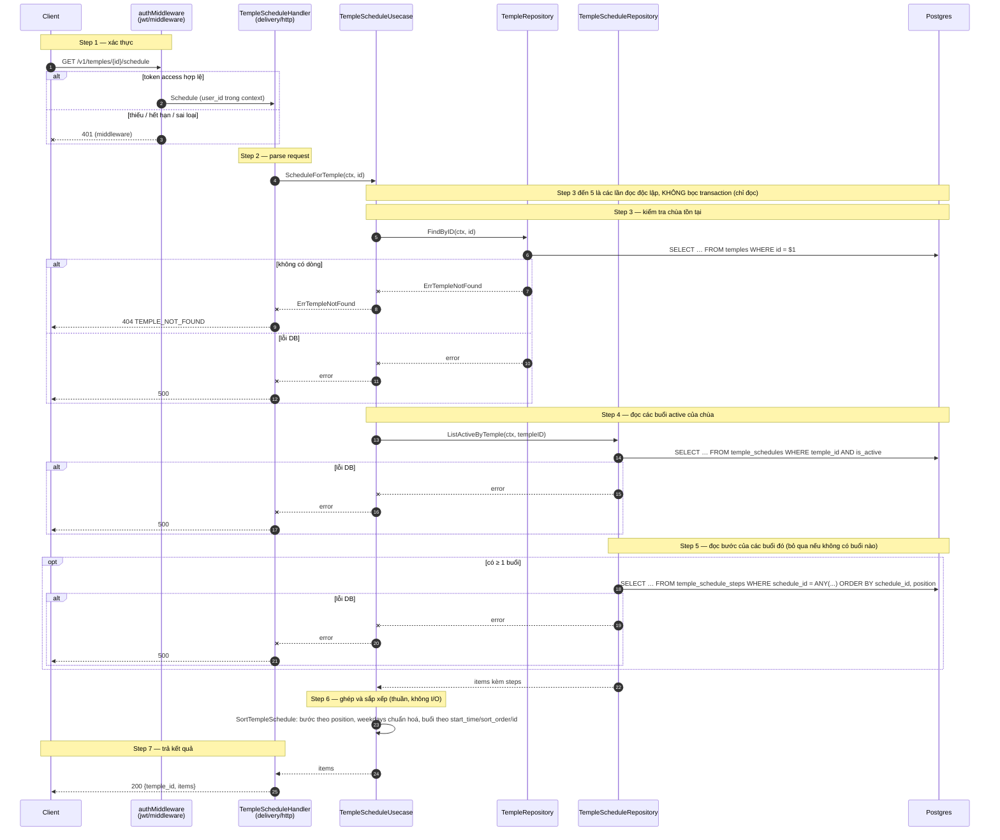
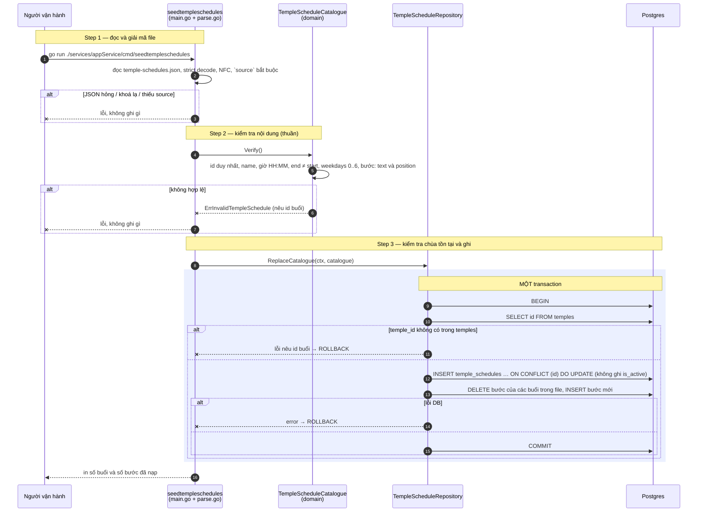

# Flow — temple-schedule

Version: 1.1
Last updated: 2026-10-13
Status: đã code; mirror `design.md`
Module: `temple-schedule`

> See `changelog.md` in this folder for the version history of this spec.

File này vẽ lại 1:1 hai section "Step-by-step Flow" của `design.md`. Số bước và thứ tự khớp nhau.

## Sequence — Lấy thời khoá của một chùa (`GET /v1/temples/{id}/schedule`)

## Sequence — Nạp dữ liệu thời khoá (`cmd/seedtempleschedules`)

