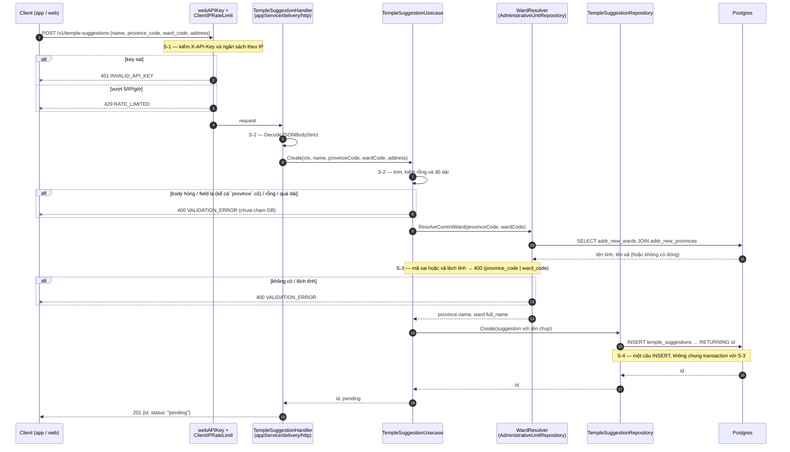

# Flow — temple-suggestion

Version: 3.4
Last updated: 2026-10-11
Status: sơ đồ gửi đề xuất v3.0 (S-1..S-4) và sơ đồ phần duyệt (C-1..C-7, v3.2) đều đã implement và kiểm chứng ngày 2026-10-11 (backoffice từ v3.4). Không đổi sơ đồ ở v3.4.
Module: `content` + `backoffice`

> See `changelog.md` in this folder for the version history of this spec.

File này vẽ hai section "Step-by-step Flow" của `design.md`; mỗi mũi tên trace 1:1 về một Step S-1..S-4 (gửi đề xuất) hoặc C-1..C-7 (tạo chùa). Hai route đọc chỉ một câu SQL nên không có sơ đồ (xem "Request flow" trong `design.md`).

## Sequence — Gửi đề xuất (POST /v1/temple-suggestions, v3.0)



## Sequence — Tạo chùa từ đề xuất (POST /v1/admin/temple-suggestions/{id}/create-temple)

```mermaid
sequenceDiagram
    autonumber
    participant C as Admin (backoffice client)
    participant M as authMiddleware +<br/>RequireActiveSession + RequireAnyRole
    participant H as TempleSuggestionHandler<br/>(backofficeService/delivery/http)
    participant U as TempleSuggestionUsecase
    participant W as WardResolver<br/>(backofficeService)
    participant R as TempleSuggestionRepository
    participant DB as Postgres

    C->>M: POST /v1/admin/temple-suggestions/{id}/create-temple
    Note over M: C-1 — xác thực token + role
    alt token sai / bị thu hồi
        M--xC: 401
    else role không được phép
        M--xC: 403
    end
    M->>H: claims (admin id) trong context
    H->>H: C-2 — parse {id}, DecodeJSONBodyStrict
    H->>U: CreateTemple(ctx, suggestionID, adminID, input)
    U->>U: C-2 — validate NewTemple, suy heritage_priority
    alt {id} sai / body sai
        U--xH: 404 / 400 VALIDATION_ERROR (chưa chạm DB)
        H-->>C: 404 / 400
    end
    U->>W: ResolveCurrentWard(provinceCode, wardCode)
    W->>DB: C-3 — SELECT addr_new_provinces LEFT JOIN addr_new_wards
    DB-->>W: tên tỉnh, tên xã (hoặc không có dòng)
    Note over W,U: C-3 chỉ đọc, ngoài transaction; mã sai hoặc xã lệch tỉnh → 400 (province_code | ward_code)
    alt không có / lệch tỉnh
        W--xH: 400 VALIDATION_ERROR (đề xuất không đổi)
        H-->>C: 400
    end
    W-->>U: province.name, ward.full_name
    U->>R: CreateTemple(ctx, suggestionID, adminID, role, newTemple với tên chụp)

    rect rgb(235, 240, 255)
        Note over R,DB: MỘT transaction (C-4 → C-7)
        R->>DB: C-4 — SELECT … FROM temple_suggestions WHERE id=$1 FOR UPDATE
        alt không có dòng
            R--xU: ErrSuggestionNotFound → rollback
        else status = created
            R--xU: ErrSuggestionAlreadyCreated → rollback
        else status = rejected và role ≠ admin
            R--xU: ErrReopenForbidden → rollback
        end
        R->>DB: C-5 — pg_advisory_xact_lock(region) + max(n) → id mới
        Note over R,DB: id dạng temple_<region>_<NNN>
        R->>DB: C-6 — INSERT INTO temples (..., province_code, ward_code, province, ward)
        alt vi phạm constraint / lỗi DB
            R--xU: lỗi → rollback (đề xuất vẫn pending)
        end
        R->>DB: C-7 — UPDATE temple_suggestions SET status='created', temple_id, reviewed_by, reviewed_at, reject_reason=NULL
        R->>DB: COMMIT
        R-->>U: temple + suggestion
    end

    alt thành công
        U-->>H: {suggestion, temple}
        H-->>C: 201 {suggestion, temple}
    else ErrSuggestionNotFound
        U--xH: 404 TEMPLE_SUGGESTION_NOT_FOUND
        H-->>C: 404
    else ErrSuggestionAlreadyCreated
        U--xH: 409 SUGGESTION_ALREADY_CREATED
        H-->>C: 409
    else ErrReopenForbidden
        U--xH: 403 FORBIDDEN
        H-->>C: 403
    else lỗi hạ tầng
        U--xH: error
        H-->>C: 500 INTERNAL_ERROR
    end
```
