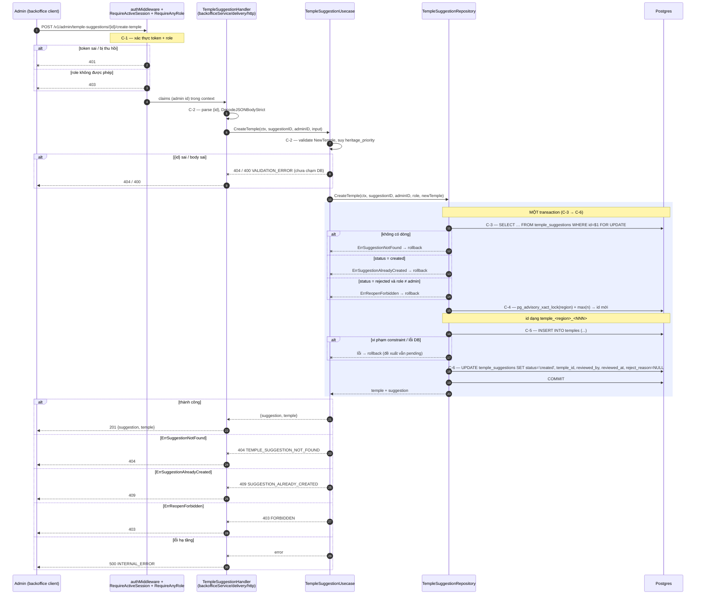

# Flow — temple-suggestion

Version: 2.4
Last updated: 2026-10-10
Status: sơ đồ cho phần duyệt (backoffice) — chưa có code; phần gửi đề xuất ở appService đã implement và không có sơ đồ. Không còn marker `⚠️ Not confirmed`.
Module: `content` + `backoffice`

> See `changelog.md` in this folder for the version history of this spec.

File này là bản vẽ của section "Step-by-step Flow" duy nhất trong `design.md`; mỗi mũi tên trace 1:1 về một Step C-1..C-6. Route gửi đề xuất và hai route đọc chỉ một câu SQL nên không có sơ đồ (xem "Request flow" trong `design.md`).

## Sequence — Tạo chùa từ đề xuất (POST /v1/admin/temple-suggestions/{id}/create-temple)

