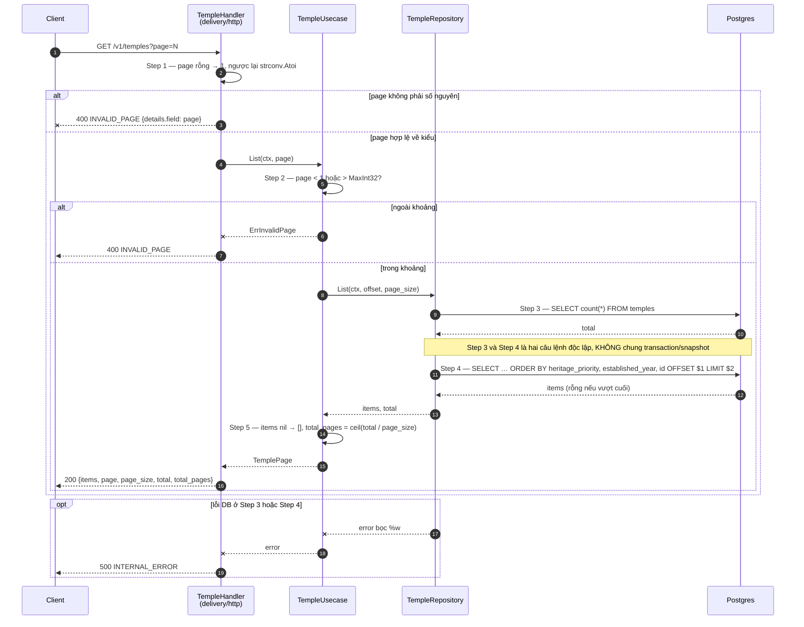
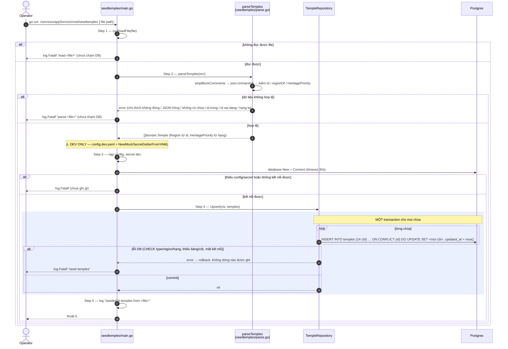

# Flow — temple

Version: 1.6
Last updated: 2026-10-10
Status: implemented (2026-09-30) — mirror 1:1 của ba Step-by-step Flow trong `design.md`, mỗi Step ở đây trace về đúng Step cùng số.
Module: `content`

> See `changelog.md` in this folder for the version history of this spec.

`top` và `detail` chỉ một câu SQL nên không có diagram — xem "Request flow" trong `design.md`.

## Sequence — Danh sách phân trang (`GET /v1/temples?page=N`)



## Sequence — Danh sách rút gọn phân trang, tìm theo tên (`GET /v1/temples/options?page=N&q=`) *(v1.5)*

```mermaid
sequenceDiagram
    autonumber
    participant C as Client
    participant H as TempleHandler<br/>(delivery/http)
    participant U as TempleUsecase
    participant R as TempleRepository
    participant DB as Postgres

    C->>H: GET /v1/temples/options?page=N&q=…
    H->>H: Step 1 — page rỗng → 1, ngược lại strconv.Atoi; đọc q (có mặt hay không)
    alt page không phải số nguyên
        H--xC: 400 INVALID_PAGE {details.field: page}
    else page hợp lệ về kiểu
        H->>U: Options(ctx, query, page)
        U->>U: Step 2 — page < 1 hoặc > MaxInt32? q có mặt: trim, rỗng hoặc > 100 ký tự?
        alt page ngoài khoảng
            U--xH: ErrInvalidPage
            H-->>C: 400 INVALID_PAGE
        else q không hợp lệ
            U--xH: ErrInvalidTempleQuery
            H-->>C: 400 INVALID_FILTER {details.field: q}
        else hợp lệ
            U->>R: ListOptions(ctx, query, offset, options_page_size)
            R->>DB: Step 3 — SELECT count(*) FROM temples [WHERE unaccent(lower(name)) LIKE …]
            DB-->>R: total (số khớp)
            Note over R,DB: Step 3 và Step 4 là hai câu lệnh độc lập, KHÔNG chung transaction/snapshot
            R->>DB: Step 4 — SELECT id, name, province … [cùng WHERE] ORDER BY … OFFSET $n LIMIT $m
            DB-->>R: dòng (rỗng nếu vượt cuối hoặc không khớp)
            R-->>U: items, total
            U->>U: Step 5 — items nil → [], total_pages = ceil(total / options_page_size)
            U-->>H: TempleOptionPage
            H-->>C: 200 {items [{id, name, province}], page, page_size, total, total_pages}
        end
    end
    opt lỗi DB ở Step 3 hoặc Step 4
        R--xU: error bọc %w
        U--xH: error
        H-->>C: 500 INTERNAL_ERROR
    end
```

## Sequence — Nạp dữ liệu bằng `cmd/seedtemples`


