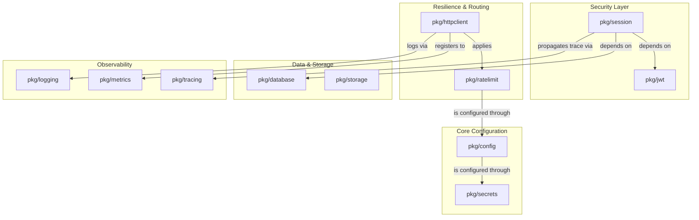

# innerlamp Architecture & Design Principles

The `innerlamp` framework is structured as a collection of modular Go packages (`pkg/`) designed to provide standard infrastructural abstractions for containerized and serverless backend services. Rather than coupling services directly to specific cloud providers (like GCP or AWS) or specific database instances, the framework uses interfaces and a dynamic factory registration pattern.

---

## 🏗️ High-Level Package Architecture

Below is a visual representation of how key modules within the `innerlamp` framework interact with one another and with external cloud resources.



---

## ⚙️ Core Design Principles

### 1. Singleton & Startup Connection Management
To support fast startup scaling characteristics of serverless architectures (such as GCP Cloud Run or AWS Fargate), components are designed to follow a strict startup connection lifecycle:
* **Creation vs Connection**: Clients are constructed via synchronous factories (e.g., `NewClient`, `NewMySQL`). At instantiation, they validate their configuration but do not immediately block on establishing remote TCP connections.
* **Explicit Lifecycle Hooks**: To establish connections, clients implement explicit lifecycle methods, such as `Connect(ctx)` or `Start(ctx)`. This allows services to fail fast during the startup phase rather than mid-request.
* **Internal Thread-Safe Reuse**: Clients are designed for high-concurrency reuse across goroutines, utilizing standard Go connection pools (`database/sql`) and thread-safe sync primitives (e.g., `sync.Mutex`, `sync.RWMutex`, `sync.Pool`).

### 2. Provider-Agnostic Interfaces (Factory/Registry Pattern)
Most major packages expose a core interface in their root file and implement provider-specific drivers in subdirectories. They register themselves at startup using the Go `init()` function:

* **Example Pattern**:
  1. Root defines interface `pkg/database/database.go` -> `type Database interface`.
  2. Subpackage `/pkg/database/mysql/mysql.go` implements the `Database` interface.
  3. The `/pkg/database/mysql/mysql.go` subpackage registers itself:
     ```go
     func init() {
         database.Register(database.MySQL, NewMySQL)
     }
     ```
  4. The consuming application performs a blank import to activate the driver:
     ```go
     import _ "chjpcoj.com.innerlamp/pkg/database/mysql"
     ```

This decoupling ensures that adding new backends or swapping providers is as simple as creating a new subpackage implementing the interface and registering it.

---

## ⚠️ Important Gotchas & Architectural Constraints

### The Import Path Name Mismatch
Although the repository's `go.mod` declares the module name as `chjpcoj.com.innerlamp`, all internal package imports throughout the codebase reference `"base_project/pkg/..."`.

* **Impact**: If you are developing a new utility or service inside this codebase, you must import adjacent packages using `"base_project/pkg/<package>"` instead of using the `innerlamp` namespace.
* **Reason**: The framework represents a production-ready codebase cloned from a standard repository template (`base_project`). To maintain backwards compatibility without triggering full-codebase import re-writes, the template's import paths have been left as-is.

### Cloud-Agnostic with GCP Defaults
While the framework provides abstractions for both AWS (S3, AWS Secrets Manager) and GCP (Cloud Storage, GCP Secret Manager, Cloud Monitoring), it is optimized for **Google Cloud Platform**.
* **Auto-Discovery**: Many packages contain explicit checks to auto-detect whether they are running on GCP serverless systems (like Cloud Run or GKE) using GCP environment flags (e.g. `K_SERVICE`, `KUBERNETES_SERVICE_HOST`). See [Validation & Utilities](../packages/validation-utils.md) for environment sensing rules.
* **Application Default Credentials (ADC)**: GCS, GCP Secret Manager, and Cloud Tracing clients default to utilizing ADC. This avoids passing raw access keys or credentials inside configuration parameters, aligning with modern security practices.

---

## 🧪 Validation & Change Safety

Before pushing code changes to any package, verify that:
1. The new package follows the same connection-lifecycle boundary.
2. Any new concrete driver registers itself under an `init()` hook.
3. Tests are quiet and pass successfully.

To run tests across all core libraries without compiling heavier executables:
```bash
go test -short ./...
```
*(Use `-short` to skip long-running cloud integration checks that require active AWS or GCP credentials).*
