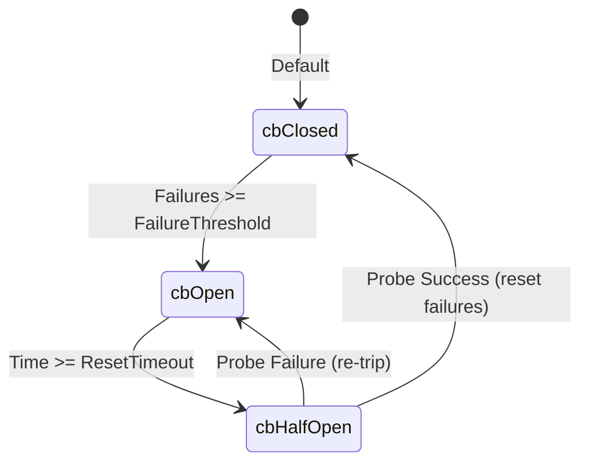

# Resilient Networking & Middlewares

The `innerlamp` framework provides robust networking capabilities divided into a **resilient egress HTTP Client** (`pkg/httpclient`) and **standardized ingress middlewares** for HTTP and gRPC protocols (`pkg/middleware`).

---

## 🛰️ Egress Resilience: Resilient HTTP Client (`pkg/httpclient`)

To prevent cascading failures across microservices, `pkg/httpclient` features a custom HTTP client that wraps any egress communication in two core resilience layers:
1. **Exponential Backoff Retries**: Standard requests automatically retry up to `MaxRetries` using a 2x exponential multiplier starting at `InitialBackoff`.
2. **Circuit Breaking**: A concurrent-safe state machine tracks failures and rejects requests when downstream services are degraded.

### Circuit Breaker States
The circuit breaker supports three states:
* `cbClosed` (0): Normal operations. All egress requests flow freely.
* `cbOpen` (1): Degraded state. Requests are rejected immediately with `ErrCircuitOpen` without executing TCP calls. The circuit remains open until `ResetTimeout` expires.
* `cbHalfOpen` (2): Probe state. One probe request is allowed. A success resets the state back to `cbClosed`; a failure trips it back to `cbOpen`.



### Client Usage Configuration
```go
type Config struct {
    Timeout          time.Duration // Per-request timeout
    MaxRetries       int           // Number of retries after initial failure
    InitialBackoff   time.Duration // Base duration for backoff
    FailureThreshold int           // Failures to open circuit (0 = disabled)
    ResetTimeout     time.Duration // Wait duration in cbOpen state before cbHalfOpen
}
```

---

## 📥 Ingress Routing: Middlewares (`pkg/middleware`)

The framework enforces common request boundaries for both HTTP REST APIs and high-performance gRPC services.

### 🌐 HTTP Middlewares
* **CORS**: Injects browser safety headers allowing standard cross-origin requests:
  ```go
  w.Header().Set("Access-Control-Allow-Origin", "*")
  w.Header().Set("Access-Control-Allow-Methods", "GET, POST, PUT, DELETE, OPTIONS")
  ```
* **Logger**: Standard console logging that measures request duration using `time.Since(start)`.
* **Recovery**: Catches server panics, logs the standard stack trace using `runtime/debug.Stack()`, and returns an RFC-compliant `500 Internal Server Error` in JSON format.

### 🔌 gRPC Interceptors
* **RecoveryInterceptor**: Standard unary server interceptor recovering from panics and returning a `codes.Internal` status code with the stack trace.
* **StreamRecoveryInterceptor**: Stream server interceptor providing standard panic safety for persistent streaming gRPC connections.

---

## 🔗 Semantic Relationships (OKF Mapped)

* **Egress Logging Integration**: Egress calls performed via `pkg/httpclient` [logs via](observability.md) `pkg/logging` to ensure that failed attempts and tripped breaker events are registered in structured observability pipelines.
* **Rate-Limit Guarding**: Ingress REST APIs wrapped in [Resilient Networking & Middlewares](networking.md) typically [applies](ratelimit.md) `pkg/ratelimit` interceptors at the outer boundary before request parameters are parsed.

---

## 🧪 Focused Validation

The client testing suite resides under `/pkg/httpclient/httpclient_test.go`.

To validate the circuit breaker, backoff schedules, and standard retries:
```bash
# Quietly validate circuit breaker mechanics
go test -v ./pkg/httpclient/...
```
