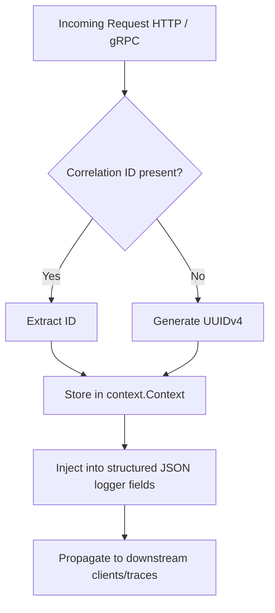

# Observability: Logging, Metrics, & Tracing

The `innerlamp` framework implements a unified, context-aware observability stack divided into **Structured Logging** (`pkg/logging`), **Resource Metrics** (`pkg/metrics`), and **Distributed Tracing** (`pkg/tracing`).

Together, these packages ensure full transparency for requests navigating multi-service boundaries.

---

## 📇 Structured Logging (`pkg/logging`)

The logging package provides standard Level-based logging supporting `DEBUG`, `INFO`, `WARN`, `ERROR`, `FATAL`, and `PANIC` severities.

### 🔄 Correlation ID Flow
To correlate isolated operations across distributed services, the logging engine uses a Context propagation pattern. It extracts the request ID from HTTP headers or gRPC metadata:



* **HTTP Header Inspection Priority**: `X-Correlation-ID`, `X-Request-ID`, `X-Trace-ID`, `Correlation-ID`, `Request-ID`.
* **gRPC Metadata Spec**: Automatically converts correlation metadata keys to lowercase (`x-correlation-id`, `x-request-id`, etc.) to follow gRPC transport guidelines.

---

## 📊 Resource Metrics (`pkg/metrics`)

The metrics framework supports collecting, aggregating, and exporting telemetry via the `Collector` interface to **Google Cloud Monitoring** (and local registries like Prometheus).

### Core Telemetry Types
* **Counter**: Cumulative metric that only increases (e.g. `http_requests_total`).
* **Gauge**: Instantaneous measurement that can increase or decrease (e.g. `goroutines_active`).
* **Histogram**: Records value distributions in pre-configured floating-point buckets (e.g. `http_request_duration_seconds`).
* **Summary**: Computes configurable sliding-window quantiles.

### Registry & Factories
* **Factory Initialization**: Consuming applications invoke `CreateCollector(config)`. If metrics are disabled (`config.Enabled == false`), the factory returns a thread-safe `NewNoOpCollector()` to prevent pointer errors.
* **GCP Driver Binding**: The GCP exporting client utilizes background batches and requires the GCP metrics driver package to be registered via a blank import:
  ```go
  import _ "base_project/pkg/metrics/gcp"
  ```

---

## 🕸️ Distributed Tracing (`pkg/tracing`)

Distributed tracing uses **OpenTelemetry (OTel)** to track requests through the system.

### Core Features
* **Tracer Abstraction**: Wraps standard OTel providers and registers a global `TracerProvider` with W3C `TraceContext` propagation.
* **Span Processing Engines**:
  * `ExporterTypeGCP`: Sends telemetry batches directly to Google Cloud Trace using the GCP Batch Span Processor.
  * `ExporterTypeStdout`: Outputs pretty-printed JSON traces locally for debugging.
  * `ExporterTypeNoop`: Safe, zero-allocation tracer that does not output telemetry.

### HTTP/gRPC Context Handling
The tracer provides middleware that hooks into http handlers and gRPC interceptors, extracting the incoming span from the metadata, starting a local child span, and propagating the updated context to downstream routines.

---

## 🔗 Semantic Relationships (OKF Mapped)

* **Telemetry Integration**: Networking calls performed via [Resilient Networking & Middlewares](networking.md) automatically [logs via](observability.md) structured context loggers and registers response codes with the metrics `Registry`.
* **Trace-Aware Identity**: Authentication filters documented under [Authentication & Session Lifecycle](security.md) automatically [propagates trace via](observability.md) `pkg/tracing` so user identity metadata is attached to spans.

---

## 🧪 Focused Validation

Testing suites are isolated within their respective package subdirectories.

To validate log serialization formatting, metrics registration, and trace propagation:
```bash
# Validate logging correlation ID extractions
go test -v ./pkg/logging/...

# Validate metrics collectors and registries
go test -v ./pkg/metrics/...

# Validate trace provider context injections
go test -v ./pkg/tracing/...
```
