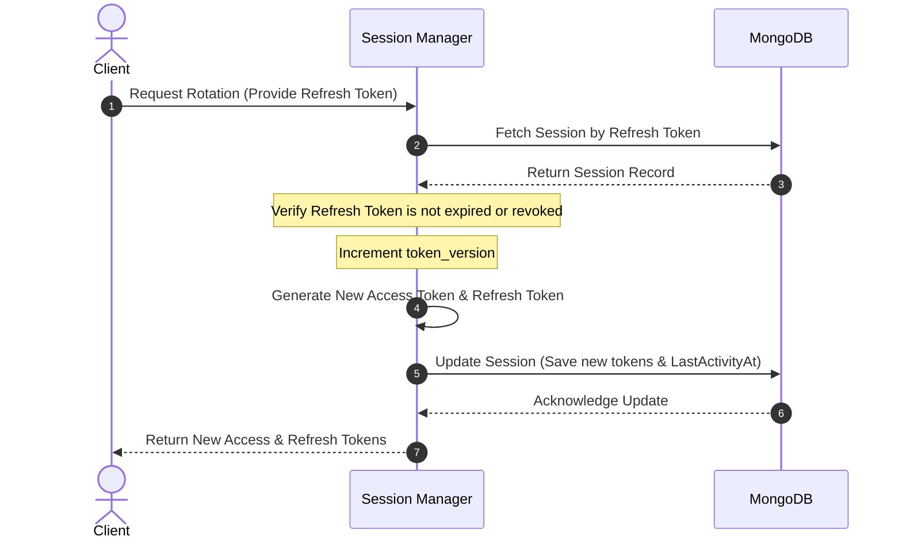

# Authentication & Session Lifecycle

The `innerlamp` security model establishes deep user protection using a stateless **JWT Generation and Parsing Service** (`pkg/jwt`) joined with a stateful **MongoDB-backed Session Management Engine** (`pkg/session`).

---

## 🔑 Stateless Identity: JWT Service (`pkg/jwt`)

The `pkg/jwt` package handles token issuance, structural parsing, and signature validations using `github.com/golang-jwt/jwt/v5`. It supports both symmetric and asymmetric cryptographic signatures.

### Supported Algorithms & Configurations
* **HS256 (HMAC-SHA256)**: Shared symmetric key. The framework enforces a **minimum length of 32 characters** for the `SecretKey` configuration to resist brute-force vector attempts.
* **RS256 (RSA-SHA256)**: Asymmetric cryptography. Requires a non-nil `*rsa.PrivateKey` for signing (private) and `*rsa.PublicKey` for validation (public).
* **Key Expiration Invariant**: The configuration validator enforces that `RefreshTokenExpiration` must strictly be greater than `AccessTokenExpiration`.

### Standard Custom Claims Schema
The custom claim payloads (`pkg/jwt/claims/claims.go`) inherit from the standard registered specs, injecting roles and extra properties:
```go
type CustomClaims struct {
    UserID    string         `json:"user_id"`
    Email     string         `json:"email"`
    Role      string         `json:"role"`
    TokenType string         `json:"token_type"` // e.g. "access" or "refresh"
    Extra     map[string]any `json:"extra,omitempty"`
    jwt.RegisteredClaims
}
```

### Ingress Verification Middlewares
* **HTTP Middleware**: Intercepts requests, extracts the bearer token from the standard `Authorization: Bearer <Token>` header, parses and validates claims, and injects the resolved context into the native HTTP request via context pointers.
* **gRPC Interceptor**: Resolves metadata authorization maps inside incoming gRPC streams and attaches user credentials securely to downstream unary handlers.

---

## 🔄 Stateful Sessions: Mongo Session Manager (`pkg/session`)

To support features like remote session revocation, concurrent device limits, and protection against stolen cookies, `pkg/session` implements stateful sessions in a MongoDB collection named `user_sessions`.

### Session Struct Data Model
```go
type Session struct {
    ID             primitive.ObjectID `bson:"_id,omitempty"`
    UserID         string             `bson:"user_id"`
    SessionID      string             `bson:"session_id"`     // Unique session identifier
    DeviceID       string             `bson:"device_id"`      // Device fingerprint hash
    DeviceInfo     *DeviceInfo        `bson:"device_info"`    // Device OS/Platform metadata
    AccessToken    string             `bson:"access_token"`   // Live JWT string
    RefreshToken   string             `bson:"refresh_token"`  // Live rotation key
    TokenVersion   int                `bson:"token_version"`  // Incremented on rotation
    IsActive       bool               `bson:"is_active"`
    IsRevoked      bool               `bson:"is_revoked"`
    ExpiresAt      time.Time          `bson:"expires_at"`     // TTL Target
    CreatedAt      time.Time          `bson:"created_at"`
}
```

### Token Rotation State Machine
Whenever an client exchanges an expired access token using their Refresh Token, the session manager rotates BOTH keys to prevent replay attacks:



### MongoDB Automated Lifecycle Indexes
When `NewMongoSessionManager` is initialized, it automatically issues bulk index creations to ensure rapid, background-indexed queries and automatic document purging:
1. **TTL Index**: A TTL index is established on the `expires_at` key with `SetExpireAfterSeconds(0)`. MongoDB's background scheduler automatically deletes expired session documents, eliminating the need for cron-based cleanups.
2. **Unique Identifier**: Compels `session_id` uniqueness.
3. **Compound Indexes**: Speeds user authorization checks via `{user_id: 1, is_active: 1}` and device identification via `{user_id: 1, device_id: 1}`.

---

## 🔗 Semantic Relationships (OKF Mapped)

* **Data Persist Engine**: Stateful sessions [depends on](data-storage.md) the MongoDB client driver registered inside `pkg/database`.
* **Stateless Signing Engine**: Stateful sessions [depends on](security.md) `pkg/jwt` to generate individual Access and Refresh tokens inside the `RotateTokens` routine.
* **Trace-Aware Observability**: Authentication middlewares [propagates trace via](observability.md) `pkg/tracing` so that request authorization logs are tied to downstream distributed span IDs.

---

## 🧪 Focused Validation

Testing suites are divided into stateless signature validations (`/pkg/jwt/jwt_test.go`) and stateful MongoDB lifecycle assertions (`/pkg/session/session_test.go`).

To test token issuance and database session index management:
```bash
# Validate JWT signatures and claims handling
go test -v ./pkg/jwt/...

# Validate Session rotation and indexes (Requires a local MongoDB)
go test -v ./pkg/session/...
```
