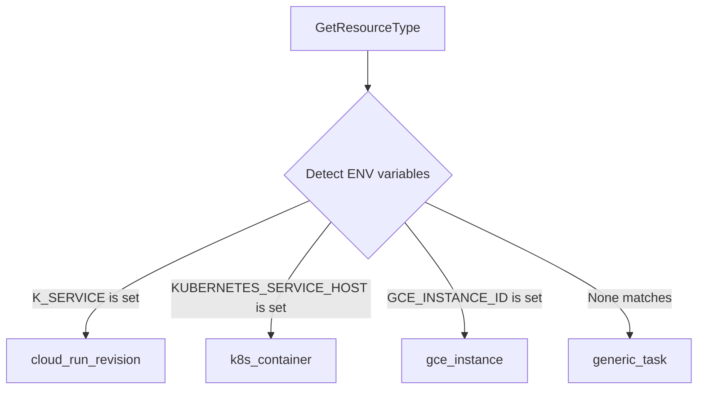

# Validation, Sanity, & GCP Helpers

The `innerlamp` framework incorporates strict lexical boundaries (`pkg/validation`), runtime reflection validators (`pkg/utils`), and serverless platform sensors (`pkg/utils/utils.go`).

Together, they ensure incoming request sanitation and automatic environmental alignment.

---

## 🇲🇽 Lexical & Mexican Market Compliance (`pkg/validation`)

The `pkg/validation` package contains regulatory and format assertions tailored for Mexican fintech and digital platforms.

### 📞 Mexican Phone Numbers
* **Regex Specifications**:
  * `MexicanPhoneRegex`: Matches 10-digit formats (`^[0-9]{10}$`).
  * `MexicanPhoneWithCountryCodeRegex`: Supports `+52` prefix.
* **Normalization**: The `NormalizeMexicanPhone(phone)` function strips non-digit characters, trims leading `+52` or `52` prefixes, and isolates the final 10 digits.

### 🆔 CURP (Clave Única de Registro de Población)
* **Regex Specifications**: `^[A-Z]{4}[0-9]{6}[HM][A-Z]{5}[0-9A-Z][0-9]$` (18 characters).
* **Validation Invariants**: Checks string length, lexical layout, and verifies the sex indicator character at position 10 (`H` or `M`).

### 📧 Email Verification
Enforces format parameters via `EmailRegex`, limits emails to **254 characters**, and prevents dot-start or dot-end local parts (e.g. `.username@domain.com`).

---

## 🛡️ XSS Prevention & Input Sanitization

To mitigate Cross-Site Scripting (XSS) vectors, the framework provides active sanitization routines:
* **HTML Escaping**: `SanitizeString(input)` strips null bytes and replaces raw characters with safe HTML entities.
* **Heuristic Scans**: `ValidateNoXSS(input)` evaluates string inputs against active script tags, standard iframes, `javascript:` prefixes, and standard DOM callback attributes (e.g. `onload=`, `onerror=`).

---

## 🏷️ Struct-Tag Validation (`pkg/utils` - Singleton Validator)

For general request body validations, `/pkg/utils/validation.go` provides a singleton wrapper over `github.com/go-playground/validator/v10`:

* **Access**: Applications fetch the shared engine using `GetValidator()`.
* **Standard Representation**: Evaluated errors parse into highly structured API fields returnable directly to client frontends:
  ```go
  type ValidationError struct {
      Field   string `json:"field"`
      Message string `json:"message"`
      Tag     string `json:"tag"`
      Value   any    `json:"value,omitempty"`
  }
  ```

---

## ☁️ Serverless Platform Sensing (`pkg/utils/utils.go`)

To ease deployment configuration, `pkg/utils` reads operating environment properties to establish Google Stackdriver metrics labels.



* **Body Size Restrictions**: Applies body constraints using `LimitRequestBodySize(w, r)` limiting default request flows to **1MB** (`MaxRequestSize`).
* **Log Injection Defense**: Truncates User-Agent strings to **200 characters** and strips Carriage Return (`\r`) or Line Feed (`\n`) characters via `SanitizeUserAgent(ua)`.

---

## 🔗 Semantic Relationships (OKF Mapped)

* **Egress Validation Pipeline**: Middlewares documented under [Resilient Networking & Middlewares](networking.md) pass request structs to `GetValidator()` [secures](validation-utils.md) to inspect fields before executing controllers.
* **Logging Integration**: User-Agent headers are sanitized using `SanitizeUserAgent(ua)` before loggers in [Observability](observability.md) parse log records.

---

## 🧪 Focused Validation

Validation systems are tested under `/pkg/validation/validation_test.go` and `/pkg/utils/http_test.go`.

To validate regular expressions and body parser constraints:
```bash
# Validate regex parsing and sanitizations
go test -v ./pkg/validation/...

# Validate json decoders and environment variables
go test -v ./pkg/utils/...
```
