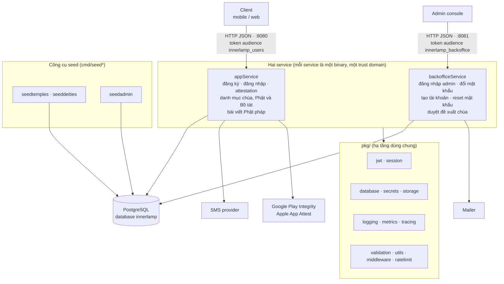

Backend gồm ba phần: **`pkg/`** là thư viện hạ tầng dùng chung, và hai service chạy độc lập là **`appService`** (API cho client) và **`backofficeService`** (API cho admin). Hai service là hai binary riêng, cùng dùng `pkg/` và cùng một database.

## Bức tranh hệ thống

| | `appService` | `backofficeService` |
| --- | --- | --- |
| Người dùng | Client cuối (mobile, web) | Admin vận hành hệ thống |
| Cổng dev | `:8080` | `:8081` |
| Tài khoản | Bảng `users`, tự đăng ký bằng OTP qua SMS | Bảng `admins`, **không** tự đăng ký |
| JWT | audience `innerlamp_users`, secret riêng, có refresh token và phiên theo thiết bị | audience `innerlamp_backoffice`, secret riêng, chỉ access token |
| Service ngoài | SMS, Play Integrity, App Attest | Mailer (gửi lời mời và mật khẩu tạm) |
| Route | 18 endpoint, xem [API Reference](/api-reference/) | 8 endpoint `/v1/admin/*` (tài khoản và duyệt đề xuất chùa), xem mục Admin trong [API Reference](/api-reference/) |

Token của service này bị service kia từ chối, vì khác secret và audience. Đây là ranh giới tin cậy giữa client và admin.

### Dữ liệu dùng chung

Cả hai service kết nối cùng database PostgreSQL `innerlamp`. Schema được quản lý bằng các file trong `migrations/` (chạy bằng `make migrate`), không service nào tự tạo bảng khi khởi động.

| Nhóm | Bảng | Service ghi |
| --- | --- | --- |
| Đăng ký, đăng nhập | `users`, `pending_registration`, `otp_codes`, `otp_send_limits`, `user_sessions`, `user_devices`, `login_attempts` | appService |
| Attestation | `attestation_challenges`, `attestation_keys` | appService |
| Danh mục | `temples`, `deities`, `gallery_images`, `articles`, `sutras` (cùng bản dịch, dòng kinh, liên kết), `dharma_talks`, `addr_*` (đơn vị hành chính), `temple_schedules` + `temple_schedule_steps` (thời khoá tu tập của chùa), `temple_events` (sự kiện của chùa, một bảng có cột lặp), cả hai liên kết `temples` | appService đọc. Tất cả do lệnh seed nạp; service không tự nạp gì khi khởi động |
| Quản trị | `admins` | backofficeService |

### Khởi tạo dữ liệu và tài khoản

- **Lệnh seed** (trong appService, `cmd/seed*`) nạp mọi danh mục: `seedtemples`, `seeddeities`, `seedgallery`, `seedarticles`, `seedsutras`, `seeddharmatalks`, `seedtempleschedules` và `seedtempleevents` (thời khoá và sự kiện của chùa; phải nạp `temples` trước) và `seedadminunits` (tỉnh/xã hệ mới + cũ + bảng chuyển đổi). Kinh liên kết với Phật/Bồ tát nên phải nạp `deities` trước.
- **appService không seed gì khi khởi động.** `make run` chạy các bước `ensure-*`, mỗi bước chỉ nạp khi bảng đang rỗng, nên chạy lại không đụng vào dữ liệu đã chỉnh. Chạy thẳng binary trên DB rỗng vẫn lên được nhưng các danh mục trả danh sách rỗng. Cần áp migration trước (`make migrate`).
- **`cmd/seedadmin`** (trong backofficeService) tạo admin đầu tiên. Ở dev, nếu bảng `admins` trống, service tự chèn một admin bootstrap với `must_change_password = TRUE`; production phải tắt cấu hình này và dùng `seedadmin`.

### Chạy local

`docker-compose.yml` dựng PostgreSQL 16, một job `migrate`, và bộ quan sát gồm Loki, Alloy, Grafana. Hai service chạy trên host bằng `make run` (appService) và `make run-backoffice`, log được ghi vào `observability/logs/` để Alloy đẩy sang Loki.

## Các lớp của mỗi service

Cả hai service dùng chung một bố cục Clean Architecture (`domain`, `usecase`, `repository`, `delivery/http`, nối ở `cmd/main.go`). Ví dụ dưới đây lấy appService.

| Lớp | Trách nhiệm | Không được làm |
| --- | --- | --- |
| `domain` | Entity, lỗi nghiệp vụ, interface. Không phụ thuộc lớp nào khác. | Biết về HTTP hay SQL. |
| `usecase` | Quy tắc nghiệp vụ: chuẩn hoá số điện thoại, giới hạn OTP, khoá đăng nhập… | Biết về HTTP. |
| `repository` | Cài đặt truy cập dữ liệu (Postgres) và dịch vụ ngoài (SMS, verifier). | Chứa quy tắc nghiệp vụ. |
| `delivery/http` | Đọc request, kiểm tra định dạng, gọi use case, ánh xạ lỗi domain sang mã lỗi HTTP. | Chứa quy tắc nghiệp vụ. |
| `cmd` | Nối mọi thứ lại và đăng ký route. | |

Phụ thuộc luôn đi một chiều: `delivery → usecase → domain ← repository`. Nhờ vậy use case test được bằng mock mà không cần DB hay HTTP.

Mỗi handler có **DTO riêng** cho response thay vì trả thẳng entity, nên đổi cấu trúc DB không làm vỡ hợp đồng với client.

## Package hạ tầng (`pkg/`)

Các package lớn đều theo cùng một mẫu **interface + factory**: package gốc định nghĩa interface và `Register`/`New`, driver cụ thể nằm ở subpackage và tự đăng ký. Đổi nhà cung cấp chỉ cần đổi một dòng import, không sửa code nghiệp vụ.

| Package | Vai trò |
| --- | --- |
| `database` | Kết nối DB (PostgreSQL, MySQL, MongoDB) |
| `jwt` | Tạo và xác thực token, kèm middleware xác thực |
| `session` | Quản lý phiên |
| `sms` | Gửi SMS (dev: chỉ ghi log) |
| `attestation` | Xác minh Play Integrity, App Attest (dev: mock) |
| `secrets` | Đọc secret (env, AWS, GCP) |
| `storage` | Lưu file (S3, GCS) |
| `validation`, `utils` | Kiểm tra dữ liệu, envelope response, decode JSON |
| `logging`, `metrics`, `tracing` | Quan sát hệ thống |
| `ratelimit`, `middleware` | Giới hạn tần suất, CORS, recovery, logger |

Hệ thống nhắm tới môi trường container/serverless (GCP Cloud Run, GKE, AWS Fargate), ưu tiên GCP.

## Thành phần đang dùng ở dev

Một số phần đang là bản dev, cần thay trước khi lên production:

- **OTP** cố định là `111111`.
- **SMS** chỉ ghi log, không gửi thật.
- **Attestation** dùng driver `mock`.
- **Secret** (mật khẩu DB, khoá JWT) đọc dạng plaintext từ file cấu hình, ở cả hai service.
- **Mailer** của backofficeService chỉ ghi log lời mời, không gửi thật; mật khẩu tạm là hằng số `111111`.
- **Admin bootstrap** (`admin` / `admin`) chỉ dành cho dev.
- Cả hai service chưa cấu hình timeout cho HTTP server.
