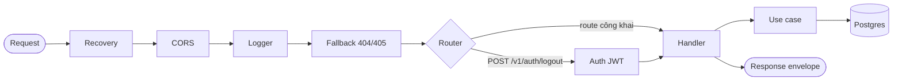
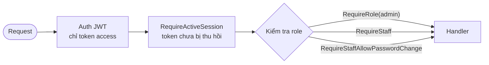

Mọi request, ở cả appService và backofficeService, đi qua cùng một chuỗi middleware, rồi đến router.

## Thứ tự middleware

Thứ tự quan trọng, mỗi lớp có lý do:

1. **Recovery** (ngoài cùng): bắt panic từ bất kỳ lớp nào bên trong và trả `500 INTERNAL_ERROR` đúng envelope.
2. **CORS**: trả lời luôn preflight `OPTIONS` và dừng ở đây, nên preflight không xuất hiện trong log.
3. **Logger**: ghi log bắt đầu và hoàn tất cho cả route khớp lẫn 404/405.
4. **Fallback**: chỉ viết lại body 404/405 mặc định của router thành envelope chuẩn. Không đụng tới response của handler thật.

## Bên trong một handler

1. **Decode JSON chặt**: từ chối body rỗng, JSON hỏng, field lạ, hai object liền nhau, sai `Content-Type`. Body quá 1 MB trả `413 PAYLOAD_TOO_LARGE`.
2. **Kiểm tra định dạng** bằng tag `validate` (email, số điện thoại, độ dài OTP…). Sai thì trả `400 VALIDATION_ERROR` kèm `details` theo từng field.
3. **Gọi use case**, nơi chứa quy tắc nghiệp vụ.
4. **Ánh xạ kết quả**: thành công đi qua `WriteSuccessResponse`. Lỗi domain được chuyển thành `(HTTP status, error.code)` ở một chỗ duy nhất, lỗi lạ rơi vào `500 INTERNAL_ERROR` và không lộ nguyên nhân.

## Xác thực

Chỉ `POST /v1/auth/logout` được bọc middleware JWT (chỉ nhận token loại `access`). Khi bị từ chối, response vẫn dùng envelope chuẩn (`401 UNAUTHORIZED`), và không nói rõ token hết hạn, giả mạo hay sai loại.

Các route còn lại là công khai: người gọi hoặc chưa có tài khoản (đăng ký), hoặc chứng minh danh tính bằng mật khẩu/refresh token trong body, hoặc chỉ đọc dữ liệu công khai (danh mục).

## Xác thực ở backofficeService

Mọi route `/v1/admin/*` trừ `login` đi qua thêm các lớp bọc handler, theo thứ tự:

| Route | Yêu cầu |
| --- | --- |
| `POST /v1/admin/auth/login`, `GET /healthz` | Công khai |
| `POST /v1/admin/auth/change-password` | Mọi admin, kể cả token đang buộc đổi mật khẩu |
| `GET /v1/admin/me` | Mọi tài khoản backoffice, đã đổi mật khẩu |
| `POST /v1/admin/users`, `POST /v1/admin/users/{id}/reset-password` | Role `admin` |

- **Thu hồi token**: token đã ký đúng nhưng cấp trước `tokens_valid_after` của admin (hoặc admin bị xoá, bị vô hiệu) bị từ chối `401`, trước cả bước kiểm role.
- **Buộc đổi mật khẩu**: token của tài khoản có `must_change_password` chỉ dùng được ở `change-password`; các route khác trả `PASSWORD_CHANGE_REQUIRED`.
- Lỗi xác thực vẫn dùng envelope chuẩn như appService.
