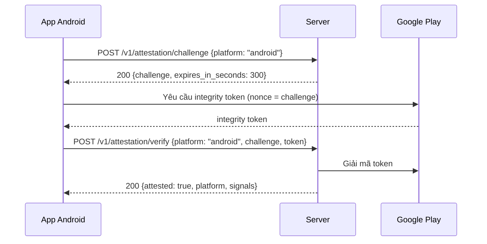
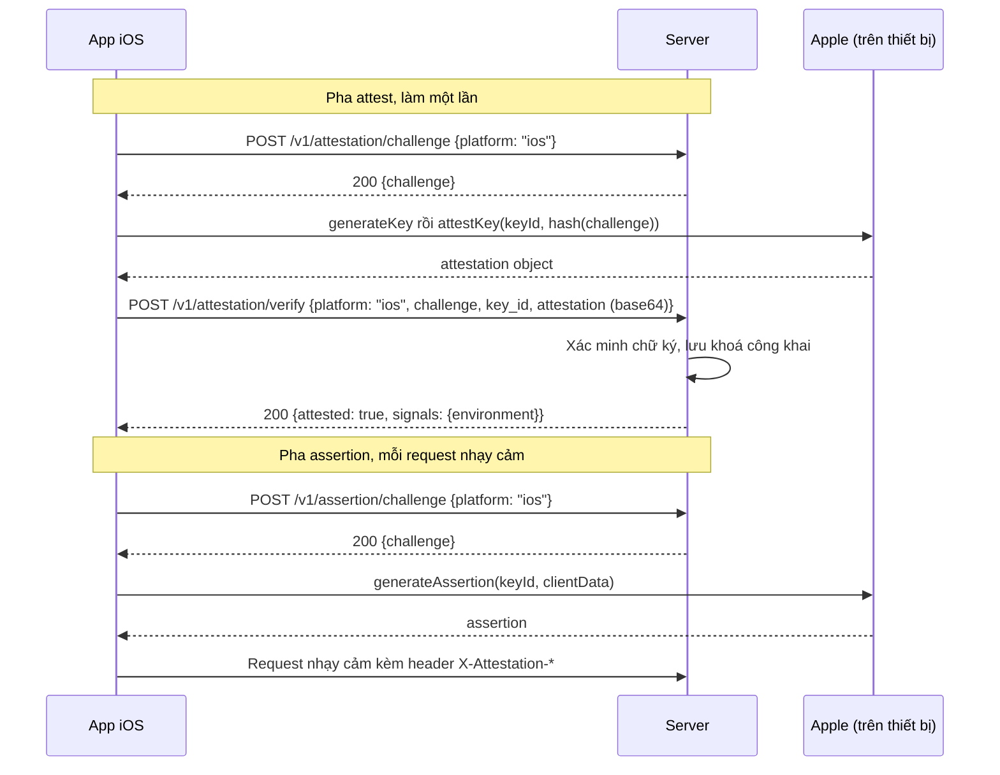

Attestation cho server biết request đến từ **app thật chạy trên thiết bị thật**, không phải bản giả mạo hay script. Cả ba endpoint đều công khai.

:::note[Trạng thái hiện tại]
Endpoint đã hoạt động, nhưng chưa có route nghiệp vụ nào **bắt buộc** attestation. Middleware `RequireAttestation` đã viết và test, chưa gắn vào route nào. Ở dev, driver là `mock` (kết quả giả), chưa gọi Google/Apple thật.
:::

## Ý tưởng chung

1. Client xin một **challenge** dùng một lần (sống 5 phút).
2. Client nhờ nền tảng (Google/Apple) ký challenge đó.
3. Client gửi bằng chứng lên server để nhận **verdict**.

Challenge chống replay: mỗi challenge chỉ dùng được một lần, kể cả khi verdict âm tính.

| Việc | Endpoint | Nền tảng | Thành công |
| --- | --- | --- | --- |
| Xin challenge để attest | `POST /v1/attestation/challenge` | Android, iOS | `200` `{challenge, expires_in_seconds}` |
| Xin challenge cho assertion | `POST /v1/assertion/challenge` | Chỉ iOS | `200` `{challenge, expires_in_seconds}` |
| Gửi bằng chứng, nhận verdict | `POST /v1/attestation/verify` | Android, iOS | `200` verdict |

Hai loại challenge **không dùng thay nhau được**: challenge của assertion gửi tới `verify` sẽ bị `ATTESTATION_CHALLENGE_INVALID`.

## Xin challenge

Body chỉ có `platform`: `android` hoặc `ios` cho `/v1/attestation/challenge`, và chỉ `ios` cho `/v1/assertion/challenge`.

```bash
curl -X POST http://localhost:8080/v1/attestation/challenge \
  -H 'Content-Type: application/json' \
  -d '{"platform": "android"}'
```

```json
{
  "success": true,
  "data": { "challenge": "q83vEjRWeJASNFZ4kBI0VniQEjRWeJASNFZ4kBI0Vng=", "expires_in_seconds": 300 }
}
```

| Field | Kiểu | Ghi chú |
| --- | --- | --- |
| `challenge` | string | 32 byte ngẫu nhiên mã hoá base64 chuẩn (44 ký tự). Dùng nguyên chuỗi này, đừng decode rồi encode lại. |
| `expires_in_seconds` | int | Thời gian sống, dev là 300 giây. Hết hạn thì xin challenge mới. |

## Android (Play Integrity)



Body của `verify` với Android: `platform`, `challenge`, `token`. **Không** gửi `key_id` hay `attestation`.

## iOS (App Attest)

iOS có hai pha: **attest** một lần để đăng ký khoá, và **assertion** cho từng request nhạy cảm.



Body của `verify` với iOS: `platform`, `challenge`, `key_id`, `attestation`. **Không** gửi `token`. `attestation` phải là base64 chuẩn.

### Header cho assertion

Route được bảo vệ bằng `RequireAttestation` đọc ba header:

| Header | Nội dung |
| --- | --- |
| `X-Attestation-Key-Id` | `key_id` đã đăng ký ở pha attest |
| `X-Attestation-Assertion` | assertion do Apple ký |
| `X-Attestation-Challenge` | challenge lấy từ `/v1/assertion/challenge` |

`X-Attestation-Assertion` là assertion (CBOR) mã hoá base64 chuẩn.

`clientData` là các byte sau nối liền nhau, không có dấu phân cách:

```text
clientData = challenge (chuỗi base64, dạng text) || method (vd. "POST") || path (vd. "/v1/...", không có query) || SHA-256(body) (32 byte thô)
```

Client gọi `generateAssertion(keyId, clientDataHash: SHA256(clientData))`. Server dựng lại `clientData` từ chính request nhận được, nên assertion ký cho request khác (khác method, path hoặc body) sẽ không qua.

Khi bị từ chối, route được bảo vệ trả `401`:

| `error.code` | `details.reason` | Khi nào |
| --- | --- | --- |
| `ATTESTATION_FAILED` | `missing_evidence` | Thiếu một trong ba header. |
| `ATTESTATION_FAILED` | `assertion_invalid` | Assertion không phải base64, hoặc chữ ký không khớp. |
| `ATTESTATION_FAILED` | `unknown_key` | `key_id` chưa được đăng ký qua pha attest. |
| `ATTESTATION_FAILED` | `counter_not_increased` | Bộ đếm không tăng (dấu hiệu replay). |
| `ATTESTATION_CHALLENGE_INVALID` | | Challenge không tồn tại, hết hạn hoặc đã dùng. Ở đây là `401`, còn ở `verify` là `400`. |

Chưa có route nào dùng middleware này, nên phần trên chưa được kiểm chứng end-to-end với app thật.

## Body của `POST /v1/attestation/verify`

| Field | Kiểu | Android | iOS | Ghi chú |
| --- | --- | --- | --- | --- |
| `platform` | string | bắt buộc | bắt buộc | `android` hoặc `ios` |
| `challenge` | string | bắt buộc | bắt buộc | Lấy từ `/v1/attestation/challenge` |
| `token` | string | bắt buộc | **cấm** | Integrity token của Play Integrity |
| `key_id` | string | **cấm** | bắt buộc | Key id của App Attest |
| `attestation` | string | **cấm** | bắt buộc | Attestation object, base64 chuẩn |

Gửi field của nền tảng kia trả `400 VALIDATION_ERROR` với `details` như `{"key_id": "excluded"}`.

## Đọc verdict

| Field | Kiểu | Ghi chú |
| --- | --- | --- |
| `attested` | bool | Kết quả. |
| `platform` | string | `android` hoặc `ios`. |
| `signals` | object | **Chỉ có khi `attested = true`.** Android: `app_recognition_verdict`, `device_recognition_verdict`, `app_licensing_verdict`. iOS: `environment` (`development` hoặc `production`). |
| `reason` | string | **Chỉ có khi `attested = false`.** Xem bảng bên dưới. |

```json
{
  "success": true,
  "data": {
    "attested": true,
    "platform": "android",
    "signals": {
      "app_recognition_verdict": "PLAY_RECOGNIZED",
      "device_recognition_verdict": "MEETS_DEVICE_INTEGRITY",
      "app_licensing_verdict": "LICENSED"
    }
  }
}
```

```json
{ "success": true, "data": { "attested": true, "platform": "ios", "signals": { "environment": "production" } } }
```

```json
{ "success": true, "data": { "attested": false, "platform": "android", "reason": "app_not_recognized" } }
```

| `reason` | Nền tảng | Ý nghĩa |
| --- | --- | --- |
| `app_not_recognized` | Android | Token hợp lệ nhưng Google không nhận ra app (dưới ngưỡng `PLAY_RECOGNIZED`). |
| `attestation_invalid` | Android, iOS | Bằng chứng không khớp (package name, nonce, quá cũ) hoặc attestation object không xác minh được. |

**Verdict âm tính vẫn là HTTP 200.** Chỉ kiểm tra `data.attested`, đừng dựa vào status code.

| Tình huống | Kết quả |
| --- | --- |
| Bằng chứng hợp lệ | `200`, `attested: true` |
| Bằng chứng không đạt | `200`, `attested: false` kèm `reason` |
| Challenge không tồn tại, hết hạn, đã dùng, hoặc là challenge của assertion | `400 ATTESTATION_CHALLENGE_INVALID` |
| Google không phản hồi khi giải mã token (chỉ Android) | `502 ATTESTATION_UPSTREAM_ERROR`, challenge chưa bị tiêu nên gửi lại được với cùng challenge |
| Thiếu field bắt buộc, gửi field bị cấm, `attestation` không phải base64 | `400 VALIDATION_ERROR`, `details` chỉ ra field |
| Body lớn hơn 1 MB | `413 PAYLOAD_TOO_LARGE` |

iOS được xác minh ngay trên server nên không có `502`. Khi iOS đạt, server lưu khoá công khai của `key_id` để dùng cho assertion.
