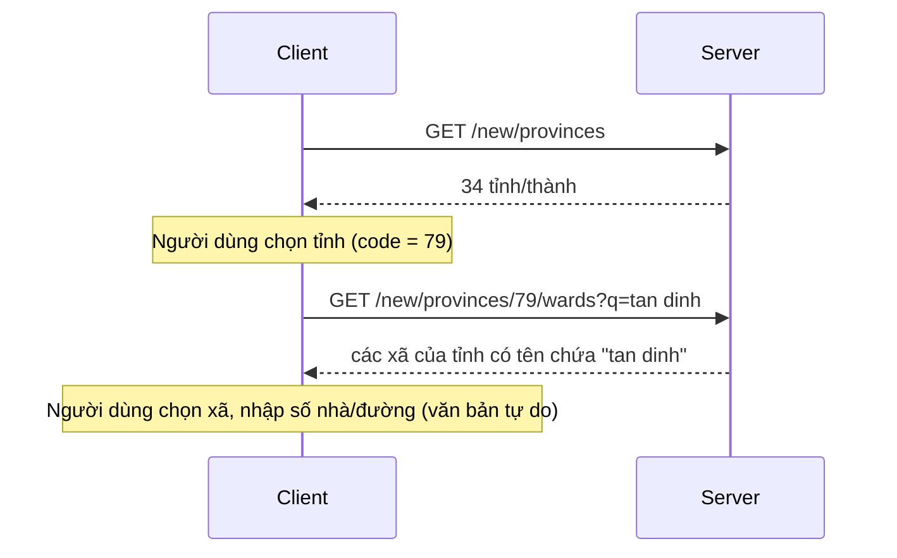

Danh mục đơn vị hành chính Việt Nam để người dùng **chọn địa chỉ tới cấp xã/phường**. Có hai hệ, tách riêng:

- **Hệ mới** (từ 01/07/2025): hai cấp, **34 tỉnh/thành → xã/phường/đặc khu**. Không có cấp huyện.
- **Hệ cũ** (trước 01/07/2025): ba cấp, **63 tỉnh/thành → quận/huyện → xã/phường**.

App chỉ cho người dùng chọn **hệ mới**. Hệ cũ và các route chuyển đổi vẫn có để tham chiếu và dùng về sau.

Mọi endpoint đều **công khai** (không cần đăng nhập, kể cả khi đang đăng ký) và **chỉ đọc**.

| Thao tác | Endpoint |
| --- | --- |
| Hệ mới: danh sách tỉnh/thành | `GET /v1/administrative-units/new/provinces` |
| Hệ mới: xã/phường của một tỉnh (có thể tìm theo tên) | `GET /v1/administrative-units/new/provinces/{code}/wards` |
| Hệ mới → cũ: các tỉnh cũ đã nhập vào tỉnh này | `GET /v1/administrative-units/new/provinces/{code}/conversion` |
| Hệ mới → cũ: các xã cũ của một xã mới | `GET /v1/administrative-units/new/wards/{code}/conversion` |
| Hệ cũ: danh sách tỉnh/thành | `GET /v1/administrative-units/old/provinces` |
| Hệ cũ: quận/huyện của một tỉnh | `GET /v1/administrative-units/old/provinces/{code}/districts` |
| Hệ cũ: xã/phường của một quận/huyện | `GET /v1/administrative-units/old/districts/{code}/wards` |
| Hệ cũ → mới: tỉnh mới tương ứng | `GET /v1/administrative-units/old/provinces/{code}/conversion` |
| Hệ cũ → mới: các xã mới của một xã cũ | `GET /v1/administrative-units/old/wards/{code}/conversion` |

## Quy ước chung

- **`code` chỉ có nghĩa cùng với hệ.** Cùng một chuỗi mã có thể là hai đơn vị khác nhau ở hệ cũ và hệ mới; luôn gọi đúng nhánh `new/` hoặc `old/` với mã lấy từ chính nhánh đó.
- Danh sách sắp theo **chữ cái tiếng Việt** của `name`; số trong tên so như số ("Phường 2" trước "Phường 10"). Không phân trang: mọi danh sách đều trả trọn trong một response (lớn nhất là 168 xã của Hồ Chí Minh).
- `name` là tên ngắn không tiền tố; `full_name` có tiền tố loại (`Thành phố Hồ Chí Minh`, `Phường Tân Định`). `type` là nhãn của bộ dữ liệu và là **tập mở**: đừng hard-code danh sách giá trị.
- Header `X-API-Key` như các route công khai khác, xem [Xác thực](/guides/authentication/#x-api-key-client-web): sai thì `401 INVALID_API_KEY`, vắng (mobile) thì phục vụ bình thường.
- Response có `Cache-Control: public, max-age=<giây>` (dev: 24 giờ). Dữ liệu chỉ đổi khi vận hành nạp bản mới, nên client cache được.
- Giới hạn theo IP chung cho cả nhóm route (dev: 60 lần mỗi phút). Vượt thì `429 RATE_LIMITED` kèm `Retry-After` và `details.retry_after_seconds`.

:::note
Giới hạn tần suất và thời hạn cache là cấu hình của server (`administrative_units.*`), có thể khác giữa các môi trường. Giá trị ở đây là của môi trường dev.
:::

## Chọn địa chỉ (hệ mới)



Cấp dưới xã (thôn, đường, số nhà) **không** có trong danh mục: người dùng tự nhập.

### Danh sách tỉnh/thành

```json title="GET /v1/administrative-units/new/provinces"
{
  "success": true,
  "data": {
    "items": [
      { "code": "79", "name": "Hồ Chí Minh", "full_name": "Thành phố Hồ Chí Minh", "type": "city" }
    ]
  }
}
```

Hệ cũ (`old/provinces`) cùng hình dạng. `type` của tỉnh/thành là `province` hoặc `city`.

### Xã/phường của một tỉnh

`GET /v1/administrative-units/new/provinces/79/wards`

```json title="Response"
{
  "success": true,
  "data": {
    "items": [
      { "code": "26737", "name": "Tân Định", "full_name": "Phường Tân Định", "type": "ward", "province_code": "79" }
    ]
  }
}
```

`type` của xã mới là `ward`, `commune` hoặc `special_zone` (đặc khu).

| Query | Ghi chú |
| --- | --- |
| `q` | Từ khoá tìm trong tên đầy đủ của xã **của tỉnh này**, 1–100 ký tự sau khi bỏ khoảng trắng hai đầu. **Bỏ hẳn** tham số để không tìm; để trống, chỉ khoảng trắng hoặc dài quá 100 ký tự trả `400 INVALID_FILTER` (`details.field = "q"`). |

Cách khớp của `q`: khớp một phần chuỗi, không phân biệt hoa thường, dấu tiếng Việt (`tan dinh` = `Tân Định`, `đ` tính như `d`), vị trí dấu thanh (`Hòa` = `Hoà`) và kiểu dấu nháy (`B’Lao` = `B'Lao`). Vì tìm trên `full_name`, gõ cả tiền tố loại cũng khớp (`phuong tan dinh`). Không khớp xã nào thì `200` với `items: []`. Thứ tự kết quả giống khi không có `q`.

## Hệ cũ

1. `GET /old/provinces` → chọn tỉnh.
2. `GET /old/provinces/{code}/districts` → chọn quận/huyện (`province_code` kèm theo).
3. `GET /old/districts/{code}/wards` → chọn xã/phường (`district_code` và `province_code` kèm theo).

Huyện đảo (Bạch Long Vĩ, Cồn Cỏ, Hoàng Sa, Lý Sơn, Côn Đảo) không có xã: bước 3 trả `200` với `items: []`, không phải lỗi.

## Chuyển đổi giữa hai hệ

Mọi route chuyển đổi trả cùng một dạng:

```json title="Response"
{
  "success": true,
  "data": {
    "unique": false,
    "candidates": [ ]
  }
}
```

- `unique = true` khi có **đúng một** kết quả: client dùng luôn. `false` khi có nhiều kết quả hoặc không có: **server không chọn hộ**, client cho người dùng chọn.
- Chuyển đổi cấp xã: mỗi ứng viên gồm `ward`, các đơn vị cha (`province`, và `district` khi đích là hệ cũ), cùng `mapping_type` và `note`. `mapping_type` là nhãn của bộ dữ liệu (`merged`, `province_changed`, `ambiguous` = chỉ một phần nhập vào, `unchanged`, `split_population`, `renamed`; tập mở), `note` là ghi chú tiếng Việt.
- Chuyển đổi cấp tỉnh: `candidates` là các tỉnh. Cũ → mới **luôn đúng một** tỉnh (`unique = true`). Mới → cũ là danh sách: ví dụ `Hồ Chí Minh` mới gom `Hồ Chí Minh`, `Bình Dương`, `Bà Rịa - Vũng Tàu` cũ.
- Khoảng 4,4% xã cũ ứng với nhiều xã mới.

:::caution
Năm đặc khu đảo (Bạch Long Vĩ, Cồn Cỏ, Hoàng Sa, Lý Sơn, Côn Đảo) thay cả huyện cũ, mà chuyển đổi cấp huyện chưa được phục vụ. `new/wards/{code}/conversion` của chúng trả `200` với `candidates: []` và `unique = false`, không phải 404.
:::

:::note
Bộ dữ liệu lấy từ nguồn cộng đồng và **chưa đối chiếu với bảng chuyển đổi chính thức**. Nên coi kết quả chuyển đổi là gợi ý cho người dùng xác nhận, không phải căn cứ pháp lý.
:::

## Dùng ở những nơi khác

Mọi nơi trong hệ thống có địa chỉ dùng cùng một bộ ba: `province_code` + `ward_code` (mã **hệ mới** từ danh mục này) + `address` (phần dưới cấp xã, văn bản tự do). Tên tỉnh và tên xã do server tra từ mã và lưu kèm, client không gửi tên.

| Nơi | Cách dùng |
| --- | --- |
| [Chùa](/guides/catalogues/temples/) | `location` trả `province_code`, `ward_code`, `ward` và `full_address` (chuỗi để hiển thị). `options` trả `province_code` để lọc/nhóm theo tỉnh. |
| [Đề xuất thêm chùa](/guides/catalogues/temple-suggestions/) | Body gửi `province_code`, `ward_code`, `address`; ban quản trị tạo chùa với cùng bộ ba. |

Khi cần hiển thị địa chỉ chùa, dùng `location.full_address`; **đừng** nối từ `location.address` riêng lẻ, vì từ phiên bản này nó chỉ còn phần dưới cấp xã và có thể rỗng. Chùa chưa có địa chỉ có cấu trúc (nếu còn) có `province_code`, `ward_code`, `ward` là `null` và `address` là chuỗi đầy đủ cũ.

## Lỗi

| HTTP | `error.code` | Khi nào |
| --- | --- | --- |
| 400 | `INVALID_FILTER` | `q` có mặt nhưng rỗng, chỉ khoảng trắng hoặc dài quá 100 ký tự (`details.field = "q"`). |
| 401 | `INVALID_API_KEY` | `X-API-Key` sai hoặc rỗng. |
| 404 | `ADMINISTRATIVE_UNIT_NOT_FOUND` | Không có đơn vị với `code` này **trong hệ đã chỉ định** (nhầm mã giữa `new/` và `old/` cũng ra lỗi này). |
| 429 | `RATE_LIMITED` | IP vượt ngân sách tra cứu; chờ `details.retry_after_seconds`. |

Danh sách rỗng (xã không khớp `q`, huyện đảo) là `200` chứ không phải 404.
