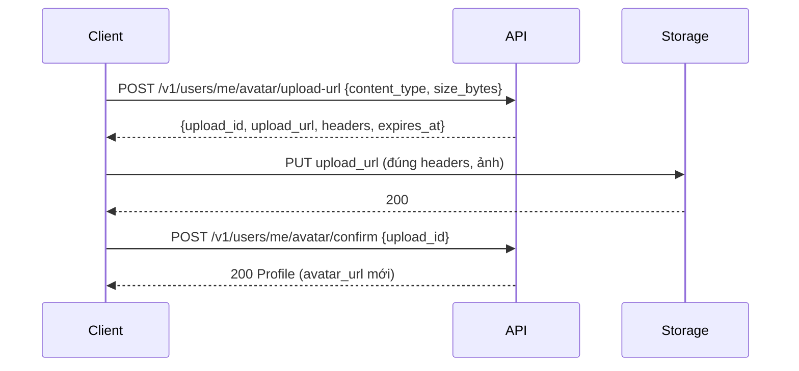

Người dùng xem hồ sơ của **chính mình**, sửa **họ tên**, **pháp danh** và **nơi quy y/xuất gia**, và đặt, đổi hoặc gỡ **ảnh đại diện**. Mọi endpoint đều **cần đăng nhập**: gửi `Authorization: Bearer <access_token>` (xem [Xác thực](/guides/authentication/)). Người dùng luôn là `user_id` trong token; không có endpoint nào nhận user id từ client và không xem được hồ sơ người khác.

:::caution[Upload ảnh chưa được kiểm chứng trên storage thật]
Năm endpoint đã chạy ở server và luồng upload ảnh (xin vé → upload → xác nhận) đã được kiểm chứng đầu-cuối, nhưng **trên storage emulator của môi trường dev**, nơi địa chỉ upload/đọc **không có chữ ký** và storage **không ép** giới hạn 5 MB, loại file hay hạn URL (server vẫn kiểm lại loại và dung lượng ở bước xác nhận). Trên bucket GCS thật, chữ ký và các giới hạn đó chưa được kiểm tra (nợ kỹ thuật `TD-001`), cần làm trước khi deploy.

Đừng viết cứng `PUT`: dùng `method` trong vé. Bucket thật dùng `PUT`; emulator dev dùng `POST`.
:::

| Thao tác | Endpoint |
| --- | --- |
| Xem hồ sơ | `GET /v1/users/me` |
| Sửa họ tên, pháp danh, chùa quy y | `PATCH /v1/users/me` |
| Xin quyền upload ảnh (bước 1) | `POST /v1/users/me/avatar/upload-url` |
| Xác nhận ảnh đã upload (bước 2) | `POST /v1/users/me/avatar/confirm` |
| Gỡ ảnh đại diện | `DELETE /v1/users/me/avatar` |

:::note
**Email và số điện thoại chỉ đọc.** Email là định danh đăng nhập và số điện thoại là thông tin hồ sơ đã xác lập lúc đăng ký, nên không đổi được ở đây (đổi cần luồng xác thực riêng, chưa có). Gửi `email` hoặc `phone_number` trong `PATCH` bị từ chối **cả request**.
:::

:::note
Các con số trên trang này (255 ký tự pháp danh, 5 MB ảnh, 5 phút quyền upload, 15 phút địa chỉ đọc ảnh, 10 request/phút) là giá trị cấu hình của server (`profile.*`), có thể khác giữa các môi trường. Giá trị ở đây là của môi trường dev.
:::

## Xem hồ sơ

`GET /v1/users/me` không có body.

```json title="Response"
{
  "success": true,
  "data": {
    "email": "an@example.com",
    "email_verified": true,
    "phone_number": "0901234567",
    "full_name": "Nguyễn Văn An",
    "dharma_name": "Thích Minh An",
    "ordination_temple": { "id": "temple_north_011", "name": "Chùa Bích Động" },
    "avatar_url": "https://storage.googleapis.com/…?X-Goog-Expires=900&X-Goog-Signature=…",
    "avatar_url_expires_at": "2026-10-11T12:15:00Z"
  }
}
```

| Field | Kiểu | Ghi chú |
| --- | --- | --- |
| `email` | string | Luôn có. |
| `email_verified` | bool | Luôn có. `true` với tài khoản đăng ký qua mã email (email được xác minh ở `verify-otp`), `false` với tài khoản cũ. |
| `phone_number` | string | Luôn có, đầy đủ, không che. |
| `full_name` | string | Họ và tên. **Vắng mặt** với tài khoản tạo trước khi đăng ký bắt buộc họ tên. |
| `dharma_name` | string | Pháp danh. **Vắng mặt** khi chưa có. |
| `ordination_temple` | object | `{id, name}` của chùa quy y. **Vắng mặt** khi chưa chọn. |
| `avatar_url` | string | Địa chỉ đọc ảnh, có chữ ký. **Vắng mặt** khi chưa có ảnh. |
| `avatar_url_expires_at` | string | UTC, RFC 3339. Có cùng `avatar_url`. |

Field chưa có giá trị **không xuất hiện** trong `data` (không phải `null`, không phải chuỗi rỗng). Client hiển thị "chưa cập nhật" khi vắng mặt.

### Địa chỉ ảnh hết hạn sau 15 phút

`avatar_url` là địa chỉ có chữ ký, **không phải URL công khai cố định**. Đừng lưu nó lâu dài. Khi hết hạn (hoặc ảnh hiển thị lỗi 403), gọi lại `GET /v1/users/me` để lấy địa chỉ mới.

## Sửa họ tên, pháp danh và chùa quy y

`PATCH /v1/users/me` cập nhật **từng phần**: chỉ gửi field muốn đổi.

| Field | Kiểu | Ghi chú |
| --- | --- | --- |
| `full_name` | string | Họ và tên, tối đa 300 **ký tự** sau khi cắt khoảng trắng đầu cuối. **Bắt buộc có giá trị**: sửa được nhưng không xoá được. |
| `dharma_name` | string \| null | Cắt khoảng trắng đầu cuối, tối đa 255 **ký tự** (không phải byte; chữ có dấu tính một ký tự). |
| `ordination_temple_id` | string \| null | Id chùa lấy từ [`GET /v1/temples/options`](/guides/catalogues/temples/). Id không có trong danh sách trả `400 INVALID_TEMPLE`. |

| Bạn gửi | Kết quả |
| --- | --- |
| Field **vắng mặt** | Giữ nguyên giá trị đang lưu. |
| `null`, `""` hoặc chỉ khoảng trắng | **Xoá** giá trị (`dharma_name`, `ordination_temple_id`). Với `full_name`: bị từ chối `400 INVALID_FULL_NAME`. |
| Một giá trị | Đặt giá trị mới. |
| `{}` | Hợp lệ, hồ sơ không đổi. |

```json title="PATCH /v1/users/me — đổi pháp danh, gỡ chùa quy y"
{ "dharma_name": "Thanh Liên", "ordination_temple_id": null }
```

Response `200` là **hồ sơ đầy đủ** sau khi cập nhật (cùng dạng với `GET`), nên client cập nhật màn hình ngay không cần gọi lại.

**Tất cả hoặc không gì:** nếu một field sai thì không field nào trong request được lưu. Ví dụ gửi pháp danh hợp lệ kèm chùa không tồn tại: pháp danh cũng không đổi.

| Lỗi | Khi nào |
| --- | --- |
| `400 INVALID_FULL_NAME` | `details.field = "full_name"`: `null`, trống hoặc quá 300 ký tự. Cùng mã với đăng ký. |
| `400 INVALID_DHARMA_NAME` | `details.field = "dharma_name"`, quá 255 ký tự. Cùng mã với đăng ký. |
| `400 VALIDATION_ERROR` | Body rỗng, sai JSON, có field lạ (`email`, `phone_number`, `avatar_url`…). |
| `400 INVALID_TEMPLE` | `details.field = "ordination_temple_id"`, id chùa không tồn tại. |

## Đặt hoặc đổi ảnh đại diện

Server **không nhận byte ảnh**. Ảnh đi thẳng từ client lên storage bằng một địa chỉ có chữ ký, qua hai bước API:



### Bước 1: xin quyền upload

| Field | Kiểu | Ghi chú |
| --- | --- | --- |
| `content_type` | string | `image/jpeg`, `image/png` hoặc `image/webp`. |
| `size_bytes` | int | Từ 1 đến 5 242 880 (5 MB); đúng 5 MB vẫn hợp lệ. |

```json title="Response (AvatarUploadTicket)"
{
  "success": true,
  "data": {
    "upload_id": "0b9c2d4e-6a1f-4c8b-9d3e-5f7a8b1c2d3e",
    "upload_url": "https://storage.googleapis.com/…?X-Goog-Expires=300&X-Goog-Signature=…",
    "method": "PUT",
    "headers": { "Content-Type": "image/jpeg", "x-goog-content-length-range": "0,5242880" },
    "expires_at": "2026-10-11T12:05:00Z"
  }
}
```

### Bước 2: upload ảnh lên storage

Gửi request với `method` của vé (bucket thật: `PUT`) tới `upload_url` cùng **đúng nguyên văn** các `headers` trong vé, trước `expires_at` (5 phút). Storage từ chối nếu quá hạn, sai `Content-Type` hoặc ảnh lớn hơn 5 MB; khi đó ảnh đại diện **không đổi**.

### Bước 3: xác nhận

Gửi `upload_id` của vé. Server kiểm tra loại và dung lượng ảnh, đặt làm ảnh đại diện và trả **hồ sơ đầy đủ** với `avatar_url` mới. Nếu người dùng đã có ảnh, ảnh cũ bị xoá.

| Lỗi | Khi nào |
| --- | --- |
| `400 VALIDATION_ERROR` | `details.field = "upload_id"` khi không phải UUID; hoặc ở bước 1: `content_type` hoặc `size_bytes` không hợp lệ. |
| `404 AVATAR_UPLOAD_NOT_FOUND` | Chưa có ảnh nào được upload với `upload_id` này (chưa PUT, PUT thất bại, hoặc id của người khác). |
| `400 INVALID_AVATAR` | Ảnh đã upload có loại không được phép hoặc quá 5 MB. Ảnh đại diện không đổi. |

```js title="Đặt ảnh đại diện (rút gọn)"
async function setAvatar(file, accessToken) {
  const auth = { Authorization: `Bearer ${accessToken}` };

  // 1. Xin vé
  const ticketRes = await fetch("/v1/users/me/avatar/upload-url", {
    method: "POST",
    headers: { ...auth, "Content-Type": "application/json" },
    body: JSON.stringify({ content_type: file.type, size_bytes: file.size }),
  });
  const { data: ticket } = await ticketRes.json();

  // 2. PUT thẳng lên storage, đúng headers của vé
  const put = await fetch(ticket.upload_url, {
    method: ticket.method,
    headers: ticket.headers,
    body: file,
  });
  if (!put.ok) throw new Error("upload failed");

  // 3. Xác nhận
  const res = await fetch("/v1/users/me/avatar/confirm", {
    method: "POST",
    headers: { ...auth, "Content-Type": "application/json" },
    body: JSON.stringify({ upload_id: ticket.upload_id }),
  });
  return (await res.json()).data; // Profile với avatar_url mới
}
```

:::caution
Server **không kiểm tra nội dung** file và **không kiểm duyệt** ảnh: nó chỉ tin loại và dung lượng đã khai. Client nên tự kiểm tra ảnh trước khi upload.
:::

## Gỡ ảnh đại diện

`DELETE /v1/users/me/avatar` gỡ ảnh và xoá khỏi storage. Response `200` là hồ sơ không có `avatar_url`. Gọi khi chưa có ảnh vẫn trả `200` với hồ sơ không đổi, nên gọi lại an toàn.

## Giới hạn tần suất

Cả năm endpoint dùng chung giới hạn **10 request mỗi phút mỗi tài khoản**, và **request đọc cũng tính**. Một lần đổi ảnh tốn khoảng 3 request (xin vé, xác nhận, đọc lại hồ sơ). Vượt giới hạn trả `429 RATE_LIMITED` kèm header `Retry-After` và `details.retry_after_seconds`:

```json
{
  "success": false,
  "error": { "code": "RATE_LIMITED", "message": "too many requests", "type": "business" },
  "details": { "retry_after_seconds": 23 }
}
```

Giới hạn tính theo **tài khoản**, không theo IP: tài khoản khác không bị ảnh hưởng. Đừng gọi lại hồ sơ liên tục để "làm mới"; dùng response `200` của `PATCH`/`confirm`/`DELETE` thay cho một lần `GET` nữa.

## Lỗi chung

| Mã | Khi nào |
| --- | --- |
| `401 UNAUTHORIZED` | Thiếu token, token sai hoặc hết hạn, hoặc gửi refresh token thay cho access token. |
| `413 PAYLOAD_TOO_LARGE` | Body JSON vượt 1 MB (không liên quan đến dung lượng ảnh, vì ảnh không đi qua API). |
| `429 RATE_LIMITED` | Vượt 10 request/phút của tài khoản. |
| `500 INTERNAL_ERROR` | Lỗi nội bộ (cơ sở dữ liệu, hoặc storage khi xác nhận/gỡ ảnh). |

Xem thêm [Xử lý lỗi](/guides/error-handling/).
