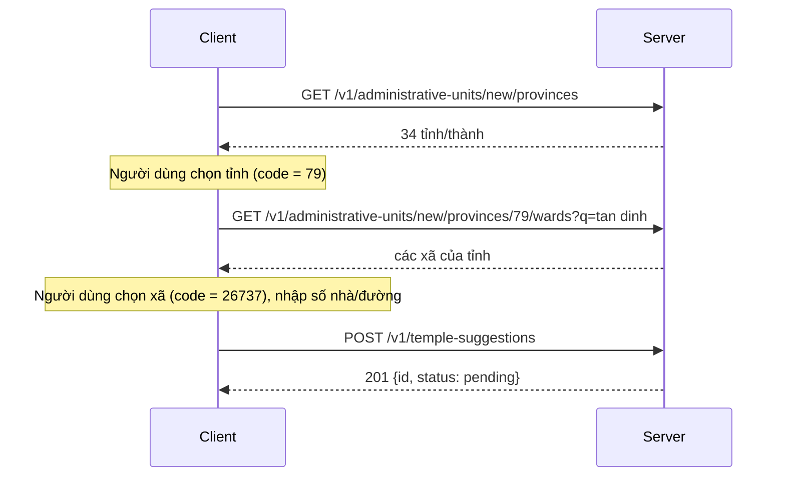

Người dùng có thể đề xuất một ngôi chùa chưa có trong [danh mục chùa](/guides/catalogues/temples/). Đề xuất được lưu ở trạng thái chờ duyệt; ban quản trị xem xét, bổ sung thông tin rồi mới đưa vào danh mục.

Phần dành cho **client (app/web)**: endpoint **công khai**, không cần đăng nhập, và **chỉ ghi**: không có route nào đọc lại đề xuất. Phần dành cho **ban quản trị** ở cuối trang.

| Gửi đề xuất |
| --- |
| `POST /v1/temple-suggestions` |

## Body

| Field | Kiểu | Bắt buộc | Ghi chú |
| --- | --- | --- | --- |
| `name` | string | có | Tên chùa, tối đa 255 ký tự. |
| `province_code` | string | có | Mã tỉnh/thành **hệ mới**, lấy từ [`GET /v1/administrative-units/new/provinces`](/guides/catalogues/administrative-units/). |
| `ward_code` | string | có | Mã xã/phường/đặc khu **hệ mới**, lấy từ `GET /v1/administrative-units/new/provinces/{code}/wards`. Phải thuộc `province_code`. |
| `address` | string | có | Phần địa chỉ **dưới cấp xã** (số nhà, đường, thôn), văn bản tự do, tối đa 500 ký tự. |

- `name` và `address` được cắt khoảng trắng đầu cuối, độ dài đếm theo ký tự Unicode, và được lưu đúng như người dùng nhập.
- Tên tỉnh và tên xã do **server** tra từ mã rồi lưu kèm đề xuất; client không gửi tên. Chỉ nhận mã **hệ mới**: cùng một chuỗi mã có thể là đơn vị khác ở hệ cũ.
- Field lạ bị từ chối `400 VALIDATION_ERROR`, kể cả `id`, `status` và **`province`** (field chuỗi tự do của phiên bản trước đã bỏ hẳn, không có chế độ chạy song song).
- Web gửi thêm header `X-API-Key` như các route công khai khác, xem [Xác thực](/guides/authentication/#x-api-key-client-web).

```bash
curl -X POST http://localhost:8080/v1/temple-suggestions \
  -H 'Content-Type: application/json' \
  -d '{"name":"Chùa Mới","province_code":"79","ward_code":"26737","address":"12 Nguyễn Huệ"}'
```

## Chọn tỉnh và xã



## Response

`201 Created`:

```json
{ "success": true, "data": { "id": 12, "status": "pending" } }
```

`id` chỉ để tham chiếu khi cần; client không có cách nào xem trạng thái đề xuất sau đó. Cùng một đề xuất gửi lại vẫn nhận `201`, vì server không dò trùng với chùa hay đề xuất đã có.

## Lỗi

| HTTP | `error.code` | Khi nào | Client nên làm gì |
| --- | --- | --- | --- |
| 400 | `VALIDATION_ERROR` | Thiếu hoặc rỗng một field, quá dài, JSON sai, field lạ (kể cả `province` cũ). `details.field` là field sai đầu tiên, theo thứ tự `name`, `province_code`, `ward_code`, `address`. | Báo lỗi cạnh field đó. |
| 400 | `VALIDATION_ERROR` | `province_code` không phải tỉnh hệ mới (`details.field = province_code`), hoặc `ward_code` không tồn tại / không thuộc tỉnh đã chọn (`details.field = ward_code`). | Cho người dùng chọn lại từ danh mục; đừng cho gõ tay mã. |
| 401 | `INVALID_API_KEY` | `X-API-Key` sai hoặc rỗng. | Kiểm tra cấu hình server web. |
| 413 | `PAYLOAD_TOO_LARGE` | Body vượt 1 MB. | Sửa request. |
| 429 | `RATE_LIMITED` | IP này đã gửi đủ số đề xuất cho phép (5 mỗi giờ, cấu hình dev). | Không retry tự động; dùng header `Retry-After` hoặc `details.retry_after_seconds`. |
| 500 | `INTERNAL_ERROR` | Lỗi nội bộ. | Cho phép thử lại thủ công. |

```json
{
  "success": false,
  "error": { "code": "RATE_LIMITED", "message": "too many requests", "type": "business" },
  "details": { "retry_after_seconds": 1800 }
}
```

:::note
Giới hạn tính theo IP và chung cho mọi người dùng cùng IP (mạng nhà mạng, văn phòng). IP chỉ dùng tạm cho bộ đếm, không lưu cùng đề xuất.
:::

Envelope và mã lỗi chung: [Xử lý lỗi](/guides/error-handling/).

## Dành cho ban quản trị (backoffice)

Ba route sau chạy trên **backofficeService (cổng `:8081`)**, không phải server của app. Cần token admin (`Authorization: Bearer`, audience `innerlamp_backoffice`; token của app bị từ chối) và role `admin` hoặc `content_editor`; `viewer` nhận `403`. Token phải thuộc tài khoản đã đổi mật khẩu tạm.

| Route | Việc |
| --- | --- |
| `GET /v1/admin/temple-suggestions` | Hàng chờ, cũ nhất trước. Query: `status` (`pending` mặc định, `created`, `rejected`), `page` (từ 1). |
| `GET /v1/admin/temple-suggestions/{id}` | Chi tiết một đề xuất, gồm kết quả duyệt. |
| `POST /v1/admin/temple-suggestions/{id}/create-temple` | Tạo chùa chính thức từ đề xuất. |

### Hàng chờ và chi tiết

Mỗi phần tử có `id`, `name`, `province_code`, `province`, `ward_code`, `ward`, `address`, `status`, `created_at`. Response phân trang như `GET /v1/temples`: `items`, `page`, `page_size`, `total`, `total_pages`; trang vượt cuối trả `200` với `items: []`.

- Đề xuất gửi **trước** khi có địa chỉ có cấu trúc có `province_code`, `ward_code`, `ward` là `null`; khi đó `province` là chuỗi người dùng đã gõ và `address` là địa chỉ đầy đủ người dùng đã gõ. Form duyệt phải hiển thị được cả hai dạng.
- Chi tiết thêm `temple_id` (chỉ khi `created`), `reviewed_by`, `reviewed_at`, `reject_reason`.
- `status` lạ → `400 INVALID_STATUS`; `page` không phải số nguyên dương → `400 INVALID_PAGE`; `{id}` không tồn tại hoặc không phải số dương → `404 TEMPLE_SUGGESTION_NOT_FOUND`.

### Tạo chùa

Mọi field của chùa lấy từ **body**, không sao chép từ đề xuất; form duyệt nên tự điền sẵn từ `GET .../{id}` rồi để admin sửa.

| Field | Kiểu | Bắt buộc | Ghi chú |
| --- | --- | --- | --- |
| `name` | string | có | Tối đa 255 ký tự. |
| `type` | string | có | `CHUA`, `THIEN_VIEN`, `DAO_TRANG`, `TINH_XA`, `THIEN_XA`. |
| `region` | string | có | `north`, `central`, `south`. Quyết định dạng id `temple_<region>_<NNN>`. |
| `sect` | string | có | Tối đa 64 ký tự. |
| `established_year` | integer | có | Dương, không ở tương lai. |
| `heritage_rank` | string | có | Một trong 8 hạng di tích (`DI_SAN_THE_GIOI` … `CHUA_XEP_HANG`). Server suy `heritage_priority`. |
| `latitude`, `longitude` | number | có | −90..90 và −180..180. `0` hợp lệ; thiếu thì `400`. |
| `province_code`, `ward_code` | string | có | Mã **hệ mới**; `ward_code` phải thuộc `province_code`. |
| `address` | string | có | Phần dưới cấp xã (số nhà, đường, thôn), tối đa 500 ký tự. |
| `image_url`, `thumbnail_url` | string | không | Rỗng, `/static/images/...` hoặc URL `http(s)`. Backend không nhận file ảnh và không kiểm file có tồn tại. |
| `aliases`, `founder`, `current_abbot`, `operating_hours`, `amenities`, `introduction`, `architecture_heritage`, `visiting_notes` | | không | Mặc định `''`, `[]`, `false`. |

- Tên tỉnh (`province`) và tên xã (`ward`) của chùa **luôn do server tra từ mã**, không bao giờ lấy từ body; field lạ bị từ chối `400`.
- Thao tác chạy trong **một transaction**: chèn chùa và đánh dấu đề xuất `created`. Lỗi bất kỳ thì không có chùa nào được tạo và đề xuất giữ nguyên trạng thái.
- Hai người cùng bấm tạo cho một đề xuất: đúng một thành công, người còn lại nhận `409 SUGGESTION_ALREADY_CREATED`.
- Đề xuất đã `rejected` chỉ `admin` mở lại để tạo chùa được (`content_editor` nhận `403`). Lý do từ chối cũ bị xoá khi đó.

`201 Created`:

```json
{
  "success": true,
  "data": {
    "suggestion": { "id": 12, "status": "created", "temple_id": "temple_south_181" },
    "temple": {
      "id": "temple_south_181",
      "name": "Chùa Mới",
      "location": {
        "lat": 10.77, "lng": 106.69, "address": "12 Nguyễn Huệ",
        "province": "Hồ Chí Minh", "province_code": "79",
        "ward_code": "26740", "ward": "Phường Sài Gòn",
        "full_address": "12 Nguyễn Huệ, Phường Sài Gòn, Hồ Chí Minh"
      }
    }
  }
}
```

`temple` có đủ hình dạng của [`GET /v1/temples/{id}`](/guides/catalogues/temples/) (rút gọn ở trên), và chùa xuất hiện ngay ở các route đọc công khai vì cùng một bảng.

| HTTP | `error.code` | Khi nào |
| --- | --- | --- |
| 400 | `VALIDATION_ERROR` | `details.field` là field sai: thiếu/rỗng, ngoài danh sách (`type`, `region`, `heritage_rank`), toạ độ hoặc năm ngoài khoảng, ảnh sai dạng, `province_code` không tồn tại, `ward_code` không có hoặc thuộc tỉnh khác. Đề xuất vẫn `pending`. |
| 401 | `UNAUTHORIZED` | Thiếu token, token sai hoặc là token app, token đã bị thu hồi. |
| 403 | `FORBIDDEN` | Role `viewer`; hoặc `content_editor` mở lại đề xuất `rejected`. |
| 403 | `PASSWORD_CHANGE_REQUIRED` | Tài khoản còn mật khẩu tạm. |
| 404 | `TEMPLE_SUGGESTION_NOT_FOUND` | Không có đề xuất này. |
| 409 | `SUGGESTION_ALREADY_CREATED` | Đề xuất đã được tạo chùa. |

:::note
Hành động **từ chối** đề xuất chưa có route; đề xuất rác tạm thời nằm ở `pending`. Trạng thái `rejected` đã sẵn trong dữ liệu và các route trên.
:::
