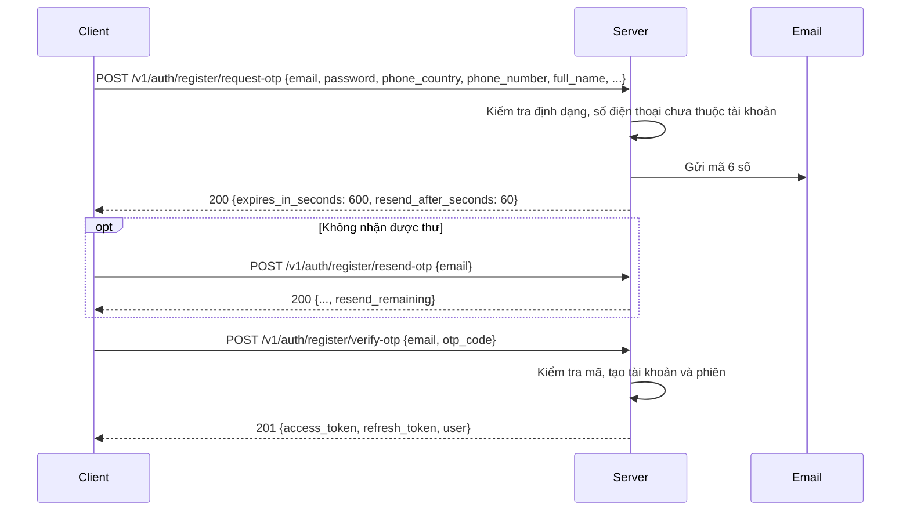
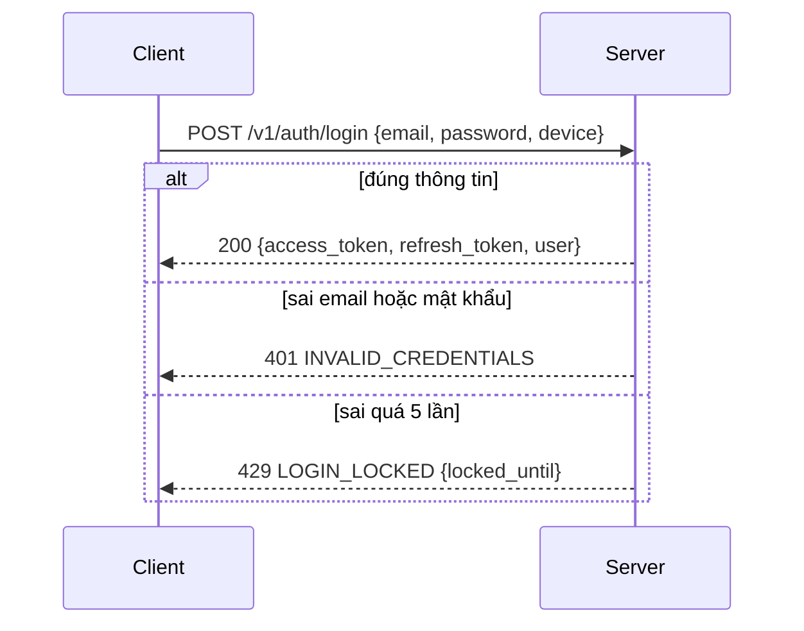
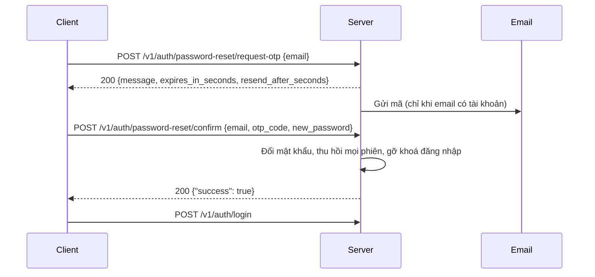

import { Tabs, TabItem } from '@astrojs/starlight/components';

Tám endpoint, đều dưới `/v1/auth`. Chỉ `logout` cần access token. Không dùng SMS: mã xác minh và mã đặt lại mật khẩu đều gửi qua **email**.

| Việc | Endpoint | Thành công |
| --- | --- | --- |
| Đăng ký, bước 1 | `POST /v1/auth/register/request-otp` | `200` thông tin mã |
| Gửi lại mã đăng ký | `POST /v1/auth/register/resend-otp` | `200` thông tin mã + `resend_remaining` |
| Đăng ký, bước 2 | `POST /v1/auth/register/verify-otp` | `201` `AuthResult` |
| Đăng nhập | `POST /v1/auth/login` | `200` `AuthResult` |
| Làm mới token | `POST /v1/auth/refresh` | `200` cặp token mới |
| Đăng xuất | `POST /v1/auth/logout` | `200` `{"success": true}` |
| Quên mật khẩu, xin mã | `POST /v1/auth/password-reset/request-otp` | `200` thông tin mã (luôn giống nhau) |
| Quên mật khẩu, đặt mật khẩu mới | `POST /v1/auth/password-reset/confirm` | `200` `{"success": true}` |

:::caution[Đường dẫn gửi lại mã đã đổi]
`POST /v1/auth/resend-otp` (body `phone_number` + `purpose`) **không còn**. Dùng `POST /v1/auth/register/resend-otp` với body `{"email": "..."}`.
:::

`refresh` và `logout` được mô tả ở [Xác thực](/guides/authentication/).

## Đăng ký (2 bước)

Đăng ký xác minh **email** bằng mã 6 số. Tài khoản chỉ được tạo ở bước 2.



### Điều cần biết

- Mã sống **10 phút** (`expires_in_seconds`, dev: 600), có thể gửi lại sau **60 giây**. Hiển thị đếm ngược theo `expires_in_seconds` và `resend_after_seconds` trả về, đừng hard-code.
- Thông tin đăng ký (mật khẩu, số điện thoại, họ tên…) chỉ gửi ở bước 1. Bước 2 và `register/resend-otp` chỉ cần email.
- Bước 2 thành công là **đã đăng nhập**, nên không cần gọi `login` nữa.
- **Số điện thoại bắt buộc nhưng không xác minh** (không có SMS). Chỉ cần đúng định dạng của nước đã chọn (`phone_country`) và chưa thuộc tài khoản nào (`409 PHONE_TAKEN`).
- **Không lộ email đã đăng ký.** Email đã có tài khoản nhận về đúng `200` như email mới; thư gửi đến là thư báo "email này đã có tài khoản" thay cho mã. Ở bước 2 mọi mã đều trả `OTP_INVALID`. Client không cần (và không thể) phân biệt hai trường hợp: hiển thị cùng một màn "nhập mã".
- Gọi lại `request-otp` với cùng email khi chưa xác minh: nếu dữ liệu **y hệt** hoặc mã trước đã hết hạn thì bản đăng ký cũ bị ghi đè và mã mới được gửi. Nếu mã trước còn sống mà dữ liệu **khác**, trả `409 REGISTRATION_IN_PROGRESS` và không đổi gì (chặn người lạ ghi đè mật khẩu của người đang đăng ký). Chờ `details.retry_after_seconds` hoặc dùng `register/resend-otp`.
- Bản đăng ký chờ xác minh sống 24 giờ.
- Nhập sai mã 3 lần thì bị khoá 30 phút (`429 OTP_LOCKED`, xem `details.locked_until`). Gửi mã quá số lần cho phép cũng bị khoá (`OTP_SEND_LIMITED`). Phát mã mới không mở khoá được `OTP_LOCKED`.
- Ở môi trường **dev**, mã luôn là `111111` và thư không được gửi thật: nội dung thư (kèm mã) chỉ ghi ở log của server.
- Mọi response của `/v1/auth/*` (trừ `logout`) kể cả lỗi có `Cache-Control: no-store`.

### Bước 1: `POST /v1/auth/register/request-otp`

| Field | Kiểu | Bắt buộc | Ghi chú |
| --- | --- | --- | --- |
| `email` | string | có | Cắt khoảng trắng, chuyển chữ thường. Sai định dạng (hoặc thiếu) trả `INVALID_EMAIL`. |
| `password` | string | có | 8 đến 64 **ký tự** (sau chuẩn hoá NFC), không có luật về chữ hoa/số. Ngoài khoảng đó trả `INVALID_PASSWORD`. |
| `phone_country` | string | có | Mã quốc gia ISO 3166 của số điện thoại: `VN`, `US`, `JP`, `KR`, `TH`, `SG`, `MY`, `TW`, `AU`, `DE`, `FR`, `CA`. Mã khác trả `INVALID_PHONE`. |
| `phone_number` | string | có | Số người dùng gõ, **không** kèm mã quốc gia hay `+`. Cho phép dấu cách, `.`, `-`; bỏ một số `0` đầu rồi phải đúng số chữ số của nước đó (VN: 9). Server trả lại dạng E.164 (`0901234567` + `VN` thành `+84901234567`). Sai trả `INVALID_PHONE`. |
| `full_name` | string | có | Họ và tên. Tối đa 300 **ký tự** sau khi cắt khoảng trắng đầu cuối (chữ có dấu tính một ký tự). Trống hoặc quá dài trả `INVALID_FULL_NAME`. |
| `dharma_name` | string | không | Pháp danh. Tối đa 255 **ký tự** sau khi cắt khoảng trắng đầu cuối. Quá dài trả `INVALID_DHARMA_NAME`. |
| `ordination_temple_id` | string | không | `id` chùa nơi quy y/xuất gia, lấy từ `GET /v1/temples/options` (danh sách rút gọn, có `?q=` tìm theo tên, không cần đăng nhập — xem [Chùa](/guides/catalogues/temples/#chọn-chùa-options)). Bỏ field nếu chưa có. Id không tồn tại trả `INVALID_TEMPLE`. |

Mỗi field có mã lỗi riêng, nên field thiếu hoặc rỗng trả mã `INVALID_*` của chính field đó. `VALIDATION_ERROR` chỉ dành cho lỗi cấu trúc (body sai JSON, field lạ như `ordination_place`, sai Content-Type).

```bash
curl -X POST http://localhost:8080/v1/auth/register/request-otp \
  -H 'Content-Type: application/json' \
  -d '{
    "email": "user@example.com",
    "password": "S3cret-pass",
    "phone_country": "VN",
    "phone_number": "0901234567",
    "full_name": "Nguyễn Văn An",
    "dharma_name": "Diệu Tâm"
  }'
```

```json
{
  "success": true,
  "data": { "message": "otp sent", "expires_in_seconds": 600, "resend_after_seconds": 60 }
}
```

### Gửi lại: `POST /v1/auth/register/resend-otp`

| Field | Kiểu | Bắt buộc | Ghi chú |
| --- | --- | --- | --- |
| `email` | string | có | Email đã dùng ở bước 1. |

Response giống bước 1, cộng thêm `resend_remaining`: số lượt gửi còn lại trước khi bị `OTP_SEND_LIMITED`. Mã cũ hết hiệu lực khi mã mới được phát.

```json
{
  "success": true,
  "data": { "message": "otp sent", "expires_in_seconds": 600, "resend_after_seconds": 60, "resend_remaining": 2 }
}
```

### Bước 2: `POST /v1/auth/register/verify-otp`

| Field | Kiểu | Bắt buộc | Ghi chú |
| --- | --- | --- | --- |
| `email` | string | có | Email đã dùng ở bước 1. |
| `otp_code` | string | có | Đúng 6 chữ số. Gửi dạng chuỗi để giữ số 0 ở đầu. |

Trả `201` với `AuthResult` (xem [bên dưới](#authresult)).

### Mã lỗi khi đăng ký

Ba endpoint: `request-otp` (bước 1), `resend-otp`, `verify-otp` (bước 2).

| HTTP | `error.code` | Ở endpoint | Khi nào | Client nên làm gì |
| --- | --- | --- | --- | --- |
| 400 | `VALIDATION_ERROR` | cả ba | Body sai JSON, field lạ, sai Content-Type; `otp_code` không đủ 6 chữ số. `details` cho biết field nào. | Sửa request. |
| 400 | `INVALID_EMAIL` | cả ba | Email sai định dạng (`details.field = "email"`). | Báo lỗi ở ô email. |
| 400 | `INVALID_PHONE` | request-otp | `phone_country` ngoài danh sách, hoặc `phone_number` sai ký tự / sai số chữ số (`details.field = "phone_number"`). | Báo lỗi ở ô số điện thoại. |
| 400 | `INVALID_PASSWORD` | request-otp | Mật khẩu dưới 8 hoặc trên 64 ký tự. | Báo lỗi ở ô mật khẩu. |
| 400 | `INVALID_FULL_NAME` | request-otp | Họ tên trống (chỉ khoảng trắng) hoặc quá 300 ký tự (`details.field = "full_name"`). | Báo lỗi ở ô họ tên. |
| 400 | `INVALID_DHARMA_NAME` | request-otp | Pháp danh quá 255 ký tự (`details.field = "dharma_name"`). | Báo lỗi ở ô pháp danh. |
| 400 | `INVALID_TEMPLE` | request-otp, verify-otp | `ordination_temple_id` không khớp chùa nào (verify-otp: chùa đã chọn không còn tồn tại). | Cho người dùng chọn lại chùa hoặc bỏ trống. |
| 400 | `OTP_INVALID` | verify-otp | Sai mã (hoặc email đã có tài khoản: mọi mã đều sai). | Cho nhập lại. |
| 400 | `OTP_EXPIRED` | verify-otp | Mã quá hạn hoặc đã dùng. | Gọi `register/resend-otp`. |
| 400 | `PENDING_REGISTRATION_EXPIRED` | verify-otp, resend-otp | Không có bản đăng ký chờ cho email này, hoặc quá 24 giờ. | Quay lại bước 1. |
| 409 | `PHONE_TAKEN` | request-otp, verify-otp | Số điện thoại đã thuộc một tài khoản. | Báo đổi số, hoặc gợi ý đăng nhập. |
| 409 | `REGISTRATION_IN_PROGRESS` | request-otp | Email này đang có mã còn sống với dữ liệu khác. `details.retry_after_seconds` là thời gian tới khi mã hết hạn. | Dùng mã đã gửi, hoặc `register/resend-otp`, hoặc chờ. |
| 429 | `OTP_RESEND_TOO_SOON` | request-otp, resend-otp | Chưa hết thời gian chờ. | Đếm ngược theo `details.retry_after_seconds`. |
| 429 | `OTP_SEND_LIMITED` | request-otp, resend-otp | Hết lượt gửi (hai endpoint dùng chung bộ đếm theo email). | Chờ tới `details.locked_until`. |
| 429 | `OTP_LOCKED` | cả ba | Nhập sai mã 3 lần liên tiếp, khoá 30 phút (cấu hình dev). | Chờ tới `details.locked_until`. |
| 429 | `RATE_LIMITED` | cả ba | IP gọi quá nhiều, hoặc hết ngân sách thư của ngày. Kèm header `Retry-After`. | Chờ `details.retry_after_seconds`. |
| 500 | `EMAIL_SEND_FAILED` | request-otp, resend-otp | Nhà cung cấp email từ chối gửi. Lượt gửi không bị tính. | Cho thử lại. |

Ví dụ lỗi có `details`:

```json
{
  "success": false,
  "error": { "code": "OTP_RESEND_TOO_SOON", "message": "please wait before requesting another code", "type": "business" },
  "details": { "retry_after_seconds": 42 }
}
```

## AuthResult

`register/verify-otp` và `login` trả cùng một cấu trúc trong `data`.

| Field | Kiểu | Ghi chú |
| --- | --- | --- |
| `access_token` | string | JWT, gửi ở header `Authorization: Bearer`. |
| `refresh_token` | string | JWT, chỉ dùng cho `POST /v1/auth/refresh`. |
| `expires_in` | int64 | Thời gian sống của `access_token`, tính bằng giây (dev: 900). Lên lịch refresh theo giá trị này. |
| `user.id` | int64 | |
| `user.email` | string | Đã chuẩn hoá (chữ thường). |
| `user.phone_number` | string | Dạng E.164, vd. `+84901234567`. |
| `user.full_name` | string | Họ và tên. Không có trong response với tài khoản tạo trước khi đăng ký bắt buộc họ tên (không phải `null`). |
| `user.dharma_name` | string | Không có trong response nếu người dùng không nhập (không phải `null`). |
| `user.ordination_temple_id` | string | `id` chùa nơi quy y/xuất gia. Không có trong response nếu người dùng chưa chọn chùa. |
| `user.created_at` | string | RFC 3339. |

```json
{
  "success": true,
  "data": {
    "access_token": "eyJhbGciOiJIUzI1NiIsInR5cCI6IkpXVCJ9…",
    "refresh_token": "eyJhbGciOiJIUzI1NiIsInR5cCI6IkpXVCJ9…",
    "expires_in": 900,
    "user": {
      "id": 42,
      "email": "user@example.com",
      "phone_number": "+84901234567",
      "full_name": "Nguyễn Văn An",
      "dharma_name": "Diệu Tâm",
      "created_at": "2026-09-30T08:15:30Z"
    }
  }
}
```

Ba field `full_name`, `dharma_name` và `ordination_temple_id` nên khai báo dạng Optional khi decode (`full_name` vắng mặt với tài khoản cũ).

## Đăng nhập

Đăng nhập bằng **email** và mật khẩu. Số điện thoại không còn dùng để đăng nhập.



- `device.platform` có thể vắng (server lưu `mobile`); `device.device_model` là **bắt buộc**. Các field còn lại của `device` tuỳ chọn.
- IP và User-Agent do server lấy từ request, không gửi trong body.
- Đăng nhập lại trên **cùng thiết bị** sẽ thu hồi phiên cũ của thiết bị đó. Mỗi thiết bị chỉ có một phiên hoạt động.
- Sai mật khẩu 5 lần liên tiếp thì khoá **email đó** 15 phút (cấu hình dev), kể cả email chưa có tài khoản. Khoá được gỡ khi đăng nhập đúng hoặc khi đặt lại mật khẩu xong.
- Server trả cùng một lỗi `INVALID_CREDENTIALS` ("Email hoặc mật khẩu không đúng") cho sai mật khẩu, email chưa có tài khoản, email mới đăng ký dở và tài khoản chưa xác minh email.

### Body của `POST /v1/auth/login`

| Field | Kiểu | Bắt buộc | Ghi chú |
| --- | --- | --- | --- |
| `email` | string | có | Chuẩn hoá như lúc đăng ký. Sai định dạng trả `INVALID_EMAIL`. |
| `password` | string | có | Chỉ kiểm tra khác rỗng (rỗng trả `INVALID_PASSWORD`). |
| `device.platform` | string | không | Vd. `ios`, `android`, `web`. Vắng hoặc rỗng: server lưu `mobile`. `web` chỉ được chấp nhận khi có `X-API-Key` đúng, nếu không `401 INVALID_API_KEY`. |
| `device.device_model` | string | có | Vd. `iPhone 15`. |
| `device.os_version` | string | không | |
| `device.app_version` | string | không | |
| `device.device_name` | string | không | Tên người dùng đặt cho máy. |

Trả `200` với [`AuthResult`](#authresult).

### Mã lỗi khi đăng nhập

| HTTP | `error.code` | Khi nào | Client nên làm gì |
| --- | --- | --- | --- |
| 400 | `VALIDATION_ERROR` | Body rỗng, sai JSON, field lạ (kể cả `phone_number` của bản cũ), sai Content-Type. | Sửa request. |
| 400 | `INVALID_EMAIL` | Email sai định dạng. | Báo lỗi ở ô email. |
| 400 | `INVALID_PASSWORD` | Mật khẩu rỗng. | Báo lỗi ở ô mật khẩu. |
| 400 | `INVALID_DEVICE` | Thiếu `device` hoặc `device_model`. | Sửa request. |
| 401 | `INVALID_CREDENTIALS` | Sai email hoặc mật khẩu. | Cho nhập lại, gợi ý "Quên mật khẩu". |
| 401 | `INVALID_API_KEY` | `X-API-Key` sai hoặc rỗng, hoặc `platform = web` mà không có key đúng. | Lỗi cấu hình server web, không retry. |
| 429 | `LOGIN_LOCKED` | Sai 5 lần liên tiếp. Lần thứ 5 vẫn là `401`, lần kế tiếp mới là `429`, kể cả khi đúng mật khẩu. | Chờ tới `details.locked_until`, hoặc đặt lại mật khẩu. |
| 429 | `RATE_LIMITED` | IP gọi quá nhiều (dev: 30 lượt/15 phút). Kèm header `Retry-After`. | Chờ `details.retry_after_seconds`. |

Các lỗi `400` không tính là một lần đăng nhập sai.

```json
{
  "success": false,
  "error": { "code": "LOGIN_LOCKED", "message": "too many failed login attempts, try again later", "type": "business" },
  "details": { "locked_until": "2026-09-30T08:30:30Z" }
}
```

## Quên mật khẩu

Hai bước, đều công khai. Mã đặt lại gửi tới email đã đăng ký.



- **Xin mã** luôn trả `200` với cùng một body cho mọi email hợp lệ, kể cả email chưa có tài khoản (khi đó không có thư nào được gửi). Hiển thị cùng một thông báo, ví dụ "Nếu email này có tài khoản, mã đã được gửi". Server cũng không trả lời sớm hơn một thời gian tối thiểu, nên không đo thời gian để dò email.
- **Gửi lại mã** là gọi lại `request-otp` (không có `resend-otp` riêng), chịu cùng giới hạn gửi (`OTP_RESEND_TOO_SOON`, `OTP_SEND_LIMITED`).
- Route này **không** trả `EMAIL_SEND_FAILED`: lỗi gửi thư không lộ ra. Nếu không thấy thư, người dùng bấm gửi lại.
- `confirm` thành công **không trả token**: đưa người dùng về màn đăng nhập. Mọi phiên cũ của tài khoản bị thu hồi, các thiết bị khác bị đăng xuất ở request kế tiếp. Khoá đăng nhập của email (nếu có) được gỡ.
- Nhập sai mã 3 lần thì khoá mã 30 phút (`429 OTP_LOCKED`). Email không có tài khoản, mã chưa phát, đã dùng hoặc hết hạn đều trả `400 OTP_EXPIRED`.

| Endpoint | Field | Ghi chú |
| --- | --- | --- |
| `request-otp` | `email` | Sai định dạng trả `INVALID_EMAIL`. |
| `confirm` | `email` | Email đã xin mã. |
| `confirm` | `otp_code` | Đúng 6 chữ số, dạng chuỗi. Sai dạng trả `VALIDATION_ERROR`. |
| `confirm` | `new_password` | 8 đến 64 ký tự, như lúc đăng ký. Sai trả `INVALID_PASSWORD`. |

| HTTP | `error.code` | Ở endpoint | Khi nào |
| --- | --- | --- | --- |
| 400 | `VALIDATION_ERROR` | cả hai | Body sai JSON, field lạ, sai Content-Type; `otp_code` không đủ 6 chữ số. |
| 400 | `INVALID_EMAIL` | cả hai | Email sai định dạng. |
| 400 | `INVALID_PASSWORD` | confirm | `new_password` ngoài 8 đến 64 ký tự. |
| 400 | `OTP_INVALID` | confirm | Sai mã. |
| 400 | `OTP_EXPIRED` | confirm | Mã hết hạn, đã dùng, chưa từng phát cho email này, hoặc email không có tài khoản. |
| 429 | `OTP_RESEND_TOO_SOON`, `OTP_SEND_LIMITED`, `OTP_LOCKED` | request-otp | Giống đăng ký. |
| 429 | `OTP_LOCKED` | confirm | Nhập sai mã quá số lần. |
| 429 | `RATE_LIMITED` | cả hai | IP gọi quá nhiều, hoặc hết ngân sách thư của ngày. |

## Giới hạn tần suất

Mọi route `/v1/auth/*` trừ `logout` bị giới hạn **theo IP**, chia thành bốn nhóm (số dev, đổi theo cấu hình). Các route cùng nhóm dùng chung một bộ đếm.

| Nhóm | Route | Dev |
| --- | --- | --- |
| `send` | `register/request-otp`, `register/resend-otp`, `password-reset/request-otp` | 10 lượt/giờ |
| `verify` | `register/verify-otp`, `password-reset/confirm` | 30 lượt/giờ |
| `login` | `login` | 30 lượt/15 phút |
| `refresh` | `refresh` | 120 lượt/15 phút |

Vượt thì `429 RATE_LIMITED` kèm `details.retry_after_seconds` và header `Retry-After` (giây), và handler không chạy. Ngoài ra, các route gửi thư còn chịu một ngân sách thư mỗi ngày (UTC) chung cho cả hệ thống; hết ngân sách cũng trả `429 RATE_LIMITED`.

Đây là bộ đếm **khác** với các giới hạn theo email (`OTP_RESEND_TOO_SOON`, `OTP_SEND_LIMITED`, `OTP_LOCKED`, `LOGIN_LOCKED`). Client web gọi từ server của website nên gửi IP của khách ở header `X-InnerLamp-Client-IP` (chỉ được tin khi request có `X-API-Key` đúng); nếu không, mọi khách web sẽ dùng chung một bộ đếm theo IP của server web. Xem [Xác thực](/guides/authentication/#x-api-key-client-web).

## Code mẫu: đăng nhập

<Tabs syncKey="lang">
	<TabItem label="cURL">
```bash
curl -X POST http://localhost:8080/v1/auth/login \
  -H 'Content-Type: application/json' \
  -d '{
    "email": "user@example.com",
    "password": "S3cret-pass",
    "device": { "platform": "ios", "device_model": "iPhone 15" }
  }'
```
	</TabItem>
	<TabItem label="Swift">
```swift
struct Device: Encodable { let platform: String; let device_model: String }
struct LoginBody: Encodable { let email: String; let password: String; let device: Device }

struct Envelope<T: Decodable>: Decodable {
    let success: Bool
    let data: T?
    let error: APIError?
}
struct APIError: Decodable { let code: String; let message: String }
struct AuthResult: Decodable { let access_token: String; let refresh_token: String }

func login(email: String, password: String) async throws -> AuthResult {
    var req = URLRequest(url: URL(string: "http://localhost:8080/v1/auth/login")!)
    req.httpMethod = "POST"
    req.setValue("application/json", forHTTPHeaderField: "Content-Type")
    req.httpBody = try JSONEncoder().encode(
        LoginBody(email: email, password: password,
                  device: Device(platform: "ios", device_model: "iPhone 15")))

    let (data, _) = try await URLSession.shared.data(for: req)
    let env = try JSONDecoder().decode(Envelope<AuthResult>.self, from: data)
    guard env.success, let result = env.data else {
        throw NSError(domain: "API", code: 0,
                      userInfo: [NSLocalizedDescriptionKey: env.error?.code ?? "UNKNOWN"])
    }
    return result   // lưu vào Keychain
}
```
	</TabItem>
	<TabItem label="Kotlin">
```kotlin
// Dùng OkHttp + kotlinx.serialization
@Serializable data class Device(val platform: String, val device_model: String)
@Serializable data class LoginBody(val email: String, val password: String, val device: Device)
@Serializable data class ApiError(val code: String, val message: String)
@Serializable data class AuthResult(val access_token: String, val refresh_token: String)
@Serializable data class Envelope<T>(val success: Boolean, val data: T? = null, val error: ApiError? = null)

fun login(client: OkHttpClient, email: String, password: String): AuthResult {
    val body = Json.encodeToString(
        LoginBody(email, password, Device("android", Build.MODEL))
    ).toRequestBody("application/json".toMediaType())

    val req = Request.Builder()
        .url("http://10.0.2.2:8080/v1/auth/login") // 10.0.2.2 = localhost của máy host khi chạy emulator
        .post(body)
        .build()

    client.newCall(req).execute().use { res ->
        val env = Json.decodeFromString<Envelope<AuthResult>>(res.body!!.string())
        return env.data ?: throw IllegalStateException(env.error?.code ?: "UNKNOWN")
    }
}
```
	</TabItem>
	<TabItem label="JavaScript">
```js
// Chạy ở server của website (Node), không phải trình duyệt: X-API-Key không được lộ.
const res = await fetch('http://localhost:8080/v1/auth/login', {
  method: 'POST',
  headers: {
    'Content-Type': 'application/json',
    'X-API-Key': process.env.INNERLAMP_WEB_API_KEY,
    'X-InnerLamp-Client-IP': visitorIp, // IP của khách, để giới hạn theo IP đếm đúng người
  },
  body: JSON.stringify({
    email: 'user@example.com',
    password: 'S3cret-pass',
    device: { platform: 'web', device_model: userAgent },
  }),
});
const json = await res.json();
if (!json.success) throw new Error(json.error.code); // rẽ nhánh theo code
const { access_token, refresh_token } = json.data;
```
	</TabItem>
</Tabs>

Xem thêm [Xác thực](/guides/authentication/) cho cách làm mới token và lưu token an toàn, và [API Reference](/api-reference/) cho toàn bộ tham số.
