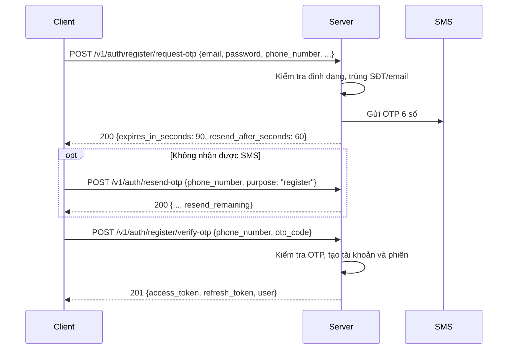
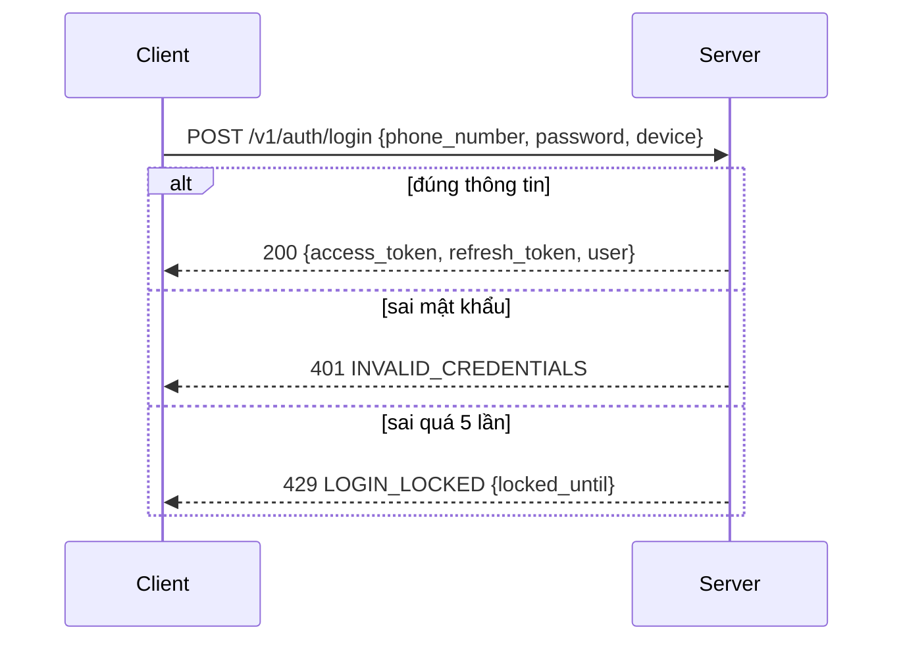

import { Tabs, TabItem } from '@astrojs/starlight/components';

Sáu endpoint, đều dưới `/v1/auth`. Chỉ `logout` cần access token.

| Việc | Endpoint | Thành công |
| --- | --- | --- |
| Đăng ký, bước 1 | `POST /v1/auth/register/request-otp` | `200` thông tin OTP |
| Gửi lại OTP | `POST /v1/auth/resend-otp` | `200` thông tin OTP + `resend_remaining` |
| Đăng ký, bước 2 | `POST /v1/auth/register/verify-otp` | `201` `AuthResult` |
| Đăng nhập | `POST /v1/auth/login` | `200` `AuthResult` |
| Làm mới token | `POST /v1/auth/refresh` | `200` cặp token mới |
| Đăng xuất | `POST /v1/auth/logout` | `200` `{"success": true}` |

`refresh` và `logout` được mô tả ở [Xác thực](/guides/authentication/).

## Đăng ký (2 bước)

Đăng ký xác minh số điện thoại bằng OTP qua SMS. Tài khoản chỉ được tạo ở bước 2.



### Điều cần biết

- OTP sống **90 giây**, có thể gửi lại sau **60 giây**. Hiển thị đếm ngược theo `expires_in_seconds` và `resend_after_seconds` trả về, đừng hard-code.
- Thông tin đăng ký (email, mật khẩu…) chỉ gửi ở bước 1. Bước 2 và `resend-otp` chỉ cần số điện thoại.
- Bước 2 thành công là **đã đăng nhập**, nên không cần gọi `login` nữa.
- Nhập sai OTP nhiều lần thì bị khoá (`429 OTP_LOCKED`, xem `details.locked_until`). Gửi OTP quá số lần cho phép cũng bị khoá (`OTP_SEND_LIMITED`).
- Ở môi trường **dev**, OTP luôn là `111111` và không có SMS thật. OTP được ghi ở log của server.
- Gọi lại `request-otp` với cùng số điện thoại khi chưa xác minh không phải lỗi trùng: bản đăng ký cũ bị ghi đè. Bản đăng ký chờ xác minh sống 24 giờ.

### Bước 1: `POST /v1/auth/register/request-otp`

| Field | Kiểu | Bắt buộc | Ghi chú |
| --- | --- | --- | --- |
| `email` | string | có | Đúng định dạng email. |
| `password` | string | có | Tối thiểu 8 ký tự. |
| `phone_number` | string | có | `+` tuỳ chọn rồi 8–15 chữ số. Server chuẩn hoá về E.164, nên `0901234567` và `+84901234567` là một số. |
| `full_name` | string | có | Họ và tên. Tối đa 300 **ký tự** sau khi cắt khoảng trắng đầu cuối (chữ có dấu tính một ký tự). Thiếu field trả `VALIDATION_ERROR`; toàn khoảng trắng hoặc quá dài trả `INVALID_FULL_NAME`. |
| `dharma_name` | string | không | Pháp danh. Tối đa 255 **ký tự** sau khi cắt khoảng trắng đầu cuối (chữ có dấu tính một ký tự). Quá dài trả `INVALID_DHARMA_NAME`. |
| `ordination_temple_id` | string | không | `id` chùa nơi quy y/xuất gia, lấy từ `GET /v1/temples/options` (danh sách rút gọn, có `?q=` tìm theo tên, không cần đăng nhập — xem [Chùa](/guides/catalogues/temples/#chọn-chùa-options)). Bỏ field nếu chưa có. Id không tồn tại trả `INVALID_TEMPLE`. |

```bash
curl -X POST http://localhost:8080/v1/auth/register/request-otp \
  -H 'Content-Type: application/json' \
  -d '{
    "email": "user@example.com",
    "password": "S3cret-pass",
    "phone_number": "0901234567",
    "full_name": "Nguyễn Văn An",
    "dharma_name": "Diệu Tâm"
  }'
```

```json
{
  "success": true,
  "data": { "message": "otp sent", "expires_in_seconds": 90, "resend_after_seconds": 60 }
}
```

### Gửi lại: `POST /v1/auth/resend-otp`

| Field | Kiểu | Bắt buộc | Ghi chú |
| --- | --- | --- | --- |
| `phone_number` | string | có | Số đã dùng ở bước 1. |
| `purpose` | string | có | Gửi `register`. Các giá trị `login`, `reset_password`, `verify_email` chưa được hỗ trợ. |

Response giống bước 1, cộng thêm `resend_remaining`: số lượt gửi còn lại trước khi bị `OTP_SEND_LIMITED`.

```json
{
  "success": true,
  "data": { "message": "otp sent", "expires_in_seconds": 90, "resend_after_seconds": 60, "resend_remaining": 2 }
}
```

### Bước 2: `POST /v1/auth/register/verify-otp`

| Field | Kiểu | Bắt buộc | Ghi chú |
| --- | --- | --- | --- |
| `phone_number` | string | có | Số đã dùng ở bước 1. |
| `otp_code` | string | có | Đúng 6 chữ số. Gửi dạng chuỗi để giữ số 0 ở đầu. |

Trả `201` với `AuthResult` (xem [bên dưới](#authresult)).

### Mã lỗi khi đăng ký

| HTTP | `error.code` | Ở endpoint | Khi nào | Client nên làm gì |
| --- | --- | --- | --- | --- |
| 400 | `VALIDATION_ERROR` | cả ba | Body sai JSON, thiếu field, field lạ, sai định dạng. `details` cho biết field nào. | Sửa request. |
| 400 | `INVALID_PASSWORD` | request-otp | Mật khẩu dưới 8 ký tự. | Báo lỗi ở ô mật khẩu. |
| 400 | `INVALID_FULL_NAME` | request-otp | Họ tên trống (chỉ khoảng trắng) hoặc quá 300 ký tự (`details.field = "full_name"`). | Báo lỗi ở ô họ tên. |
| 400 | `INVALID_DHARMA_NAME` | request-otp | Pháp danh quá 255 ký tự (`details.field = "dharma_name"`). | Báo lỗi ở ô pháp danh. |
| 400 | `INVALID_EMAIL`, `INVALID_PHONE` | request-otp | Không chuẩn hoá được email hoặc số điện thoại. | Báo lỗi ở ô tương ứng (`details.field`). |
| 400 | `INVALID_TEMPLE` | request-otp, verify-otp | `ordination_temple_id` không khớp chùa nào (verify-otp: chùa đã chọn không còn tồn tại). | Cho người dùng chọn lại chùa hoặc bỏ trống. |
| 400 | `OTP_INVALID` | verify-otp, resend-otp | Sai mã, hoặc không có bản đăng ký chờ cho số này. | Cho nhập lại. |
| 400 | `OTP_EXPIRED` | verify-otp | Mã quá 90 giây. | Gọi `resend-otp`. |
| 400 | `PENDING_REGISTRATION_EXPIRED` | verify-otp, resend-otp | Bản đăng ký quá 24 giờ. | Quay lại bước 1. |
| 400 | `UNSUPPORTED_OTP_PURPOSE` | resend-otp | `purpose` khác `register`. | Sửa request. |
| 409 | `PHONE_TAKEN`, `EMAIL_TAKEN` | request-otp, verify-otp | Số điện thoại hoặc email đã có tài khoản. | Gợi ý đăng nhập. |
| 429 | `OTP_RESEND_TOO_SOON` | request-otp, resend-otp | Chưa hết thời gian chờ. | Đếm ngược theo `details.retry_after_seconds`. |
| 429 | `OTP_SEND_LIMITED` | request-otp, resend-otp | Hết lượt gửi (hai endpoint dùng chung bộ đếm). | Chờ tới `details.locked_until`. |
| 429 | `OTP_LOCKED` | cả ba | Nhập sai OTP 3 lần liên tiếp, khoá 30 phút (cấu hình dev). | Chờ tới `details.locked_until`. |
| 500 | `SMS_SEND_FAILED` | request-otp, resend-otp | Nhà cung cấp SMS từ chối gửi. | Cho thử lại. |

Ví dụ lỗi có `details`:

```json
{
  "success": false,
  "error": { "code": "OTP_RESEND_TOO_SOON", "message": "please wait before requesting another code", "type": "business" },
  "details": { "retry_after_seconds": 42 }
}
```

## AuthResult

`verify-otp` và `login` trả cùng một cấu trúc trong `data`.

| Field | Kiểu | Ghi chú |
| --- | --- | --- |
| `access_token` | string | JWT, gửi ở header `Authorization: Bearer`. |
| `refresh_token` | string | JWT, chỉ dùng cho `POST /v1/auth/refresh`. |
| `expires_in` | int64 | Thời gian sống của `access_token`, tính bằng giây (dev: 900). Lên lịch refresh theo giá trị này. |
| `user.id` | int64 | |
| `user.email` | string | Đã chuẩn hoá. |
| `user.phone_number` | string | Dạng E.164, vd. `+84901234567`. |
| `user.full_name` | string | Họ và tên. Không có trong response với tài khoản tạo trước khi đăng ký bắt buộc họ tên (không phải `null`). |
| `user.dharma_name` | string | Không có trong response nếu người dùng không nhập (không phải `null`). |
| `user.ordination_temple_id` | string | `id` chùa nơi quy y/xuất gia. Không có trong response nếu người dùng chưa chọn chùa. |
| `user.created_at` | string | RFC 3339. |

```json
{
  "success": true,
  "data": {
    "access_token": "eyJhbGciOiJIUzI1NiIsInR5cCI6IkpXVCJ9…",
    "refresh_token": "eyJhbGciOiJIUzI1NiIsInR5cCI6IkpXVCJ9…",
    "expires_in": 900,
    "user": {
      "id": 42,
      "email": "user@example.com",
      "phone_number": "+84901234567",
      "full_name": "Nguyễn Văn An",
      "dharma_name": "Diệu Tâm",
      "created_at": "2026-09-30T08:15:30Z"
    }
  }
}
```

Ba field `full_name`, `dharma_name` và `ordination_temple_id` nên khai báo dạng Optional khi decode (`full_name` vắng mặt với tài khoản cũ).

## Đăng nhập



- `device.platform` và `device.device_model` là **bắt buộc**. Các field còn lại của `device` tuỳ chọn.
- IP và User-Agent do server lấy từ request, không gửi trong body.
- Đăng nhập lại trên **cùng thiết bị** sẽ thu hồi phiên cũ của thiết bị đó. Mỗi thiết bị chỉ có một phiên hoạt động.
- Sai mật khẩu 5 lần thì khoá đăng nhập 15 phút (cấu hình dev).
- Server trả cùng một lỗi `INVALID_CREDENTIALS` cho "sai mật khẩu" và "chưa có tài khoản".

### Body của `POST /v1/auth/login`

| Field | Kiểu | Bắt buộc | Ghi chú |
| --- | --- | --- | --- |
| `phone_number` | string | có | Chuẩn hoá về E.164 như lúc đăng ký. |
| `password` | string | có | |
| `device.platform` | string | có | Vd. `ios`, `android`, `web`. `web` chỉ được chấp nhận khi có `X-API-Key` đúng, nếu không `401 INVALID_API_KEY`. |
| `device.device_model` | string | có | Vd. `iPhone 15`. |
| `device.os_version` | string | không | |
| `device.app_version` | string | không | |
| `device.device_name` | string | không | Tên người dùng đặt cho máy. |

Trả `200` với [`AuthResult`](#authresult).

### Mã lỗi khi đăng nhập

| HTTP | `error.code` | Khi nào | Client nên làm gì |
| --- | --- | --- | --- |
| 400 | `VALIDATION_ERROR` | Body rỗng, sai JSON, field lạ, sai Content-Type. | Sửa request. |
| 400 | `INVALID_PHONE` | Số điện thoại không đọc được. | Báo lỗi ở ô số điện thoại. |
| 400 | `INVALID_PASSWORD` | Mật khẩu rỗng. | Báo lỗi ở ô mật khẩu. |
| 400 | `INVALID_DEVICE` | Thiếu `device`, `platform` hoặc `device_model`. | Sửa request. |
| 401 | `INVALID_CREDENTIALS` | Sai số điện thoại hoặc mật khẩu. | Cho nhập lại. |
| 401 | `INVALID_API_KEY` | `X-API-Key` sai hoặc rỗng, hoặc `platform = web` mà không có key đúng. | Lỗi cấu hình server web, không retry. |
| 429 | `LOGIN_LOCKED` | Sai 5 lần liên tiếp. Lần thứ 5 vẫn là `401`, lần kế tiếp mới là `429`, kể cả khi đúng mật khẩu. | Chờ tới `details.locked_until`. |

Các lỗi `400` không tính là một lần đăng nhập sai.

```json
{
  "success": false,
  "error": { "code": "LOGIN_LOCKED", "message": "too many failed login attempts, try again later", "type": "business" },
  "details": { "locked_until": "2026-09-30T08:30:30Z" }
}
```

## Code mẫu: đăng nhập

<Tabs syncKey="lang">
	<TabItem label="cURL">
```bash
curl -X POST http://localhost:8080/v1/auth/login \
  -H 'Content-Type: application/json' \
  -d '{
    "phone_number": "0901234567",
    "password": "S3cret-pass",
    "device": { "platform": "ios", "device_model": "iPhone 15" }
  }'
```
	</TabItem>
	<TabItem label="Swift">
```swift
struct Device: Encodable { let platform: String; let device_model: String }
struct LoginBody: Encodable { let phone_number: String; let password: String; let device: Device }

struct Envelope<T: Decodable>: Decodable {
    let success: Bool
    let data: T?
    let error: APIError?
}
struct APIError: Decodable { let code: String; let message: String }
struct AuthResult: Decodable { let access_token: String; let refresh_token: String }

func login(phone: String, password: String) async throws -> AuthResult {
    var req = URLRequest(url: URL(string: "http://localhost:8080/v1/auth/login")!)
    req.httpMethod = "POST"
    req.setValue("application/json", forHTTPHeaderField: "Content-Type")
    req.httpBody = try JSONEncoder().encode(
        LoginBody(phone_number: phone, password: password,
                  device: Device(platform: "ios", device_model: "iPhone 15")))

    let (data, _) = try await URLSession.shared.data(for: req)
    let env = try JSONDecoder().decode(Envelope<AuthResult>.self, from: data)
    guard env.success, let result = env.data else {
        throw NSError(domain: "API", code: 0,
                      userInfo: [NSLocalizedDescriptionKey: env.error?.code ?? "UNKNOWN"])
    }
    return result   // lưu vào Keychain
}
```
	</TabItem>
	<TabItem label="Kotlin">
```kotlin
// Dùng OkHttp + kotlinx.serialization
@Serializable data class Device(val platform: String, val device_model: String)
@Serializable data class LoginBody(val phone_number: String, val password: String, val device: Device)
@Serializable data class ApiError(val code: String, val message: String)
@Serializable data class AuthResult(val access_token: String, val refresh_token: String)
@Serializable data class Envelope<T>(val success: Boolean, val data: T? = null, val error: ApiError? = null)

fun login(client: OkHttpClient, phone: String, password: String): AuthResult {
    val body = Json.encodeToString(
        LoginBody(phone, password, Device("android", Build.MODEL))
    ).toRequestBody("application/json".toMediaType())

    val req = Request.Builder()
        .url("http://10.0.2.2:8080/v1/auth/login") // 10.0.2.2 = localhost của máy host khi chạy emulator
        .post(body)
        .build()

    client.newCall(req).execute().use { res ->
        val env = Json.decodeFromString<Envelope<AuthResult>>(res.body!!.string())
        return env.data ?: throw IllegalStateException(env.error?.code ?: "UNKNOWN")
    }
}
```
	</TabItem>
	<TabItem label="JavaScript">
```js
const res = await fetch('http://localhost:8080/v1/auth/login', {
  method: 'POST',
  headers: { 'Content-Type': 'application/json' },
  body: JSON.stringify({
    phone_number: '0901234567',
    password: 'S3cret-pass',
    device: { platform: 'web', device_model: navigator.userAgent },
  }),
});
const json = await res.json();
if (!json.success) throw new Error(json.error.code); // rẽ nhánh theo code
const { access_token, refresh_token } = json.data;
```
	</TabItem>
</Tabs>

Xem thêm [Xác thực](/guides/authentication/) cho cách làm mới token và lưu token an toàn, và [API Reference](/api-reference/) cho toàn bộ tham số.
